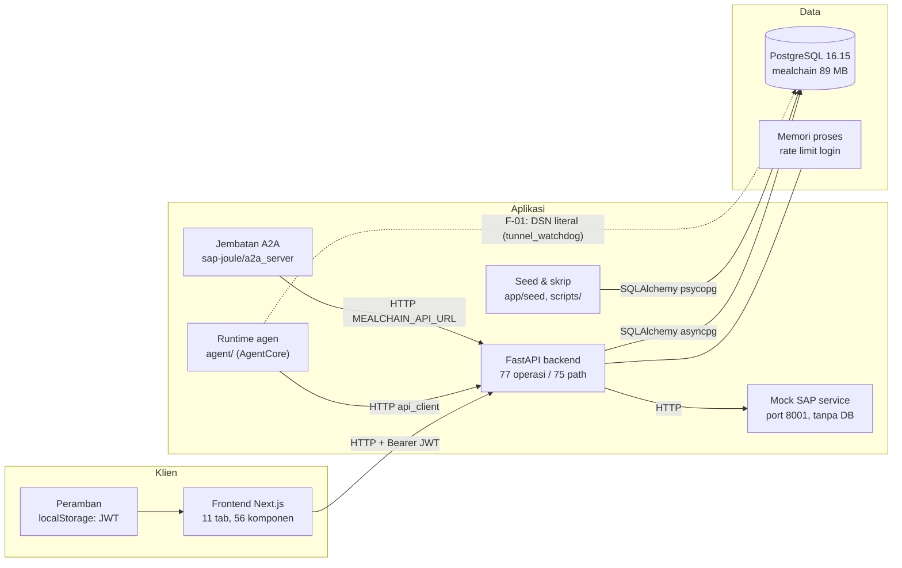
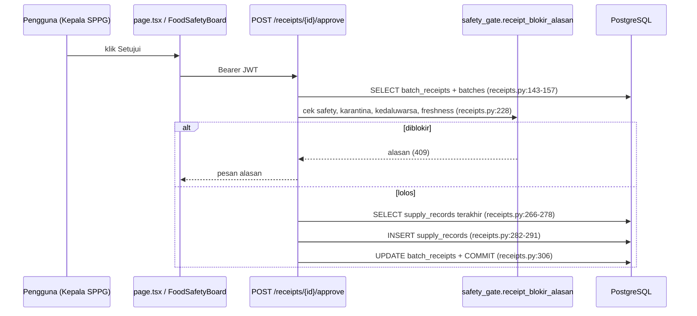
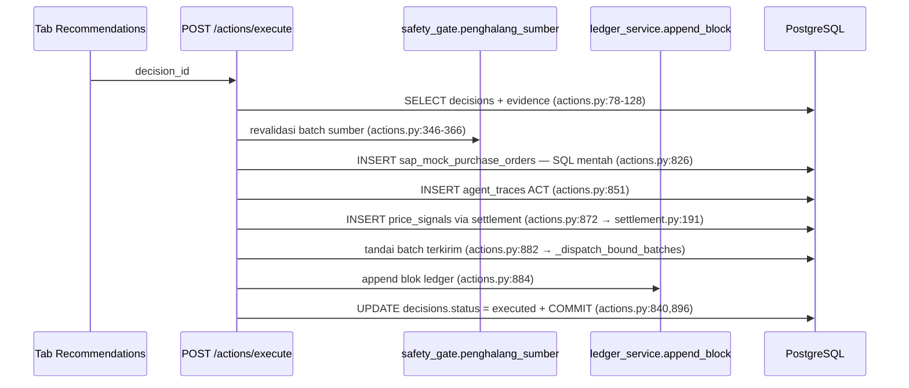
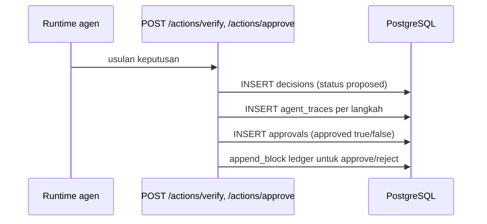
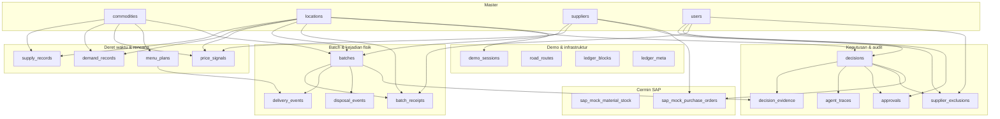

# Database Lineage and Usage Audit — MealChain Guardian

| | |
|---|---|
| Repositori | `E:/hackathon/HackathonAWS/mealchain-guardian` |
| Branch / commit | `feature/db-modes-demo-coverage` / `d414957` |
| Tanggal audit | 25 Oktober 2026 |
| Lingkup | seluruh penyimpanan data, koneksi, skema, jalur tulis/baca, migrasi, integritas, dan risiko |
| Sifat | **read-only**. Tidak ada migrasi, tidak ada DDL, tidak ada INSERT/UPDATE/DELETE, tidak ada seed ulang |
| Berkas keluaran | berkas ini satu-satunya yang dibuat di dalam repo |
| Rahasia | semua nilai rahasia dirujuk sebagai `[REDACTED]`; hanya **nama kunci** yang ditulis |

> **Pembaruan 26 Oktober 2026.** Beberapa angka keadaan di dokumen ini sudah berubah
> karena data demo dibangun ulang dan beberapa temuan sudah diperbaiki:
> rantai audit kini **1.598 blok** (1.526 arsip, **0 blok yatim**, `valid=true`) — bukan 166 blok
> dengan 22 yatim; jejak agen **85**; PO **16**; bukti keputusan **51**; approval **21**; batch **120**;
> pemasok **60**. Instrumen pengukuran yang sama (baca-saja) ada di `scripts/snapshot_state.py`,
> hasil terbaru di `docs/state-snapshot.md`. Angka lama di bawah dipertahankan sebagai catatan temuan
> saat audit dilakukan, bukan sebagai keadaan sekarang.

## Daftar isi

1. [Executive Summary](#1-executive-summary)
2. [Scope, Method, and Tools](#2-scope-method-and-tools)
3. [Store Inventory](#3-store-inventory)
4. [Connection Map](#4-connection-map)
5. [Complete Schema Catalog](#5-complete-schema-catalog)
6. [Table Usage Matrix](#6-table-usage-matrix)
7. [Column and Caller Index](#7-column-and-caller-index)
8. [Frontend-to-Database Flows](#8-frontend-to-database-flows)
9. [API-to-Database Mapping](#9-api-to-database-mapping)
10. [Background Jobs, Agents, Scripts](#10-background-jobs-agents-scripts)
11. [Dependency Graph](#11-dependency-graph)
12. [Migration Inventory](#12-migration-inventory)
13. [Integrity and Query Behavior](#13-integrity-and-query-behavior)
14. [Unused, Orphaned, Duplicate, Uncertain](#14-unused-orphaned-duplicate-uncertain)
15. [Risks and Findings](#15-risks-and-findings)
16. [Skills and Tools Used](#16-skills-and-tools-used)
17. [Coverage and Limitations](#17-coverage-and-limitations)
18. [Read-Only Reproduction Commands](#18-read-only-reproduction-commands)
19. [Evidence Appendix](#19-evidence-appendix)

---

## 1. Executive Summary

**Satu penyimpanan persisten, bukan banyak.** MealChain Guardian menyimpan seluruh
keadaan di **satu basis data PostgreSQL 16.15** di dalam
kontainer `mealchain-postgres`: **24 tabel basis** (23 tabel domain +
`alembic_version`), **241 kolom**, **127 constraint**, **89 indeks**,
**52 foreign key**, ukuran total **89 MB**, **14.218 baris**
di luar `alembic_version`.

Yang sering disalahpahami sebagai "database kedua" — **`sap_mock_material_stock` dan
`sap_mock_purchase_orders` — bukan penyimpanan terpisah.** Keduanya tabel di basis data yang
sama, hanya meniru bentuk OData SAP. Layanan `app/sap_integration/mock_service.py` sendiri
**tidak menyentuh basis data** (0 rujukan `sqlalchemy/select/get_db`); ia hanya HTTP. Baris
cermin SAP ditulis oleh seed dan oleh alur eksekusi keputusan.

Tidak ada penyimpanan lain yang saya temukan: tidak ada Redis, S3, message queue, atau basis
data vektor di kode. Frontend **tidak punya driver basis data** (tidak ada `pg`/`prisma`/`mysql`
di `frontend/`), jadi semua akses data lewat HTTP API. Runtime agen (`agent/`) memanggil backend
lewat HTTP (`agent/api_client.py`), bukan SQL — dengan **satu pengecualian yang menjadi temuan
prioritas tertinggi** (F-01).

| Angka kunci | Nilai |
|---|---|
| Basis data | `mealchain` · PostgreSQL 16.15 · encoding `UTF8` · collation `en_US.utf8` |
| Ukuran | 89 MB |
| Tabel / kolom / constraint / indeks / FK | 24 / 241 / 127 / 89 / 52 |
| Foreign key yatim | **0** dari 52 FK (semua FK satu kolom, jadi cakupan 100%) |
| Kepala migrasi | `031_ledger_generation` (33 berkas revisi); `alembic check` → *No new upgrade operations detected* |
| Operasi API | **77** operasi pada **75** path (di luar `/docs`, `/redoc`, `/openapi.json`) |
| Fungsi klien Frontend | **61** fungsi di `frontend/lib/api.ts` |
| Tab UI | 11 (`today`, `overview`, `recommendations`, `evidence`, `safety`, `surplus`, `suppliers`, `agent-log`, `kpi-kualitas`, `settings`, `demo-control`) |
| Rantai ledger | 166 blok, `valid=true`, generasi aktif 64, **22 blok yatim** (`linked_ratio` 0,766 — dilaporkan aplikasi sendiri) |
| Temuan | **14** (1 High — sudah diperbaiki, 6 Medium, 5 Low, 2 Info; rincian §15) |

### Status verifikasi (jujur, bukan "lulus semua")

| Tingkat | Isi |
|---|---|
| **Terverifikasi langsung** | daftar tabel/kolom/constraint/indeks/FK; jumlah baris; ukuran; FK yatim = 0; kepala migrasi; `alembic check` bersih; rantai ledger valid; jumlah operasi API; tidak ada driver DB di frontend |
| **Terverifikasi statis (kode)** | jalur tulis/baca per tabel (konstruktor ORM, `select()`, `delete()`, SQL mentah), pemetaan rute→tabel, kredensial literal di kode, isi `docs/Schema.md` vs constraint |
| **Diinferensi** | tujuan bisnis tiap tabel; pemetaan rute→tabel (closure impor 1 langkah, bisa melebar/melegakan); keterkaitan blok ledger ke entitas (diperkirakan lewat 6 tabel id) |
| **Tidak diverifikasi** | perilaku runtime di bawah beban (EXPLAIN aktual, N+1 nyata), consumer di luar repo, isi riwayat git, apakah indeks yang belum terpakai benar-benar tak berguna |

**Kesimpulan satu paragraf.** Lineage datanya sehat pada lapisan yang bisa diuji: satu store,
skema dan metadata ORM tidak berbeda (`alembic check` bersih), tidak ada FK yatim, dan rantai
ledger utuh. Yang perlu perhatian bukan kerusakan data, melainkan **kebersihan batas-batas**:
satu kredensial basis data tertulis langsung di kode agen (F-01), dokumentasi skema tertinggal
dari basis data (F-02…F-04, F-09), jejak audit generasi aktif tidak lagi menunjuk entitas yang
masih ada untuk 22 dari 94 blok (F-05), dan 22 foreign key tanpa indeks pendukung (F-07).

---

## 2. Scope, Method, and Tools

### 2.1 Lingkup

| Termasuk | Tidak termasuk |
|---|---|
| Skema fisik (katalog `information_schema`/`pg_catalog`), constraint, indeks, FK | Mengubah skema, migrasi baru, perbaikan data |
| Definisi model SQLAlchemy dan kesesuaiannya dengan basis data | Menjalankan test suite (menulis ke basis data) |
| Seluruh jalur baca/tulis di `backend/app`, `agent/`, `sap-joule/`, `scripts/`, `frontend/` | Deploy, restart layanan, mengubah konfigurasi |
| Rute HTTP, fungsi klien frontend, tab UI, alur tulis ujung-ke-ujung | Audit keamanan penuh (hanya temuan yang muncul dari lineage) |
| Migrasi Alembic dan status kepala | Riwayat git, PR, atau commit lama |
| Integritas: FK yatim, rantai ledger, kesesuaian metadata↔DB | Beban produksi, rencana eksekusi nyata, replikasi/backup |

### 2.2 Metode

1. **Inventaris runtime.** Membaca identitas basis data dari konfigurasi aplikasi yang sedang
   berjalan (nama host dan basis data saja; kredensial tidak dicetak), lalu memeriksa katalog
   Postgres dengan `psql` memakai pernyataan `SELECT` terhadap `pg_catalog`/`information_schema`.
2. **Inventaris statis.** Pemindaian seluruh berkas `.py`, `.ts`, `.tsx`, `.sql` (di luar
   `node_modules`, `.next`, `__pycache__`, `.venv`) untuk nama tabel dan nama kelas model,
   dengan nomor baris. Pencarian memakai ripgrep 15.2.0 dan pemindai Python untuk agregasi.
3. **Graf dependensi.** Mengekstrak `from app.… import …` untuk membangun graf modul, lalu
   menghitung closure satu langkah dari setiap modul rute sebagai perkiraan tabel yang
   tersentuh (ditandai *diinferensi* di seluruh laporan).
4. **Kesesuaian ORM↔DB.** `alembic check` (murni perbandingan metadata, tanpa DDL).
5. **Integritas.** Pemindaian FK yatim untuk **seluruh** 52 FK satu kolom (SQL dibangkitkan
   dari katalog, bukan ditulis tangan), pemeriksaan keterkaitan blok ledger, dan pembacaan
   `verify_chain()` yang didokumentasikan murni-baca.

### 2.3 Jaminan read-only

- Hanya `SELECT` dan pembacaan katalog; tidak ada `INSERT/UPDATE/DELETE/TRUNCATE/ALTER/CREATE`.
- `CREATE EXTENSION pgstattuple` **sengaja tidak dijalankan** meski itu cara termudah mengukur
  bloat, karena ia mengubah skema. Konsekuensinya: bloat tidak diukur, hanya ukuran per objek.
- Tidak ada seed, tidak ada `docker compose down -v`, tidak ada penghapusan baris `origin='demo'`.
- Working tree sudah tidak bersih **sebelum** audit (109 entri, perubahan perbaikan yang sedang
  berjalan). Audit ini tidak mengubah berkas repo mana pun kecuali laporan ini.

### 2.4 Keterbatasan metodologis yang harus dibaca bersama angka

- Pemetaan rute→tabel adalah **closure impor satu langkah**. Rute yang memanggil layanan lewat
  lapisan kedua bisa tampak "tidak menyentuh" tabel; sebaliknya modul besar bisa membuat rute
  tampak menyentuh tabel yang tak dipakainya. Semua kolom semacam itu ditandai *diinferensi*.
- Pemindaian statis tidak mengeksekusi SQL dinamis yang dibangun dari variabel.
- `alembic check` membandingkan metadata dengan basis data, **bukan** membuktikan bahwa semua
  migrasi dapat dijalankan dari nol (itu pernah diuji terpisah di sesi lain, bukan di sini).

---

## 3. Store Inventory

Ada **satu sistem pencatatan** (system of record). Sisanya adalah turunan, cermin, atau
penyimpanan sementara — penting disebut supaya tidak ada yang mengira ada dua database yang
harus disinkronkan.

| ID | Penyimpanan | Teknologi | Peran | Persisten? | Bukti | Status |
|---|---|---|---|---|---|---|
| STORE-1 | Basis data `mealchain` | PostgreSQL 16.15 (kontainer `mealchain-postgres`) | **System of record**: 23 tabel domain | Ya (volume) | `identity`, `table_sizes`, `columns` | Terverifikasi |
| STORE-2 | `mealchain_gate`, `mealchain_gate2`, `mealchain_gate3` | PostgreSQL, **instans yang sama** | Basis data gerbang uji (133 MB / 15 MB / 15 MB) | Ya, tetapi sekali pakai | `pg_database` | Terverifikasi |
| STORE-3 | `sap_mock_material_stock`, `sap_mock_purchase_orders` | Tabel di STORE-1 | Cermin data SAP untuk demo | Ya | `columns`, `models/sap_mock.py` | Terverifikasi |
| STORE-4 | `_riwayat` pembatas laju login | `dict[str, deque]` di memori proses | Batas percobaan login (IP+email) | **Tidak** — hilang saat restart, per-proses | `backend/app/core/rate_limit.py:30` | Terverifikasi (statis) |
| STORE-5 | `localStorage` peramban | Web Storage | Menyimpan JWT sesi pengguna | Ya, di sisi klien | `frontend/app/page.tsx:225,741` (`TOKEN_STORAGE_KEY`) | Terverifikasi (statis) |
| STORE-6 | Cache rute jalan `road_routes` | Tabel di STORE-1 | Cache hasil OSRM (jarak/durasi) | Ya | `columns` | Terverifikasi |

**Yang tidak ada** (diperiksa, bukan diasumsikan): tidak ada Redis/Memcached, tidak ada object
storage aplikasi, tidak ada message broker, tidak ada basis data vektor (pgvector tidak terpasang
— tidak ada di `other_objects`), dan **tidak ada view, materialized view, trigger, maupun enum
native** di basis data.

Konsekuensi penting: **seluruh integritas ditegakkan oleh constraint dan kode aplikasi**, bukan
oleh trigger. Tidak ada satu pun trigger yang bisa menolak tulisan yang salah; bila sebuah jalur
kode melewatkan pemeriksaan, basis data hanya menolak ketika ada CHECK/FK/NOT NULL yang cocok.

## 4. Connection Map



### 4.1 Sumber konfigurasi koneksi (nama kunci saja)

| Kunci | Di mana | Dipakai oleh | Catatan |
|---|---|---|---|
| `DATABASE_URL` | `.env` / env kontainer | Aplikasi (`app/core/config.py:17`), tes (`backend/tests/dsn.py`) | Nilai default di kode memuat kredensial dev (lihat F-02) |
| `SEED_DATABASE_URL` | env, opsional | Hanya seeder (`app/seed/seed_data.py:45-53`) | Prioritas tertinggi untuk seed; **mengabaikan** `DATABASE_URL` bila diisi |
| `POSTGRES_USER`, `POSTGRES_PASSWORD`, `POSTGRES_DB` | `.env` / compose | Kontainer `postgres` | Nilai `[REDACTED]` |
| `FORWARDED_ALLOW_IPS` | env / `docker-compose.prod.yml:90` | uvicorn (`--forwarded-allow-ips`) | Menentukan IP klien yang dipercaya pembatas laju |
| `DEMO_MODE`, `DEMO_SESSION_ENFORCE`, `DEMO_SESSION_MINUTES` | env | Aplikasi & seed | Mengatur sesi demo, bukan koneksi |

### 4.2 Siklus koneksi

- Engine dibuat sekali per proses dari `DATABASE_URL` (`app/db.py`); sesi per permintaan lewat
  dependency dan ditutup setelah respons.
- Penulisan memakai `db.commit()` eksplisit di handler (mis. `receipts.py:306`,
  `actions.py:896`): satu unit kerja = satu permintaan HTTP. Tidak ada transaksi lintas
  permintaan dan tidak ada pola outbox.
- Seeder memakai jalur koneksi sendiri (psycopg, bukan asyncpg) dan bisa menunjuk basis data lain
  lewat `SEED_DATABASE_URL`.
- Pemisahan "demo" dan "uji" **hanya** lewat nilai env; tidak ada batasan tingkat basis data yang
  mencegah tes menulis ke basis data demo bila env salah.

---

## 5. Complete Schema Catalog

Sumber: katalog Postgres (`information_schema` + `pg_catalog`), bukan dari model. Setiap tabel
menampilkan jumlah baris, ukuran, kolom, constraint, dan indeks apa adanya. Semua 23 tabel domain
punya model, dan semua model punya tabel (selisih satu-satunya: `alembic_version`, milik Alembic).

| Tabel | Baris | Heap | Indeks | Total | # Indeks |
|---|---|---|---|---|---|
| `price_signals` | 6.019 | 936 kB | 31.5 MB | 32.5 MB | 7 |
| `supply_records` | 5.240 | 736 kB | 32.8 MB | 33.6 MB | 6 |
| `demand_records` | 1.360 | 248 kB | 7.7 MB | 8.0 MB | 6 |
| `menu_plans` | 660 | 72 kB | 1.2 MB | 1.3 MB | 4 |
| `delivery_events` | 171 | 32 kB | 720 kB | 792 kB | 5 |
| `ledger_blocks` | 166 | 64 kB | 360 kB | 464 kB | 4 |
| `batches` | 121 | 200 kB | 368 kB | 608 kB | 5 |
| `agent_traces` | 85 | 32 kB | 224 kB | 296 kB | 3 |
| `disposal_events` | 80 | 24 kB | 200 kB | 264 kB | 5 |
| `suppliers` | 60 | 64 kB | 64 kB | 168 kB | 4 |
| `road_routes` | 53 | 64 kB | 48 kB | 1.0 MB | 3 |
| `decision_evidence` | 43 | 32 kB | 88 kB | 160 kB | 2 |
| `sap_mock_material_stock` | 40 | 16 kB | 32 kB | 88 kB | 2 |
| `decisions` | 36 | 72 kB | 192 kB | 304 kB | 6 |
| `users` | 27 | 80 kB | 136 kB | 256 kB | 3 |
| `sap_mock_purchase_orders` | 16 | 16 kB | 64 kB | 120 kB | 4 |
| `approvals` | 12 | 8 kB | 88 kB | 136 kB | 3 |
| `locations` | 10 | 24 kB | 32 kB | 96 kB | 2 |
| `demo_sessions` | 10 | 8 kB | 32 kB | 80 kB | 2 |
| `commodities` | 4 | 8 kB | 32 kB | 80 kB | 2 |
| `supplier_exclusions` | 2 | 8 kB | 64 kB | 112 kB | 4 |
| `batch_receipts` | 2 | 8 kB | 80 kB | 112 kB | 5 |
| `ledger_meta` | 1 | 8 kB | 16 kB | 56 kB | 1 |

### 5.1 Master data

#### `commodities` — 4 baris, 80 kB

**Tujuan (inferensi):** Katalog komoditas pangan (nama, satuan, umur simpan) — rujukan tujuan pengiriman dan perhitungan kesegaran.

**Model:** `backend/app/models/commodities.py:12` · **Dibuat oleh:** 001_master_data

| # | Kolom | Tipe | Nullable | Default |
|---|---|---|---|---|
| 1 | `id` | uuid | tidak | `gen_random_uuid()` |
| 2 | `name` | character varying | tidak | `—` |
| 3 | `unit` | character varying | tidak | `'kg'::character varying` |
| 4 | `created_at` | timestamp with time zone | tidak | `now()` |

**Constraint**

- `commodities_pkey` (PK): PRIMARY KEY (id)
- `commodities_name_key` (UNIQUE): UNIQUE (name)

**Indeks**

| Nama | Unik | Definisi (dipotong 150) | Scan sejak reset |
|---|---|---|---|
| `commodities_name_key` | ya | CREATE UNIQUE INDEX commodities_name_key ON public.commodities USING btree (name) | 0 (belum dipakai) |
| `commodities_pkey` | ya | CREATE UNIQUE INDEX commodities_pkey ON public.commodities USING btree (id) | > 0 |

#### `locations` — 10 baris, 96 kB

**Tujuan (inferensi):** Node jaringan: SPPG (dapur) dan gudang/pemasok, termasuk koordinat dan peran lokasi.

**Model:** `backend/app/models/locations.py:12` · **Dibuat oleh:** 001_master_data

| # | Kolom | Tipe | Nullable | Default |
|---|---|---|---|---|
| 1 | `id` | uuid | tidak | `gen_random_uuid()` |
| 2 | `name` | character varying | tidak | `—` |
| 3 | `region` | character varying | tidak | `—` |
| 4 | `latitude` | numeric | tidak | `—` |
| 5 | `longitude` | numeric | tidak | `—` |
| 6 | `role_hint` | character varying | YA | `—` |
| 7 | `created_at` | timestamp with time zone | tidak | `now()` |

**Constraint**

- `locations_pkey` (PK): PRIMARY KEY (id)
- `locations_name_key` (UNIQUE): UNIQUE (name)

**Indeks**

| Nama | Unik | Definisi (dipotong 150) | Scan sejak reset |
|---|---|---|---|
| `locations_name_key` | ya | CREATE UNIQUE INDEX locations_name_key ON public.locations USING btree (name) | 0 (belum dipakai) |
| `locations_pkey` | ya | CREATE UNIQUE INDEX locations_pkey ON public.locations USING btree (id) | > 0 |

#### `suppliers` — 60 baris, 168 kB

**Tujuan (inferensi):** Identitas pemasok beserta koordinat, status, dan nilai pembaruan terakhir.

**Model:** `backend/app/models/suppliers.py:33` · **Dibuat oleh:** 001_master_data

| # | Kolom | Tipe | Nullable | Default |
|---|---|---|---|---|
| 1 | `id` | uuid | tidak | `gen_random_uuid()` |
| 2 | `name` | character varying | tidak | `—` |
| 3 | `location_id` | uuid | tidak | `—` |
| 4 | `reliability_score` | numeric | tidak | `0.80` |
| 5 | `created_at` | timestamp with time zone | tidak | `now()` |
| 6 | `latitude` | numeric | YA | `—` |
| 7 | `longitude` | numeric | YA | `—` |
| 8 | `commodity_id` | uuid | YA | `—` |
| 9 | `capacity_kg_per_week` | numeric | YA | `—` |
| 10 | `certification_status` | character varying | YA | `—` |
| 11 | `address` | text | YA | `—` |
| 12 | `contact_name` | character varying | YA | `—` |
| 13 | `updated_at` | timestamp with time zone | YA | `—` |

**Constraint**

- `check_reliability` (CHECK): CHECK (((reliability_score >= (0)::numeric) AND (reliability_score <= (1)::numeric)))
- `check_supplier_capacity_nonneg` (CHECK): CHECK (((capacity_kg_per_week IS NULL) OR (capacity_kg_per_week >= (0)::numeric)))
- `check_supplier_certification_vocab` (CHECK): CHECK (((certification_status IS NULL) OR ((certification_status)::text = ANY ((ARRAY['none'::character varying, 'hygiene'::character varying, 'haccp'::character varying])::text[]))))
- `check_supplier_coordinates_pair` (CHECK): CHECK (((latitude IS NULL) = (longitude IS NULL)))
- `check_supplier_latitude_range` (CHECK): CHECK (((latitude IS NULL) OR ((latitude >= ('-90'::integer)::numeric) AND (latitude <= (90)::numeric))))
- `check_supplier_longitude_range` (CHECK): CHECK (((longitude IS NULL) OR ((longitude >= ('-180'::integer)::numeric) AND (longitude <= (180)::numeric))))
- `suppliers_commodity_id_fkey` (FK): FOREIGN KEY (commodity_id) REFERENCES commodities(id)
- `suppliers_location_id_fkey` (FK): FOREIGN KEY (location_id) REFERENCES locations(id)
- `suppliers_pkey` (PK): PRIMARY KEY (id)

**Indeks**

| Nama | Unik | Definisi (dipotong 150) | Scan sejak reset |
|---|---|---|---|
| `idx_suppliers_location` | tidak | CREATE INDEX idx_suppliers_location ON public.suppliers USING btree (location_id) | 0 (belum dipakai) |
| `ix_suppliers_commodity_id` | tidak | CREATE INDEX ix_suppliers_commodity_id ON public.suppliers USING btree (commodity_id) | 0 (belum dipakai) |
| `ix_suppliers_location_id` | tidak | CREATE INDEX ix_suppliers_location_id ON public.suppliers USING btree (location_id) | 0 (belum dipakai) |
| `suppliers_pkey` | ya | CREATE UNIQUE INDEX suppliers_pkey ON public.suppliers USING btree (id) | > 0 |

#### `users` — 27 baris, 256 kB

**Tujuan (inferensi):** Akun pengguna: peran (approver, kepala SPPG, bgn_monitor, dst.), lokasi terikat, hash kata sandi.

**Model:** `backend/app/models/users.py:19` · **Dibuat oleh:** 001_master_data

| # | Kolom | Tipe | Nullable | Default |
|---|---|---|---|---|
| 1 | `id` | uuid | tidak | `gen_random_uuid()` |
| 2 | `name` | character varying | tidak | `—` |
| 3 | `email` | character varying | tidak | `—` |
| 4 | `password_hash` | character varying | tidak | `—` |
| 5 | `role` | character varying | tidak | `—` |
| 6 | `location_id` | uuid | YA | `—` |
| 7 | `created_at` | timestamp with time zone | tidak | `now()` |

**Constraint**

- `check_user_role` (CHECK): CHECK (((role)::text = ANY ((ARRAY['sppg_head'::character varying, 'sppg_nutritionist'::character varying, 'bgn_monitor'::character varying])::text[])))
- `check_user_role_location_scope` (CHECK): CHECK (((((role)::text = ANY ((ARRAY['sppg_head'::character varying, 'sppg_nutritionist'::character varying])::text[])) AND (location_id IS NOT NULL)) OR (((role)::text = 'bgn_monitor'::text) AND (location_id IS NULL))))
- `users_location_id_fkey` (FK): FOREIGN KEY (location_id) REFERENCES locations(id)
- `users_pkey` (PK): PRIMARY KEY (id)
- `users_email_key` (UNIQUE): UNIQUE (email)

**Indeks**

| Nama | Unik | Definisi (dipotong 150) | Scan sejak reset |
|---|---|---|---|
| `idx_users_location` | tidak | CREATE INDEX idx_users_location ON public.users USING btree (location_id) | > 0 |
| `users_email_key` | ya | CREATE UNIQUE INDEX users_email_key ON public.users USING btree (email) | > 0 |
| `users_pkey` | ya | CREATE UNIQUE INDEX users_pkey ON public.users USING btree (id) | > 0 |

### 5.2 Deret waktu & rencana

#### `supply_records` — 5.240 baris, 33.6 MB

**Tujuan (inferensi):** Catatan pasokan per lokasi×komoditas×waktu; sumber mock_sap/manual/sensor. Basis perhitungan surplus.

**Model:** `backend/app/models/supply_records.py:24` · **Dibuat oleh:** 002_operational_data

| # | Kolom | Tipe | Nullable | Default |
|---|---|---|---|---|
| 1 | `id` | uuid | tidak | `gen_random_uuid()` |
| 2 | `location_id` | uuid | tidak | `—` |
| 3 | `commodity_id` | uuid | tidak | `—` |
| 4 | `quantity_kg` | numeric | tidak | `—` |
| 5 | `recorded_at` | timestamp with time zone | tidak | `—` |
| 6 | `source` | character varying | tidak | `—` |
| 7 | `created_at` | timestamp with time zone | tidak | `now()` |
| 8 | `origin` | character varying | tidak | `'seed'::character varying` |
| 9 | `generated_at` | timestamp with time zone | YA | `—` |
| 10 | `demo_session_id` | uuid | YA | `—` |

**Constraint**

- `check_supply_records_origin_vocab` (CHECK): CHECK (((origin)::text = ANY ((ARRAY['seed'::character varying, 'demo'::character varying])::text[])))
- `supply_records_quantity_nonneg_check` (CHECK): CHECK ((quantity_kg >= (0)::numeric))
- `supply_records_source_check` (CHECK): CHECK (((source)::text = ANY ((ARRAY['mock_sap'::character varying, 'manual'::character varying, 'sensor'::character varying])::text[])))
- `supply_records_commodity_id_fkey` (FK): FOREIGN KEY (commodity_id) REFERENCES commodities(id)
- `supply_records_demo_session_id_fkey` (FK): FOREIGN KEY (demo_session_id) REFERENCES demo_sessions(id) ON DELETE SET NULL
- `supply_records_location_id_fkey` (FK): FOREIGN KEY (location_id) REFERENCES locations(id)
- `supply_records_pkey` (PK): PRIMARY KEY (id)
- `uq_supply_records_loc_com_time_source` (UNIQUE): UNIQUE (location_id, commodity_id, recorded_at, source)

**Indeks**

| Nama | Unik | Definisi (dipotong 150) | Scan sejak reset |
|---|---|---|---|
| `idx_supply_latest` | tidak | CREATE INDEX idx_supply_latest ON public.supply_records USING btree (location_id, commodity_id, recorded_at DESC) | > 0 |
| `idx_supply_location_commodity` | tidak | CREATE INDEX idx_supply_location_commodity ON public.supply_records USING btree (location_id, commodity_id) | 0 (belum dipakai) |
| `ix_supply_records_demo_session_id` | tidak | CREATE INDEX ix_supply_records_demo_session_id ON public.supply_records USING btree (demo_session_id) | > 0 |
| `ix_supply_records_origin_recorded_at` | tidak | CREATE INDEX ix_supply_records_origin_recorded_at ON public.supply_records USING btree (origin, recorded_at) | > 0 |
| `supply_records_pkey` | ya | CREATE UNIQUE INDEX supply_records_pkey ON public.supply_records USING btree (id) | > 0 |
| `uq_supply_records_loc_com_time_source` | ya | CREATE UNIQUE INDEX uq_supply_records_loc_com_time_source ON public.supply_records USING btree (location_id, commodity_id, recorded_at, source) | 0 (belum dipakai) |

#### `demand_records` — 1.360 baris, 8.0 MB

**Tujuan (inferensi):** Kebutuhan per lokasi×komoditas dan tenggat `needed_by`; dipakai untuk defisit dan rekomendasi.

**Model:** `backend/app/models/demand_records.py:24` · **Dibuat oleh:** 002_operational_data

| # | Kolom | Tipe | Nullable | Default |
|---|---|---|---|---|
| 1 | `id` | uuid | tidak | `gen_random_uuid()` |
| 2 | `location_id` | uuid | tidak | `—` |
| 3 | `commodity_id` | uuid | tidak | `—` |
| 4 | `quantity_kg` | numeric | tidak | `—` |
| 5 | `needed_by` | timestamp with time zone | tidak | `—` |
| 6 | `recorded_at` | timestamp with time zone | tidak | `—` |
| 7 | `created_at` | timestamp with time zone | tidak | `now()` |
| 8 | `origin` | character varying | tidak | `'seed'::character varying` |
| 9 | `generated_at` | timestamp with time zone | YA | `—` |
| 10 | `demo_session_id` | uuid | YA | `—` |

**Constraint**

- `check_demand_records_origin_vocab` (CHECK): CHECK (((origin)::text = ANY ((ARRAY['seed'::character varying, 'demo'::character varying])::text[])))
- `demand_records_quantity_nonneg_check` (CHECK): CHECK ((quantity_kg >= (0)::numeric))
- `demand_records_commodity_id_fkey` (FK): FOREIGN KEY (commodity_id) REFERENCES commodities(id)
- `demand_records_demo_session_id_fkey` (FK): FOREIGN KEY (demo_session_id) REFERENCES demo_sessions(id) ON DELETE SET NULL
- `demand_records_location_id_fkey` (FK): FOREIGN KEY (location_id) REFERENCES locations(id)
- `demand_records_pkey` (PK): PRIMARY KEY (id)
- `uq_demand_records_loc_com_time` (UNIQUE): UNIQUE (location_id, commodity_id, recorded_at)

**Indeks**

| Nama | Unik | Definisi (dipotong 150) | Scan sejak reset |
|---|---|---|---|
| `demand_records_pkey` | ya | CREATE UNIQUE INDEX demand_records_pkey ON public.demand_records USING btree (id) | 0 (belum dipakai) |
| `idx_demand_latest` | tidak | CREATE INDEX idx_demand_latest ON public.demand_records USING btree (location_id, commodity_id, recorded_at DESC) | 0 (belum dipakai) |
| `idx_demand_location_commodity` | tidak | CREATE INDEX idx_demand_location_commodity ON public.demand_records USING btree (location_id, commodity_id) | > 0 |
| `ix_demand_records_demo_session_id` | tidak | CREATE INDEX ix_demand_records_demo_session_id ON public.demand_records USING btree (demo_session_id) | > 0 |
| `ix_demand_records_origin_recorded_at` | tidak | CREATE INDEX ix_demand_records_origin_recorded_at ON public.demand_records USING btree (origin, recorded_at) | > 0 |
| `uq_demand_records_loc_com_time` | ya | CREATE UNIQUE INDEX uq_demand_records_loc_com_time ON public.demand_records USING btree (location_id, commodity_id, recorded_at) | 0 (belum dipakai) |

#### `price_signals` — 6.019 baris, 32.5 MB

**Tujuan (inferensi):** Harga per kg: acuan PIHPS (tanpa pemasok) atau penawaran pemasok (wajib supplier_id) — dijaga CHECK konsistensi.

**Model:** `backend/app/models/price_signals.py:24` · **Dibuat oleh:** 002_operational_data

| # | Kolom | Tipe | Nullable | Default |
|---|---|---|---|---|
| 1 | `id` | uuid | tidak | `gen_random_uuid()` |
| 2 | `location_id` | uuid | tidak | `—` |
| 3 | `commodity_id` | uuid | tidak | `—` |
| 4 | `price_per_kg` | numeric | tidak | `—` |
| 5 | `recorded_at` | timestamp with time zone | tidak | `—` |
| 6 | `source` | character varying | tidak | `—` |
| 7 | `created_at` | timestamp with time zone | tidak | `now()` |
| 8 | `supplier_id` | uuid | YA | `—` |
| 9 | `origin` | character varying | tidak | `'seed'::character varying` |
| 10 | `generated_at` | timestamp with time zone | YA | `—` |
| 11 | `demo_session_id` | uuid | YA | `—` |
| 12 | `source_ref` | text | YA | `—` |

**Constraint**

- `check_price_signals_origin_vocab` (CHECK): CHECK (((origin)::text = ANY ((ARRAY['seed'::character varying, 'demo'::character varying])::text[])))
- `price_signals_price_positive_check` (CHECK): CHECK ((price_per_kg > (0)::numeric))
- `price_signals_source_quote_check` (CHECK): CHECK (((source)::text = ANY ((ARRAY['pihps_reference'::character varying, 'supplier_quote'::character varying])::text[])))
- `price_signals_supplier_consistency_check` (CHECK): CHECK (((((source)::text = 'pihps_reference'::text) AND (supplier_id IS NULL)) OR (((source)::text = 'supplier_quote'::text) AND (supplier_id IS NOT NULL))))
- `price_signals_commodity_id_fkey` (FK): FOREIGN KEY (commodity_id) REFERENCES commodities(id)
- `price_signals_demo_session_id_fkey` (FK): FOREIGN KEY (demo_session_id) REFERENCES demo_sessions(id) ON DELETE SET NULL
- `price_signals_location_id_fkey` (FK): FOREIGN KEY (location_id) REFERENCES locations(id)
- `price_signals_supplier_id_fkey` (FK): FOREIGN KEY (supplier_id) REFERENCES suppliers(id)
- `price_signals_pkey` (PK): PRIMARY KEY (id)

**Indeks**

| Nama | Unik | Definisi (dipotong 150) | Scan sejak reset |
|---|---|---|---|
| `idx_price_signals_supplier` | tidak | CREATE INDEX idx_price_signals_supplier ON public.price_signals USING btree (supplier_id) | 0 (belum dipakai) |
| `ix_price_signals_demo_session_id` | tidak | CREATE INDEX ix_price_signals_demo_session_id ON public.price_signals USING btree (demo_session_id) | > 0 |
| `ix_price_signals_origin_recorded_at` | tidak | CREATE INDEX ix_price_signals_origin_recorded_at ON public.price_signals USING btree (origin, recorded_at) | > 0 |
| `price_signals_pkey` | ya | CREATE UNIQUE INDEX price_signals_pkey ON public.price_signals USING btree (id) | 0 (belum dipakai) |
| `uq_price_signals_quote` | ya | CREATE UNIQUE INDEX uq_price_signals_quote ON public.price_signals USING btree (location_id, commodity_id, supplier_id, recorded_at) WHERE ((source):: | > 0 |
| `uq_price_signals_reference` | ya | CREATE UNIQUE INDEX uq_price_signals_reference ON public.price_signals USING btree (location_id, commodity_id, recorded_at) WHERE ((source)::text = 'p | > 0 |
| `uq_price_signals_source_ref` | ya | CREATE UNIQUE INDEX uq_price_signals_source_ref ON public.price_signals USING btree (source_ref) WHERE (source_ref IS NOT NULL) | > 0 |

#### `menu_plans` — 660 baris, 1.3 MB

**Tujuan (inferensi):** Rencana menu harian per lokasi (hidangan, porsi) yang menjadi masukan kebutuhan bahan.

**Model:** `backend/app/models/kpi_facts.py:32` · **Dibuat oleh:** 009_kpi_facts_tables

| # | Kolom | Tipe | Nullable | Default |
|---|---|---|---|---|
| 1 | `id` | uuid | tidak | `gen_random_uuid()` |
| 2 | `location_id` | uuid | tidak | `—` |
| 3 | `plan_date` | date | tidak | `—` |
| 4 | `planned_portions` | integer | tidak | `—` |
| 5 | `created_at` | timestamp with time zone | tidak | `now()` |
| 6 | `origin` | character varying | tidak | `'seed'::character varying` |
| 7 | `generated_at` | timestamp with time zone | YA | `—` |
| 8 | `demo_session_id` | uuid | YA | `—` |

**Constraint**

- `check_menu_plans_origin_vocab` (CHECK): CHECK (((origin)::text = ANY ((ARRAY['seed'::character varying, 'demo'::character varying])::text[])))
- `menu_plans_demo_session_id_fkey` (FK): FOREIGN KEY (demo_session_id) REFERENCES demo_sessions(id) ON DELETE SET NULL
- `menu_plans_location_id_fkey` (FK): FOREIGN KEY (location_id) REFERENCES locations(id) ON DELETE CASCADE
- `menu_plans_pkey` (PK): PRIMARY KEY (id)
- `uq_menu_plans_loc_date` (UNIQUE): UNIQUE (location_id, plan_date)

**Indeks**

| Nama | Unik | Definisi (dipotong 150) | Scan sejak reset |
|---|---|---|---|
| `ix_menu_plans_demo_session_id` | tidak | CREATE INDEX ix_menu_plans_demo_session_id ON public.menu_plans USING btree (demo_session_id) | > 0 |
| `ix_menu_plans_origin_plan_date` | tidak | CREATE INDEX ix_menu_plans_origin_plan_date ON public.menu_plans USING btree (origin, plan_date) | > 0 |
| `menu_plans_pkey` | ya | CREATE UNIQUE INDEX menu_plans_pkey ON public.menu_plans USING btree (id) | > 0 |
| `uq_menu_plans_loc_date` | ya | CREATE UNIQUE INDEX uq_menu_plans_loc_date ON public.menu_plans USING btree (location_id, plan_date) | > 0 |

### 5.3 Batch, penerimaan & kejadian fisik

#### `batches` — 121 baris, 608 kB

**Tujuan (inferensi):** Unit inti kesegaran/keamanan: kuantitas, panen, log suhu JSONB, skor kesegaran, status keselamatan dan karantina, waktu berangkat.

**Model:** `backend/app/models/batches.py:23` · **Dibuat oleh:** 002_operational_data

| # | Kolom | Tipe | Nullable | Default |
|---|---|---|---|---|
| 1 | `id` | uuid | tidak | `gen_random_uuid()` |
| 2 | `commodity_id` | uuid | tidak | `—` |
| 3 | `location_id` | uuid | tidak | `—` |
| 4 | `supplier_id` | uuid | tidak | `—` |
| 5 | `quantity_kg` | numeric | tidak | `—` |
| 6 | `harvested_at` | timestamp with time zone | tidak | `—` |
| 7 | `temperature_log` | jsonb | tidak | `'[]'::jsonb` |
| 8 | `certification_status` | character varying | tidak | `'none'::character varying` |
| 9 | `freshness_score` | numeric | YA | `—` |
| 10 | `safety_status` | text | tidak | `'pending'::text` |
| 11 | `usable_until` | timestamp with time zone | YA | `—` |
| 12 | `created_at` | timestamp with time zone | tidak | `now()` |
| 13 | `origin` | character varying | tidak | `'seed'::character varying` |
| 14 | `generated_at` | timestamp with time zone | YA | `—` |
| 15 | `dispatched_at` | timestamp with time zone | YA | `—` |
| 16 | `quarantine_status` | text | tidak | `'none'::text` |
| 17 | `quarantine_reason` | text | YA | `—` |
| 18 | `quarantined_at` | timestamp with time zone | YA | `—` |
| 19 | `quarantine_updated_at` | timestamp with time zone | YA | `—` |
| 20 | `quarantine_actor_id` | uuid | YA | `—` |
| 21 | `demo_session_id` | uuid | YA | `—` |

**Constraint**

- `batches_certification_check` (CHECK): CHECK (((certification_status)::text = ANY ((ARRAY['none'::character varying, 'hygiene'::character varying, 'haccp'::character varying])::text[])))
- `batches_dispatch_after_harvest` (CHECK): CHECK (((dispatched_at IS NULL) OR (dispatched_at >= harvested_at)))
- `batches_freshness_range_check` (CHECK): CHECK (((freshness_score IS NULL) OR ((freshness_score >= (0)::numeric) AND (freshness_score <= (1)::numeric))))
- `batches_quarantine_status_check` (CHECK): CHECK ((quarantine_status = ANY (ARRAY['none'::text, 'quarantined'::text, 'released'::text, 'failed'::text])))
- `batches_safety_status_check` (CHECK): CHECK ((safety_status = ANY (ARRAY['pending'::text, 'pass'::text, 'fail'::text, 'needs_verification'::text])))
- `check_batches_origin_vocab` (CHECK): CHECK (((origin)::text = ANY ((ARRAY['seed'::character varying, 'demo'::character varying])::text[])))
- `batches_commodity_id_fkey` (FK): FOREIGN KEY (commodity_id) REFERENCES commodities(id)
- `batches_demo_session_id_fkey` (FK): FOREIGN KEY (demo_session_id) REFERENCES demo_sessions(id) ON DELETE SET NULL
- `batches_location_id_fkey` (FK): FOREIGN KEY (location_id) REFERENCES locations(id)
- `batches_quarantine_actor_id_fkey` (FK): FOREIGN KEY (quarantine_actor_id) REFERENCES users(id) ON DELETE SET NULL
- `batches_supplier_id_fkey` (FK): FOREIGN KEY (supplier_id) REFERENCES suppliers(id)
- `batches_pkey` (PK): PRIMARY KEY (id)

**Indeks**

| Nama | Unik | Definisi (dipotong 150) | Scan sejak reset |
|---|---|---|---|
| `batches_pkey` | ya | CREATE UNIQUE INDEX batches_pkey ON public.batches USING btree (id) | > 0 |
| `idx_batches_safety_status` | tidak | CREATE INDEX idx_batches_safety_status ON public.batches USING btree (safety_status) | > 0 |
| `ix_batches_demo_session_id` | tidak | CREATE INDEX ix_batches_demo_session_id ON public.batches USING btree (demo_session_id) | > 0 |
| `ix_batches_origin_harvested_at` | tidak | CREATE INDEX ix_batches_origin_harvested_at ON public.batches USING btree (origin, harvested_at) | > 0 |
| `ix_batches_quarantine_status` | tidak | CREATE INDEX ix_batches_quarantine_status ON public.batches USING btree (quarantine_status) | 0 (belum dipakai) |

#### `batch_receipts` — 2 baris, 112 kB

**Tujuan (inferensi):** Penerimaan barang per batch di lokasi penerima: jumlah diterima, kondisi, pemeriksa, status persetujuan, tautan ke catatan stok.

**Model:** `backend/app/models/receipts.py:14` · **Dibuat oleh:** 016_batch_receipts

| # | Kolom | Tipe | Nullable | Default |
|---|---|---|---|---|
| 1 | `id` | uuid | tidak | `gen_random_uuid()` |
| 2 | `batch_id` | uuid | tidak | `—` |
| 3 | `checked` | jsonb | tidak | `'{}'::jsonb` |
| 4 | `other_note` | text | YA | `—` |
| 5 | `recorded_by` | uuid | tidak | `—` |
| 6 | `recorded_at` | timestamp with time zone | tidak | `now()` |
| 7 | `demo_session_id` | uuid | YA | `—` |
| 8 | `status` | text | tidak | `'menunggu'::text` |
| 9 | `reviewed_by` | uuid | YA | `—` |
| 10 | `reviewed_at` | timestamp with time zone | YA | `—` |
| 11 | `review_note` | text | YA | `—` |
| 12 | `supply_record_id` | uuid | YA | `—` |

**Constraint**

- `batch_receipts_status_check` (CHECK): CHECK ((status = ANY (ARRAY['menunggu'::text, 'disetujui'::text, 'ditolak'::text])))
- `batch_receipts_batch_id_fkey` (FK): FOREIGN KEY (batch_id) REFERENCES batches(id) ON DELETE CASCADE
- `batch_receipts_demo_session_id_fkey` (FK): FOREIGN KEY (demo_session_id) REFERENCES demo_sessions(id) ON DELETE SET NULL
- `batch_receipts_recorded_by_fkey` (FK): FOREIGN KEY (recorded_by) REFERENCES users(id)
- `batch_receipts_reviewed_by_fkey` (FK): FOREIGN KEY (reviewed_by) REFERENCES users(id) ON DELETE SET NULL
- `batch_receipts_supply_record_id_fkey` (FK): FOREIGN KEY (supply_record_id) REFERENCES supply_records(id) ON DELETE SET NULL
- `batch_receipts_pkey` (PK): PRIMARY KEY (id)

**Indeks**

| Nama | Unik | Definisi (dipotong 150) | Scan sejak reset |
|---|---|---|---|
| `batch_receipts_pkey` | ya | CREATE UNIQUE INDEX batch_receipts_pkey ON public.batch_receipts USING btree (id) | 0 (belum dipakai) |
| `ix_batch_receipts_batch_recorded` | tidak | CREATE INDEX ix_batch_receipts_batch_recorded ON public.batch_receipts USING btree (batch_id, recorded_at DESC) | > 0 |
| `ix_batch_receipts_demo_session_id` | tidak | CREATE INDEX ix_batch_receipts_demo_session_id ON public.batch_receipts USING btree (demo_session_id) | 0 (belum dipakai) |
| `ix_batch_receipts_status_recorded` | tidak | CREATE INDEX ix_batch_receipts_status_recorded ON public.batch_receipts USING btree (status, recorded_at) | 0 (belum dipakai) |
| `uq_batch_receipts_satu_disetujui` | ya | CREATE UNIQUE INDEX uq_batch_receipts_satu_disetujui ON public.batch_receipts USING btree (batch_id) WHERE (status = 'disetujui'::text) | 0 (belum dipakai) |

#### `delivery_events` — 171 baris, 792 kB

**Tujuan (inferensi):** Peristiwa perjalanan (berangkat/tiba/tertunda) untuk papan pengiriman dan estimasi tiba.

**Model:** `backend/app/models/kpi_facts.py:69` · **Dibuat oleh:** 009_kpi_facts_tables

| # | Kolom | Tipe | Nullable | Default |
|---|---|---|---|---|
| 1 | `id` | uuid | tidak | `gen_random_uuid()` |
| 2 | `menu_plan_id` | uuid | tidak | `—` |
| 3 | `delivered_portions` | integer | tidak | `—` |
| 4 | `status` | text | tidak | `'delivered'::text` |
| 5 | `delivered_at` | timestamp with time zone | tidak | `now()` |
| 6 | `origin` | character varying | tidak | `'seed'::character varying` |
| 7 | `generated_at` | timestamp with time zone | YA | `—` |
| 8 | `demo_session_id` | uuid | YA | `—` |
| 9 | `source_ref` | text | YA | `—` |

**Constraint**

- `check_delivery_events_origin_vocab` (CHECK): CHECK (((origin)::text = ANY ((ARRAY['seed'::character varying, 'demo'::character varying])::text[])))
- `delivery_events_demo_session_id_fkey` (FK): FOREIGN KEY (demo_session_id) REFERENCES demo_sessions(id) ON DELETE SET NULL
- `delivery_events_menu_plan_id_fkey` (FK): FOREIGN KEY (menu_plan_id) REFERENCES menu_plans(id) ON DELETE CASCADE
- `delivery_events_pkey` (PK): PRIMARY KEY (id)

**Indeks**

| Nama | Unik | Definisi (dipotong 150) | Scan sejak reset |
|---|---|---|---|
| `delivery_events_pkey` | ya | CREATE UNIQUE INDEX delivery_events_pkey ON public.delivery_events USING btree (id) | 0 (belum dipakai) |
| `idx_delivery_events_menu_plan` | tidak | CREATE INDEX idx_delivery_events_menu_plan ON public.delivery_events USING btree (menu_plan_id) | > 0 |
| `ix_delivery_events_demo_session_id` | tidak | CREATE INDEX ix_delivery_events_demo_session_id ON public.delivery_events USING btree (demo_session_id) | 0 (belum dipakai) |
| `ix_delivery_events_origin_delivered_at` | tidak | CREATE INDEX ix_delivery_events_origin_delivered_at ON public.delivery_events USING btree (origin, delivered_at) | 0 (belum dipakai) |
| `uq_delivery_events_source_ref` | ya | CREATE UNIQUE INDEX uq_delivery_events_source_ref ON public.delivery_events USING btree (source_ref) WHERE (source_ref IS NOT NULL) | 0 (belum dipakai) |

#### `disposal_events` — 80 baris, 264 kB

**Tujuan (inferensi):** Pembuangan/limbah: batch, alasan, kuantitas, mitra pembuangan; bahan tab Surplus & Limbah.

**Model:** `backend/app/models/kpi_facts.py:119` · **Dibuat oleh:** 009_kpi_facts_tables

| # | Kolom | Tipe | Nullable | Default |
|---|---|---|---|---|
| 1 | `id` | uuid | tidak | `gen_random_uuid()` |
| 2 | `location_id` | uuid | tidak | `—` |
| 3 | `commodity_id` | uuid | tidak | `—` |
| 4 | `quantity_kg` | numeric | tidak | `—` |
| 5 | `reason` | text | tidak | `—` |
| 6 | `disposed_at` | timestamp with time zone | tidak | `now()` |
| 7 | `origin` | character varying | tidak | `'seed'::character varying` |
| 8 | `generated_at` | timestamp with time zone | YA | `—` |
| 9 | `partner_name` | text | YA | `—` |
| 10 | `demo_session_id` | uuid | YA | `—` |
| 11 | `source_ref` | text | YA | `—` |

**Constraint**

- `check_disposal_events_origin_vocab` (CHECK): CHECK (((origin)::text = ANY ((ARRAY['seed'::character varying, 'demo'::character varying])::text[])))
- `disposal_events_commodity_id_fkey` (FK): FOREIGN KEY (commodity_id) REFERENCES commodities(id) ON DELETE RESTRICT
- `disposal_events_demo_session_id_fkey` (FK): FOREIGN KEY (demo_session_id) REFERENCES demo_sessions(id) ON DELETE SET NULL
- `disposal_events_location_id_fkey` (FK): FOREIGN KEY (location_id) REFERENCES locations(id) ON DELETE CASCADE
- `disposal_events_pkey` (PK): PRIMARY KEY (id)

**Indeks**

| Nama | Unik | Definisi (dipotong 150) | Scan sejak reset |
|---|---|---|---|
| `disposal_events_pkey` | ya | CREATE UNIQUE INDEX disposal_events_pkey ON public.disposal_events USING btree (id) | 0 (belum dipakai) |
| `idx_disposal_events_loc_time` | tidak | CREATE INDEX idx_disposal_events_loc_time ON public.disposal_events USING btree (location_id, disposed_at) | 0 (belum dipakai) |
| `ix_disposal_events_demo_session_id` | tidak | CREATE INDEX ix_disposal_events_demo_session_id ON public.disposal_events USING btree (demo_session_id) | 0 (belum dipakai) |
| `ix_disposal_events_origin_disposed_at` | tidak | CREATE INDEX ix_disposal_events_origin_disposed_at ON public.disposal_events USING btree (origin, disposed_at) | 0 (belum dipakai) |
| `uq_disposal_events_source_ref` | ya | CREATE UNIQUE INDEX uq_disposal_events_source_ref ON public.disposal_events USING btree (source_ref) WHERE (source_ref IS NOT NULL) | 0 (belum dipakai) |

### 5.4 Keputusan & jejak audit

#### `decisions` — 36 baris, 304 kB

**Tujuan (inferensi):** Keputusan agen (rekomendasi) dengan status siklus hidup, angka biaya, kedaluwarsa, dan tautan sesi demo.

**Model:** `backend/app/models/decisions.py:27` · **Dibuat oleh:** 006_decision_persistence

| # | Kolom | Tipe | Nullable | Default |
|---|---|---|---|---|
| 1 | `id` | uuid | tidak | `gen_random_uuid()` |
| 2 | `decision_type` | text | tidak | `'regional_balance'::text` |
| 3 | `status` | text | tidak | `'proposed'::text` |
| 4 | `proposed_by` | text | tidak | `'supervisor_agent'::text` |
| 5 | `verified_by` | text | YA | `—` |
| 6 | `verifier_note` | text | YA | `—` |
| 7 | `source_location_id` | uuid | YA | `—` |
| 8 | `target_location_id` | uuid | YA | `—` |
| 9 | `commodity_id` | uuid | YA | `—` |
| 10 | `quantity_kg` | numeric | YA | `—` |
| 11 | `safe_delivered_cost` | numeric | YA | `—` |
| 12 | `cost_breakdown` | jsonb | YA | `—` |
| 13 | `expires_at` | timestamp with time zone | tidak | `—` |
| 14 | `created_at` | timestamp with time zone | tidak | `now()` |
| 15 | `rejection_reason` | text | YA | `—` |
| 16 | `iteration` | integer | tidak | `1` |
| 17 | `supersedes_id` | uuid | YA | `—` |
| 18 | `demo_case` | text | YA | `—` |
| 19 | `origin` | character varying | tidak | `'seed'::character varying` |
| 20 | `generated_at` | timestamp with time zone | YA | `—` |
| 21 | `supplier_id` | uuid | YA | `—` |
| 22 | `demo_session_id` | uuid | YA | `—` |

**Constraint**

- `check_decisions_origin_vocab` (CHECK): CHECK (((origin)::text = ANY ((ARRAY['seed'::character varying, 'demo'::character varying])::text[])))
- `decisions_decision_type_check` (CHECK): CHECK ((decision_type = ANY (ARRAY['regional_balance'::text, 'price_anomaly'::text, 'safety_disruption'::text, 'supplier_exclusion'::text, 'supplier_exclusion_restoration'::text, 'supplier_procurement'::text])))
- `decisions_quantity_positive_check` (CHECK): CHECK (((quantity_kg IS NULL) OR (quantity_kg > (0)::numeric)))
- `decisions_status_check` (CHECK): CHECK ((status = ANY (ARRAY['proposed'::text, 'verifier_flagged'::text, 'pending_approval'::text, 'approved'::text, 'rejected'::text, 'executed'::text, 'review_only'::text])))
- `decisions_commodity_id_fkey` (FK): FOREIGN KEY (commodity_id) REFERENCES commodities(id)
- `decisions_demo_session_id_fkey` (FK): FOREIGN KEY (demo_session_id) REFERENCES demo_sessions(id) ON DELETE SET NULL
- `decisions_source_location_id_fkey` (FK): FOREIGN KEY (source_location_id) REFERENCES locations(id)
- `decisions_supplier_id_fkey` (FK): FOREIGN KEY (supplier_id) REFERENCES suppliers(id) ON DELETE SET NULL
- `decisions_target_location_id_fkey` (FK): FOREIGN KEY (target_location_id) REFERENCES locations(id)
- `fk_decisions_supersedes_id` (FK): FOREIGN KEY (supersedes_id) REFERENCES decisions(id) ON DELETE SET NULL
- `decisions_pkey` (PK): PRIMARY KEY (id)

**Indeks**

| Nama | Unik | Definisi (dipotong 150) | Scan sejak reset |
|---|---|---|---|
| `decisions_pkey` | ya | CREATE UNIQUE INDEX decisions_pkey ON public.decisions USING btree (id) | > 0 |
| `idx_decisions_demo_case` | tidak | CREATE INDEX idx_decisions_demo_case ON public.decisions USING btree (demo_case) | 0 (belum dipakai) |
| `idx_decisions_status` | tidak | CREATE INDEX idx_decisions_status ON public.decisions USING btree (status) | > 0 |
| `idx_decisions_supersedes_id` | tidak | CREATE INDEX idx_decisions_supersedes_id ON public.decisions USING btree (supersedes_id) | > 0 |
| `ix_decisions_demo_session_id` | tidak | CREATE INDEX ix_decisions_demo_session_id ON public.decisions USING btree (demo_session_id) | > 0 |
| `ix_decisions_origin_created_at` | tidak | CREATE INDEX ix_decisions_origin_created_at ON public.decisions USING btree (origin, created_at) | > 0 |

#### `decision_evidence` — 43 baris, 160 kB

**Tujuan (inferensi):** Bukti pendukung keputusan (PO SAP, GPS, suhu, inspeksi manusia, harga pasar) + hasil consistency check.

**Model:** `backend/app/models/decisions.py:124` · **Dibuat oleh:** 006_decision_persistence

| # | Kolom | Tipe | Nullable | Default |
|---|---|---|---|---|
| 1 | `id` | uuid | tidak | `gen_random_uuid()` |
| 2 | `decision_id` | uuid | tidak | `—` |
| 3 | `evidence_type` | text | tidak | `—` |
| 4 | `payload` | jsonb | tidak | `'{}'::jsonb` |
| 5 | `is_consistent` | boolean | YA | `—` |
| 6 | `recorded_at` | timestamp with time zone | tidak | `now()` |

**Constraint**

- `decision_evidence_type_check` (CHECK): CHECK ((evidence_type = ANY (ARRAY['sap_purchase_order'::text, 'sap_goods_receipt'::text, 'gps'::text, 'temperature'::text, 'human_inspection'::text, 'market_price'::text])))
- `decision_evidence_decision_id_fkey` (FK): FOREIGN KEY (decision_id) REFERENCES decisions(id) ON DELETE CASCADE
- `decision_evidence_pkey` (PK): PRIMARY KEY (id)

**Indeks**

| Nama | Unik | Definisi (dipotong 150) | Scan sejak reset |
|---|---|---|---|
| `decision_evidence_pkey` | ya | CREATE UNIQUE INDEX decision_evidence_pkey ON public.decision_evidence USING btree (id) | 0 (belum dipakai) |
| `ix_decision_evidence_decision_id` | tidak | CREATE INDEX ix_decision_evidence_decision_id ON public.decision_evidence USING btree (decision_id) | > 0 |

#### `agent_traces` — 85 baris, 296 kB

**Tujuan (inferensi):** Cermin lokal langkah agen (DETECT…LEARN) per keputusan untuk Agent Log.

**Model:** `backend/app/models/decisions.py:183` · **Dibuat oleh:** 006_decision_persistence

| # | Kolom | Tipe | Nullable | Default |
|---|---|---|---|---|
| 1 | `id` | uuid | tidak | `gen_random_uuid()` |
| 2 | `decision_id` | uuid | tidak | `—` |
| 3 | `step_name` | text | tidak | `—` |
| 4 | `tool_called` | text | YA | `—` |
| 5 | `input_summary` | jsonb | YA | `—` |
| 6 | `output_summary` | jsonb | YA | `—` |
| 7 | `duration_ms` | integer | YA | `—` |
| 8 | `step_at` | timestamp with time zone | tidak | `now()` |
| 9 | `run_id` | uuid | YA | `—` |
| 10 | `agent_name` | text | YA | `—` |
| 11 | `confidence` | double precision | YA | `—` |
| 12 | `citations` | jsonb | YA | `—` |

**Constraint**

- `agent_traces_step_name_check` (CHECK): CHECK ((step_name = ANY (ARRAY['DETECT'::text, 'VERIFY'::text, 'TRACE'::text, 'PREDICT'::text, 'OPTIMIZE'::text, 'DECIDE'::text, 'SUPERVISE'::text, 'ACT'::text, 'LEARN'::text])))
- `agent_traces_decision_id_fkey` (FK): FOREIGN KEY (decision_id) REFERENCES decisions(id) ON DELETE CASCADE
- `agent_traces_pkey` (PK): PRIMARY KEY (id)

**Indeks**

| Nama | Unik | Definisi (dipotong 150) | Scan sejak reset |
|---|---|---|---|
| `agent_traces_pkey` | ya | CREATE UNIQUE INDEX agent_traces_pkey ON public.agent_traces USING btree (id) | 0 (belum dipakai) |
| `ix_agent_traces_decision_id` | tidak | CREATE INDEX ix_agent_traces_decision_id ON public.agent_traces USING btree (decision_id) | > 0 |
| `ix_agent_traces_run_id` | tidak | CREATE INDEX ix_agent_traces_run_id ON public.agent_traces USING btree (run_id) | 0 (belum dipakai) |

#### `approvals` — 12 baris, 136 kB

**Tujuan (inferensi):** Suara persetujuan manusia per keputusan (approved true/false, komentar, waktu).

**Model:** `backend/app/models/decisions.py:153` · **Dibuat oleh:** 006_decision_persistence

| # | Kolom | Tipe | Nullable | Default |
|---|---|---|---|---|
| 1 | `id` | uuid | tidak | `gen_random_uuid()` |
| 2 | `decision_id` | uuid | tidak | `—` |
| 3 | `approved_by` | uuid | tidak | `—` |
| 4 | `approved` | boolean | tidak | `—` |
| 5 | `comment` | text | YA | `—` |
| 6 | `approved_at` | timestamp with time zone | tidak | `now()` |

**Constraint**

- `approvals_approved_by_fkey` (FK): FOREIGN KEY (approved_by) REFERENCES users(id)
- `approvals_decision_id_fkey` (FK): FOREIGN KEY (decision_id) REFERENCES decisions(id) ON DELETE CASCADE
- `approvals_pkey` (PK): PRIMARY KEY (id)

**Indeks**

| Nama | Unik | Definisi (dipotong 150) | Scan sejak reset |
|---|---|---|---|
| `approvals_pkey` | ya | CREATE UNIQUE INDEX approvals_pkey ON public.approvals USING btree (id) | 0 (belum dipakai) |
| `ix_approvals_decision_id` | tidak | CREATE INDEX ix_approvals_decision_id ON public.approvals USING btree (decision_id) | 0 (belum dipakai) |
| `uq_approvals_decision_user` | ya | CREATE UNIQUE INDEX uq_approvals_decision_user ON public.approvals USING btree (decision_id, approved_by) | 0 (belum dipakai) |

#### `supplier_exclusions` — 2 baris, 112 kB

**Tujuan (inferensi):** Status administratif pengecualian pemasok per lokasi penerima, terpisah dari status keselamatan batch.

**Model:** `backend/app/models/supplier_exclusions.py:14` · **Dibuat oleh:** 011_supplier_exclusions

| # | Kolom | Tipe | Nullable | Default |
|---|---|---|---|---|
| 1 | `id` | uuid | tidak | `gen_random_uuid()` |
| 2 | `supplier_id` | uuid | tidak | `—` |
| 3 | `scope_location_id` | uuid | tidak | `—` |
| 4 | `status` | text | tidak | `'proposed'::text` |
| 5 | `reason` | text | tidak | `—` |
| 6 | `evidence_refs` | jsonb | tidak | `—` |
| 7 | `source_decision_id` | uuid | tidak | `—` |
| 8 | `restoration_decision_id` | uuid | YA | `—` |
| 9 | `proposed_by` | uuid | tidak | `—` |
| 10 | `approved_at` | timestamp with time zone | YA | `—` |
| 11 | `activated_at` | timestamp with time zone | YA | `—` |
| 12 | `revoked_at` | timestamp with time zone | YA | `—` |
| 13 | `revocation_reason` | text | YA | `—` |
| 14 | `created_at` | timestamp with time zone | tidak | `now()` |
| 15 | `updated_at` | timestamp with time zone | tidak | `now()` |
| 16 | `demo_session_id` | uuid | YA | `—` |

**Constraint**

- `supplier_exclusions_status_check` (CHECK): CHECK ((status = ANY (ARRAY['proposed'::text, 'active'::text, 'rejected'::text, 'revoked'::text])))
- `supplier_exclusions_demo_session_id_fkey` (FK): FOREIGN KEY (demo_session_id) REFERENCES demo_sessions(id) ON DELETE SET NULL
- `supplier_exclusions_proposed_by_fkey` (FK): FOREIGN KEY (proposed_by) REFERENCES users(id)
- `supplier_exclusions_restoration_decision_id_fkey` (FK): FOREIGN KEY (restoration_decision_id) REFERENCES decisions(id) ON DELETE SET NULL
- `supplier_exclusions_scope_location_id_fkey` (FK): FOREIGN KEY (scope_location_id) REFERENCES locations(id)
- `supplier_exclusions_source_decision_id_fkey` (FK): FOREIGN KEY (source_decision_id) REFERENCES decisions(id) ON DELETE CASCADE
- `supplier_exclusions_supplier_id_fkey` (FK): FOREIGN KEY (supplier_id) REFERENCES suppliers(id)
- `supplier_exclusions_pkey` (PK): PRIMARY KEY (id)

**Indeks**

| Nama | Unik | Definisi (dipotong 150) | Scan sejak reset |
|---|---|---|---|
| `idx_supplier_exclusions_scope` | tidak | CREATE INDEX idx_supplier_exclusions_scope ON public.supplier_exclusions USING btree (supplier_id, scope_location_id, status) | 0 (belum dipakai) |
| `ix_supplier_exclusions_demo_session_id` | tidak | CREATE INDEX ix_supplier_exclusions_demo_session_id ON public.supplier_exclusions USING btree (demo_session_id) | 0 (belum dipakai) |
| `supplier_exclusions_pkey` | ya | CREATE UNIQUE INDEX supplier_exclusions_pkey ON public.supplier_exclusions USING btree (id) | 0 (belum dipakai) |
| `uq_supplier_exclusions_active_scope` | ya | CREATE UNIQUE INDEX uq_supplier_exclusions_active_scope ON public.supplier_exclusions USING btree (supplier_id, scope_location_id) WHERE (status = 'ac | 0 (belum dipakai) |

### 5.5 Demo & infrastruktur

#### `demo_sessions` — 10 baris, 80 kB

**Tujuan (inferensi):** Sesi demo: penanda kepemilikan baris demo, jam simulasi, status sesi.

**Model:** `backend/app/models/demo_sessions.py:20` · **Dibuat oleh:** 024_demo_sessions

| # | Kolom | Tipe | Nullable | Default |
|---|---|---|---|---|
| 1 | `id` | uuid | tidak | `gen_random_uuid()` |
| 2 | `status` | character varying | tidak | `'active'::character varying` |
| 3 | `started_at` | timestamp with time zone | tidak | `now()` |
| 4 | `expires_at` | timestamp with time zone | tidak | `—` |
| 5 | `anchor_now` | timestamp with time zone | tidak | `—` |
| 6 | `ended_at` | timestamp with time zone | YA | `—` |
| 7 | `template_version` | text | YA | `—` |
| 8 | `created_by` | uuid | YA | `—` |

**Constraint**

- `demo_sessions_status_check` (CHECK): CHECK (((status)::text = ANY ((ARRAY['active'::character varying, 'expired'::character varying, 'ended'::character varying])::text[])))
- `demo_sessions_created_by_fkey` (FK): FOREIGN KEY (created_by) REFERENCES users(id) ON DELETE SET NULL
- `demo_sessions_pkey` (PK): PRIMARY KEY (id)

**Indeks**

| Nama | Unik | Definisi (dipotong 150) | Scan sejak reset |
|---|---|---|---|
| `demo_sessions_pkey` | ya | CREATE UNIQUE INDEX demo_sessions_pkey ON public.demo_sessions USING btree (id) | 0 (belum dipakai) |
| `ix_demo_sessions_status_expires` | tidak | CREATE INDEX ix_demo_sessions_status_expires ON public.demo_sessions USING btree (status, expires_at) | 0 (belum dipakai) |

#### `road_routes` — 53 baris, 1.0 MB

**Tujuan (inferensi):** Cache rute jalan (asal, tujuan, jarak, durasi) untuk biaya angkut dan peta.

**Model:** `backend/app/models/road_routes.py:33` · **Dibuat oleh:** 014_road_routes

| # | Kolom | Tipe | Nullable | Default |
|---|---|---|---|---|
| 1 | `id` | uuid | tidak | `gen_random_uuid()` |
| 2 | `route_key` | character varying | tidak | `—` |
| 3 | `profile` | character varying | tidak | `'driving'::character varying` |
| 4 | `origin_lat` | numeric | tidak | `—` |
| 5 | `origin_lon` | numeric | tidak | `—` |
| 6 | `destination_lat` | numeric | tidak | `—` |
| 7 | `destination_lon` | numeric | tidak | `—` |
| 8 | `distance_m` | integer | tidak | `—` |
| 9 | `duration_s` | integer | tidak | `—` |
| 10 | `geometry` | jsonb | tidak | `—` |
| 11 | `source` | character varying | tidak | `—` |
| 12 | `fetched_at` | timestamp with time zone | tidak | `now()` |
| 13 | `demo_session_id` | uuid | YA | `—` |

**Constraint**

- `check_road_routes_source_vocab` (CHECK): CHECK (((source)::text = 'osrm'::text))
- `road_routes_distance_check` (CHECK): CHECK ((distance_m >= 0))
- `road_routes_duration_check` (CHECK): CHECK ((duration_s >= 0))
- `road_routes_demo_session_id_fkey` (FK): FOREIGN KEY (demo_session_id) REFERENCES demo_sessions(id) ON DELETE SET NULL
- `road_routes_pkey` (PK): PRIMARY KEY (id)
- `uq_road_routes_key` (UNIQUE): UNIQUE (route_key)

**Indeks**

| Nama | Unik | Definisi (dipotong 150) | Scan sejak reset |
|---|---|---|---|
| `ix_road_routes_demo_session_id` | tidak | CREATE INDEX ix_road_routes_demo_session_id ON public.road_routes USING btree (demo_session_id) | > 0 |
| `road_routes_pkey` | ya | CREATE UNIQUE INDEX road_routes_pkey ON public.road_routes USING btree (id) | 0 (belum dipakai) |
| `uq_road_routes_key` | ya | CREATE UNIQUE INDEX uq_road_routes_key ON public.road_routes USING btree (route_key) | > 0 |

### 5.6 Ledger (append-only)

#### `ledger_blocks` — 166 baris, 464 kB

**Tujuan (inferensi):** Rantai hash append-only; tinggi unik, prev_hash/payload_hash 64 hex, payload kanonik.

**Model:** `backend/app/models/ledger.py:31` · **Dibuat oleh:** 010_ledger_blocks

| # | Kolom | Tipe | Nullable | Default |
|---|---|---|---|---|
| 1 | `id` | uuid | tidak | `gen_random_uuid()` |
| 2 | `height` | bigint | tidak | `—` |
| 3 | `prev_hash` | text | tidak | `—` |
| 4 | `payload_hash` | text | tidak | `—` |
| 5 | `action` | text | tidak | `—` |
| 6 | `entity_id` | uuid | YA | `—` |
| 7 | `actor_id` | uuid | YA | `—` |
| 8 | `payload` | text | tidak | `—` |
| 9 | `created_at` | timestamp with time zone | tidak | `now()` |
| 10 | `generation` | integer | tidak | `1` |

**Constraint**

- `ledger_hash_len_check` (CHECK): CHECK (((length(payload_hash) = 64) AND (length(prev_hash) = 64)))
- `ledger_blocks_pkey` (PK): PRIMARY KEY (id)
- `ledger_blocks_height_key` (UNIQUE): UNIQUE (height)

**Indeks**

| Nama | Unik | Definisi (dipotong 150) | Scan sejak reset |
|---|---|---|---|
| `idx_ledger_blocks_generation` | tidak | CREATE INDEX idx_ledger_blocks_generation ON public.ledger_blocks USING btree (generation, height) | 0 (belum dipakai) |
| `idx_ledger_blocks_height` | tidak | CREATE INDEX idx_ledger_blocks_height ON public.ledger_blocks USING btree (height) | > 0 |
| `ledger_blocks_height_key` | ya | CREATE UNIQUE INDEX ledger_blocks_height_key ON public.ledger_blocks USING btree (height) | 0 (belum dipakai) |
| `ledger_blocks_pkey` | ya | CREATE UNIQUE INDEX ledger_blocks_pkey ON public.ledger_blocks USING btree (id) | 0 (belum dipakai) |

#### `ledger_meta` — 1 baris, 56 kB

**Tujuan (inferensi):** Metadata ledger: generasi aktif dan tinggi terakhir.

**Model:** `backend/app/models/ledger.py:69` · **Dibuat oleh:** —

| # | Kolom | Tipe | Nullable | Default |
|---|---|---|---|---|
| 1 | `id` | smallint | tidak | `—` |
| 2 | `generation` | integer | tidak | `1` |
| 3 | `updated_at` | timestamp with time zone | tidak | `now()` |

**Constraint**

- `ledger_meta_pkey` (PK): PRIMARY KEY (id)

**Indeks**

| Nama | Unik | Definisi (dipotong 150) | Scan sejak reset |
|---|---|---|---|
| `ledger_meta_pkey` | ya | CREATE UNIQUE INDEX ledger_meta_pkey ON public.ledger_meta USING btree (id) | 0 (belum dipakai) |

### 5.7 Cermin SAP

#### `sap_mock_material_stock` — 40 baris, 88 kB

**Tujuan (inferensi):** Cermin stok material SAP (plant, storage location, batch, kuantitas).

**Model:** `backend/app/models/sap_mock.py:23` · **Dibuat oleh:** 002_operational_data

| # | Kolom | Tipe | Nullable | Default |
|---|---|---|---|---|
| 1 | `id` | uuid | tidak | `gen_random_uuid()` |
| 2 | `material_number` | character varying | tidak | `—` |
| 3 | `plant` | character varying | tidak | `—` |
| 4 | `storage_location` | character varying | YA | `—` |
| 5 | `batch` | character varying | YA | `—` |
| 6 | `quantity` | numeric | tidak | `—` |
| 7 | `unit` | character varying | tidak | `—` |
| 8 | `created_at` | timestamp with time zone | tidak | `now()` |
| 9 | `demo_session_id` | uuid | YA | `—` |

**Constraint**

- `sap_mock_material_stock_demo_session_id_fkey` (FK): FOREIGN KEY (demo_session_id) REFERENCES demo_sessions(id) ON DELETE SET NULL
- `sap_mock_material_stock_pkey` (PK): PRIMARY KEY (id)

**Indeks**

| Nama | Unik | Definisi (dipotong 150) | Scan sejak reset |
|---|---|---|---|
| `ix_sap_mock_material_stock_demo_session_id` | tidak | CREATE INDEX ix_sap_mock_material_stock_demo_session_id ON public.sap_mock_material_stock USING btree (demo_session_id) | 0 (belum dipakai) |
| `sap_mock_material_stock_pkey` | ya | CREATE UNIQUE INDEX sap_mock_material_stock_pkey ON public.sap_mock_material_stock USING btree (id) | 0 (belum dipakai) |

#### `sap_mock_purchase_orders` — 16 baris, 120 kB

**Tujuan (inferensi):** Cermin PO SAP; po_number unik dan decision_id menautkan PO ke keputusan pemicu.

**Model:** `backend/app/models/sap_mock.py:47` · **Dibuat oleh:** 002_operational_data

| # | Kolom | Tipe | Nullable | Default |
|---|---|---|---|---|
| 1 | `id` | uuid | tidak | `gen_random_uuid()` |
| 2 | `po_number` | character varying | tidak | `—` |
| 3 | `supplier_id` | uuid | tidak | `—` |
| 4 | `material_number` | text | tidak | `—` |
| 5 | `ordered_quantity` | numeric | tidak | `—` |
| 6 | `price` | numeric | tidak | `—` |
| 7 | `decision_id` | uuid | YA | `—` |
| 8 | `status` | character varying | tidak | `'draft'::character varying` |
| 9 | `created_at` | timestamp with time zone | tidak | `now()` |
| 10 | `demo_session_id` | uuid | YA | `—` |
| 11 | `origin` | character varying | tidak | `'seed'::character varying` |

**Constraint**

- `sap_mock_po_origin_check` (CHECK): CHECK (((origin)::text = ANY ((ARRAY['seed'::character varying, 'demo'::character varying])::text[])))
- `sap_mock_po_price_positive_check` (CHECK): CHECK ((price > (0)::numeric))
- `sap_mock_po_status_check` (CHECK): CHECK (((status)::text = ANY ((ARRAY['draft'::character varying, 'submitted'::character varying, 'confirmed'::character varying])::text[])))
- `sap_mock_purchase_orders_demo_session_id_fkey` (FK): FOREIGN KEY (demo_session_id) REFERENCES demo_sessions(id) ON DELETE SET NULL
- `sap_mock_purchase_orders_supplier_id_fkey` (FK): FOREIGN KEY (supplier_id) REFERENCES suppliers(id)
- `sap_po_decision_fk` (FK): FOREIGN KEY (decision_id) REFERENCES decisions(id) ON DELETE CASCADE
- `sap_mock_purchase_orders_pkey` (PK): PRIMARY KEY (id)
- `sap_mock_purchase_orders_po_number_key` (UNIQUE): UNIQUE (po_number)

**Indeks**

| Nama | Unik | Definisi (dipotong 150) | Scan sejak reset |
|---|---|---|---|
| `ix_sap_mock_purchase_orders_decision_id` | tidak | CREATE INDEX ix_sap_mock_purchase_orders_decision_id ON public.sap_mock_purchase_orders USING btree (decision_id) | > 0 |
| `ix_sap_mock_purchase_orders_demo_session_id` | tidak | CREATE INDEX ix_sap_mock_purchase_orders_demo_session_id ON public.sap_mock_purchase_orders USING btree (demo_session_id) | 0 (belum dipakai) |
| `sap_mock_purchase_orders_pkey` | ya | CREATE UNIQUE INDEX sap_mock_purchase_orders_pkey ON public.sap_mock_purchase_orders USING btree (id) | 0 (belum dipakai) |
| `sap_mock_purchase_orders_po_number_key` | ya | CREATE UNIQUE INDEX sap_mock_purchase_orders_po_number_key ON public.sap_mock_purchase_orders USING btree (po_number) | 0 (belum dipakai) |

---

## 6. Table Usage Matrix

Legenda kolom: **R** = situs `select()`/`db.get()` pada model, **W** = konstruktor model
(`Model(`, yaitu INSERT lewat ORM), **D** = `delete(Model)`, **SQL** = baris yang memuat nama
tabel bersama kata kunci SQL (jalur `text()`), **API** = jumlah operasi yang **berkas handler-nya
menyebut nama tabel atau kelas modelnya** (langsung, bukan lewat layanan). Kolom "Berkas"
menghitung berkas, bukan baris. **Berkas FE** hampir selalu 0 karena frontend memakai endpoint
API, bukan nama tabel — ini bukti tidak langsung bahwa UI tidak menyentuh basis data.

| Tabel | Berkas app | R | W | D | SQL | API | Berkas tes | Berkas FE | Status verifikasi |
|---|---|---|---|---|---|---|---|---|---|
| `agent_traces` | 26 | 13 | 16 | 1 | 41 | 22 | 26 | 0 | Baca+tulis (ORM) |
| `approvals` | 24 | 12 | 10 | 3 | 39 | 22 | 30 | 0 | Baca+tulis (ORM) |
| `batch_receipts` | 16 | 9 | 6 | 2 | 11 | 7 | 4 | 0 | Baca+tulis (ORM) |
| `batches` | 66 | 56 | 9 | 5 | 93 | 39 | 69 | 0 | Baca+tulis (ORM) |
| `commodities` | 55 | 47 | 3 | 1 | 26 | 42 | 46 | 0 | Baca+tulis (ORM) |
| `decision_evidence` | 30 | 22 | 16 | 1 | 32 | 23 | 25 | 0 | Baca+tulis (ORM) |
| `decisions` | 53 | 46 | 21 | 4 | 173 | 31 | 86 | 0 | Baca+tulis (ORM) |
| `delivery_events` | 17 | 3 | 4 | 1 | 21 | 0 | 10 | 0 | Baca+tulis (ORM) |
| `demand_records` | 18 | 7 | 3 | 0 | 15 | 7 | 12 | 0 | Baca+tulis (ORM) |
| `demo_sessions` | 18 | 3 | 2 | 1 | 3 | 0 | 2 | 0 | Baca+tulis (ORM) |
| `disposal_events` | 21 | 6 | 5 | 2 | 12 | 2 | 9 | 0 | Baca+tulis (ORM) |
| `ledger_blocks` | 8 | 0 | 1 | 0 | 39 | 0 | 13 | 0 | Tulis saja (ORM) |
| `ledger_meta` | 4 | 0 | 1 | 0 | 7 | 0 | 2 | 0 | Tulis saja (ORM) |
| `locations` | 66 | 58 | 3 | 1 | 116 | 49 | 89 | 0 | Baca+tulis (ORM) |
| `menu_plans` | 17 | 9 | 3 | 0 | 33 | 0 | 11 | 0 | Baca+tulis (ORM) |
| `price_signals` | 32 | 16 | 6 | 1 | 27 | 15 | 23 | 0 | Baca+tulis (ORM) |
| `road_routes` | 17 | 5 | 2 | 0 | 6 | 6 | 3 | 0 | Baca+tulis (ORM) |
| `sap_mock_material_stock` | 6 | 1 | 2 | 0 | 1 | 0 | 2 | 0 | Baca+tulis (ORM) |
| `sap_mock_purchase_orders` | 25 | 8 | 6 | 3 | 49 | 20 | 27 | 0 | Baca+tulis (ORM) |
| `supplier_exclusions` | 22 | 18 | 4 | 1 | 8 | 6 | 7 | 0 | Baca+tulis (ORM) |
| `suppliers` | 56 | 43 | 3 | 0 | 53 | 32 | 45 | 0 | Baca+tulis (ORM) |
| `supply_records` | 23 | 6 | 4 | 0 | 42 | 11 | 16 | 0 | Baca+tulis (ORM) |
| `users` | 69 | 18 | 11 | 2 | 103 | 76 | 47 | 0 | Baca+tulis (ORM) |

**Cara membaca.** R tertinggi ada pada `locations` (58),
`batches` (56), `commodities`
(47), dan `decisions`
(46) — wajar karena hampir semua perhitungan butuh lokasi,
batch, dan keputusan. W tertinggi ada pada `decisions`
(21) dan `agent_traces`
(16): setiap usulan/jalur agen membuat baris baru, sedangkan
kebanyakan tabel lain diperbarui di tempat (`UPDATE`), bukan di-INSERT.

`ledger_blocks` dan `ledger_meta` **tidak punya** `select()`/`delete()` lewat ORM sama sekali:
keduanya dibaca dan ditulis lewat SQL mentah (`text()`), sehingga angka R/D-nya 0 meski tabelnya
aktif. Ini contoh mengapa kolom **SQL** harus dibaca bersama R/W/D.

Angka **D** yang kecil bukan berarti aman: banyak penghapusan dilakukan lewat `delete()` dengan
kriteria `where(...)` pada model lain, atau lewat `TRUNCATE`/`DELETE` di seeder yang tidak
menyebut nama tabel. Baris seperti itu masuk ke kolom **SQL**, bukan **D**.

---

## 7. Column and Caller Index

Indeks ini menjawab dua pertanyaan: *kolom apa saja yang ada* dan *siapa yang menyentuh tabel
ini*. Untuk setiap tabel: definisi model, daftar kolom beserta tipe, lalu pemanggil
(rute API, modul aplikasi, berkas tes, berkas frontend). Nomor baris menunjuk kemunculan
pertama di berkas itu; daftar lengkap dapat direproduksi dengan perintah di §18.

**Batas granularitas yang saya akui:** indeks ini **berkas + nomor baris**, bukan indeks simbol
per simbol. Untuk tabel dengan ratusan kemunculan (`batches`, `decisions`), daftar setiap baris
akan menjadi ribuan baris yang tidak terbaca; karena itu saya berhenti di tingkat berkas dan
menyediakan perintah reproduksi. Tidak ada klaim "semua pemanggil sudah terdaftar" di luar
cakupan yang ditunjukkan tabel.

### `agent_traces`

- **Model:** `backend/app/models/decisions.py:183` (kelas `AgentTrace`)
- **Kolom (12):** `id` uuid, `decision_id` uuid, `step_name` text, `tool_called` text, `input_summary` jsonb, `output_summary` jsonb, `duration_ms` integer, `step_at` timestamptz, `run_id` uuid, `agent_name` text, `confidence` double precision, `citations` jsonb
- **Rute API (modul handler langsung):** `GET /decisions/{decision_id}/approval-summary`, `GET /decisions/{decision_id}/chain`, `GET /decisions/{decision_id}/traces`, `GET /decisions/{decision_id}`, `GET /decisions`, `GET /demo/agent/commodities`, `GET /demo/agent/last-run`, `GET /demo/data-status`
- **Modul aplikasi:** `backend/app/api/demo.py` (15×), `backend/app/api/decisions.py` (9×), `backend/app/seed/demo_template.py` (7×), `backend/app/seed/jakarta_lengkap.py` (6×), `backend/app/services/trace_persistence.py` (6×), `backend/app/api/actions.py` (5×), `backend/app/seed/demo_extra.py` (5×), `backend/app/seed/demo_kasus_bukti.py` (4×)
- **Tes (26 berkas):** `test_agent_trace_fields.py`, `test_decision_read_endpoints.py`, `test_decisions_agent_review_flag.py`, `test_demo_activity.py`, `test_demo_agent_control_api.py`, `test_demo_event1_api.py`, `test_demo_harian.py`, `test_demo_kasus_bukti.py`, `test_demo_kpi_riwayat.py`, `test_demo_seed.py`

### `approvals`

- **Model:** `backend/app/models/decisions.py:153` (kelas `Approval`)
- **Kolom (6):** `id` uuid, `decision_id` uuid, `approved_by` uuid, `approved` boolean, `comment` text, `approved_at` timestamptz
- **Rute API (modul handler langsung):** `GET /demo/agent/commodities`, `GET /demo/agent/last-run`, `GET /demo/data-status`, `GET /demo/preview`, `GET /sap/purchase-orders/summary`, `GET /sap/purchase-orders/{po_number}/pdf`, `GET /sap/purchase-orders`, `GET /supplier-exclusions`
- **Modul aplikasi:** `backend/app/seed/demo_template.py` (15×), `backend/app/api/actions.py` (10×), `backend/app/services/approval_summary.py` (8×), `backend/app/seed/demo_activity.py` (7×), `backend/app/seed/jakarta_lengkap.py` (6×), `backend/app/seed/demo_extra.py` (5×), `backend/app/services/dossier_service.py` (5×), `backend/app/seed/db_mode.py` (3×)
- **Tes (30 berkas):** `conftest.py`, `test_actions.py`, `test_actions_scope_operasional.py`, `test_agent_workers_p3.py`, `test_akun_multi_kota.py`, `test_approval_four_eyes.py`, `test_approval_summary.py`, `test_approve_wajib_verifikasi.py`, `test_can_execute_parity.py`, `test_demo_activity.py`

### `batch_receipts`

- **Model:** `backend/app/models/receipts.py:14` (kelas `BatchReceipt`)
- **Kolom (12):** `id` uuid, `batch_id` uuid, `checked` jsonb, `other_note` text, `recorded_by` uuid, `recorded_at` timestamptz, `demo_session_id` uuid, `status` text, `reviewed_by` uuid, `reviewed_at` timestamptz, `review_note` text, `supply_record_id` uuid
- **Rute API (modul handler langsung):** `GET /batches/{batch_id}`, `GET /batches`, `GET /receipts/menunggu`, `GET /receipts`, `POST /receipts/{receipt_id}/approve`, `POST /receipts/{receipt_id}/reject`, `POST /receipts`
- **Modul aplikasi:** `backend/app/api/receipts.py` (21×), `backend/app/api/batches.py` (7×), `backend/app/seed/hari_ini.py` (7×), `backend/app/seed/demo_template.py` (5×), `backend/app/seed/db_mode.py` (3×), `backend/app/seed/demo_extra.py` (3×), `backend/app/seed/jakarta_lengkap.py` (3×), `backend/app/models/__init__.py` (2×)
- **Tes (4 berkas):** `test_receipts_api.py`, `test_receipts_approval.py`, `test_receipts_safety_gate.py`, `test_domain_penerimaan_karantina.py`

### `batches`

- **Model:** `backend/app/models/batches.py:23` (kelas `Batch`)
- **Kolom (21):** `id` uuid, `commodity_id` uuid, `location_id` uuid, `supplier_id` uuid, `quantity_kg` numeric, `harvested_at` timestamptz, `temperature_log` jsonb, `certification_status` varchar, `freshness_score` numeric, `safety_status` text, `usable_until` timestamptz, `created_at` timestamptz, `origin` varchar, `generated_at` timestamptz, `dispatched_at` timestamptz, `quarantine_status` text, `quarantine_reason` text, `quarantined_at` timestamptz, `quarantine_updated_at` timestamptz, `quarantine_actor_id` uuid, `demo_session_id` uuid
- **Rute API (modul handler langsung):** `GET /agenda`, `GET /batches/{batch_id}`, `GET /batches`, `GET /decisions/{decision_id}/approval-summary`, `GET /decisions/{decision_id}/chain`, `GET /decisions/{decision_id}/traces`, `GET /decisions/{decision_id}`, `GET /decisions`
- **Modul aplikasi:** `backend/app/seed/demo_template.py` (78×), `backend/app/services/supplier_eligibility.py` (33×), `backend/app/api/batches.py` (32×), `backend/app/seed/demo_activity.py` (23×), `backend/app/api/demo.py` (16×), `backend/app/services/recommendation_service.py` (14×), `backend/app/api/supplier_routes.py` (13×), `backend/app/api/receipts.py` (12×)
- **Tes (69 berkas):** `conftest.py`, `test_actions.py`, `test_actions_scope_operasional.py`, `test_agenda_api.py`, `test_agent_golden_cases.py`, `test_agent_validation.py`, `test_agent_workers.py`, `test_api_domain_tools.py`, `test_approval_summary.py`, `test_aws_mcp_provider.py`

### `commodities`

- **Model:** `backend/app/models/commodities.py:12` (kelas `Commodity`)
- **Kolom (4):** `id` uuid, `name` varchar, `unit` varchar, `created_at` timestamptz
- **Rute API (modul handler langsung):** `GET /balance/map`, `GET /balance/{location}/{commodity}`, `GET /batches/{batch_id}`, `GET /batches`, `GET /decisions/{decision_id}/approval-summary`, `GET /decisions/{decision_id}/chain`, `GET /decisions/{decision_id}/traces`, `GET /decisions/{decision_id}`
- **Modul aplikasi:** `backend/app/seed/seed_data.py` (10×), `backend/app/seed/demo_template.py` (8×), `backend/app/api/actions.py` (7×), `backend/app/api/suppliers.py` (7×), `backend/app/api/demo.py` (6×), `backend/app/seed/reference.py` (6×), `backend/app/api/balance.py` (5×), `backend/app/api/batches.py` (5×)
- **Tes (46 berkas):** `test_actions.py`, `test_actions_scope_operasional.py`, `test_api_decision_intelligence.py`, `test_api_domain_tools.py`, `test_api_supply_demand.py`, `test_approval_summary.py`, `test_balance_data_state.py`, `test_balance_map.py`, `test_can_execute_parity.py`, `test_demand_timeseries.py`

### `decision_evidence`

- **Model:** `backend/app/models/decisions.py:124` (kelas `DecisionEvidence`)
- **Kolom (6):** `id` uuid, `decision_id` uuid, `evidence_type` text, `payload` jsonb, `is_consistent` boolean, `recorded_at` timestamptz
- **Rute API (modul handler langsung):** `GET /decisions/{decision_id}/approval-summary`, `GET /decisions/{decision_id}/chain`, `GET /decisions/{decision_id}/traces`, `GET /decisions/{decision_id}`, `GET /decisions`, `GET /demo/agent/commodities`, `GET /demo/agent/last-run`, `GET /demo/data-status`
- **Modul aplikasi:** `backend/app/services/supplier_exclusion_service.py` (10×), `backend/app/seed/demo_template.py` (8×), `backend/app/api/actions.py` (6×), `backend/app/api/supplier_exclusion_context.py` (6×), `backend/app/services/event2_service.py` (6×), `backend/app/api/demo.py` (5×), `backend/app/seed/demo_activity.py` (5×), `backend/app/services/event3_service.py` (5×)
- **Tes (25 berkas):** `test_actions.py`, `test_actions_scope_operasional.py`, `test_approval_summary.py`, `test_bukti_dan_draf_demo.py`, `test_can_execute_parity.py`, `test_compliance.py`, `test_decision_schema.py`, `test_demo_activity.py`, `test_demo_completed_decisions_konsisten.py`, `test_demo_harian.py`

### `decisions`

- **Model:** `backend/app/models/decisions.py:27` (kelas `Decision`)
- **Kolom (22):** `id` uuid, `decision_type` text, `status` text, `proposed_by` text, `verified_by` text, `verifier_note` text, `source_location_id` uuid, `target_location_id` uuid, `commodity_id` uuid, `quantity_kg` numeric, `safe_delivered_cost` numeric, `cost_breakdown` jsonb, `expires_at` timestamptz, `created_at` timestamptz, `rejection_reason` text, `iteration` integer, `supersedes_id` uuid, `demo_case` text, `origin` varchar, `generated_at` timestamptz, `supplier_id` uuid, `demo_session_id` uuid
- **Rute API (modul handler langsung):** `GET /auth/me`, `GET /decisions/{decision_id}/approval-summary`, `GET /decisions/{decision_id}/chain`, `GET /decisions/{decision_id}/compliance`, `GET /decisions/{decision_id}/dossier`, `GET /decisions/{decision_id}/traces`, `GET /decisions/{decision_id}`, `GET /decisions`
- **Modul aplikasi:** `backend/app/seed/demo_template.py` (32×), `backend/app/api/decisions.py` (27×), `backend/app/api/demo.py` (21×), `backend/app/api/actions.py` (13×), `backend/app/services/agenda_service.py` (13×), `backend/app/services/kpi_service.py` (11×), `backend/app/seed/jakarta_lengkap.py` (10×), `backend/app/seed/demo_activity.py` (9×)
- **Tes (86 berkas):** `test_action_boundary_e2e.py`, `test_actions.py`, `test_actions_scope_operasional.py`, `test_agenda_api.py`, `test_agent_golden_cases.py`, `test_agent_orchestrator.py`, `test_agent_trace_fields.py`, `test_agent_validation.py`, `test_agent_workers_p3.py`, `test_akun_multi_kota.py`

### `delivery_events`

- **Model:** `backend/app/models/kpi_facts.py:69` (kelas `DeliveryEvent`)
- **Kolom (9):** `id` uuid, `menu_plan_id` uuid, `delivered_portions` integer, `status` text, `delivered_at` timestamptz, `origin` varchar, `generated_at` timestamptz, `demo_session_id` uuid, `source_ref` text
- **Rute API (modul handler langsung):** tidak ada; tabel ini hanya disentuh lewat layanan/seed
- **Modul aplikasi:** `backend/app/seed/seed_data.py` (12×), `backend/app/seed/timeseries.py` (11×), `backend/app/services/settlement.py` (7×), `backend/app/services/agenda_service.py` (6×), `backend/app/seed/hari_ini.py` (4×), `backend/app/seed/db_mode.py` (3×), `backend/app/seed/jakarta_lengkap.py` (3×), `backend/app/models/__init__.py` (2×)
- **Tes (10 berkas):** `test_agenda_api.py`, `test_demo_timeseries_api.py`, `test_deret_demo_aman.py`, `test_kpi.py`, `test_kpi_batas_tanggal.py`, `test_perluasan_kirim_limbah.py`, `test_seed_menu_plan_anak.py`, `test_settlement.py`, `test_timeseries_db.py`, `test_timeseries_kiriman_masa_depan.py`

### `demand_records`

- **Model:** `backend/app/models/demand_records.py:24` (kelas `DemandRecord`)
- **Kolom (10):** `id` uuid, `location_id` uuid, `commodity_id` uuid, `quantity_kg` numeric, `needed_by` timestamptz, `recorded_at` timestamptz, `created_at` timestamptz, `origin` varchar, `generated_at` timestamptz, `demo_session_id` uuid
- **Rute API (modul handler langsung):** `GET /balance/map`, `GET /balance/{location}/{commodity}`, `GET /demand/forecast/{location}/{commodity}`, `GET /demand/{location}/{commodity}`, `GET /surplus/allocations`, `POST /balance/analyze`, `POST /balance/recommend`
- **Modul aplikasi:** `backend/app/seed/timeseries.py` (22×), `backend/app/api/demand.py` (9×), `backend/app/api/balance.py` (7×), `backend/app/seed/db_mode.py` (6×), `backend/app/services/demo_procurement_orchestrator.py` (5×), `backend/app/services/event1_orchestrator.py` (5×), `backend/app/services/supplier_procurement.py` (4×), `backend/app/seed/jakarta_lengkap.py` (3×)
- **Tes (12 berkas):** `test_api_decision_intelligence.py`, `test_api_supply_demand.py`, `test_balance_data_state.py`, `test_balance_map.py`, `test_demand_timeseries.py`, `test_demo_timeseries_api.py`, `test_deret_demo_aman.py`, `test_operational_schema.py`, `test_recommendation_as_of.py`, `test_scope_matrix.py`

### `demo_sessions`

- **Model:** `backend/app/models/demo_sessions.py:20` (kelas `DemoSession`)
- **Kolom (8):** `id` uuid, `status` varchar, `started_at` timestamptz, `expires_at` timestamptz, `anchor_now` timestamptz, `ended_at` timestamptz, `template_version` text, `created_by` uuid
- **Rute API (modul handler langsung):** tidak ada; tabel ini hanya disentuh lewat layanan/seed
- **Modul aplikasi:** `backend/app/services/demo_session.py` (12×), `backend/app/seed/demo_template.py` (4×), `backend/app/models/kpi_facts.py` (3×), `backend/app/seed/db_mode.py` (3×), `backend/app/seed/demo_extra.py` (3×), `backend/app/models/__init__.py` (2×), `backend/app/models/sap_mock.py` (2×), `backend/app/models/batches.py` (1×)
- **Tes (2 berkas):** `test_demo_session.py`, `test_demo_session_mulai_atomik.py`

### `disposal_events`

- **Model:** `backend/app/models/kpi_facts.py:119` (kelas `DisposalEvent`)
- **Kolom (11):** `id` uuid, `location_id` uuid, `commodity_id` uuid, `quantity_kg` numeric, `reason` text, `disposed_at` timestamptz, `origin` varchar, `generated_at` timestamptz, `partner_name` text, `demo_session_id` uuid, `source_ref` text
- **Rute API (modul handler langsung):** `GET /waste/summary`, `POST /waste/disposals`
- **Modul aplikasi:** `backend/app/seed/timeseries.py` (10×), `backend/app/api/waste.py` (9×), `backend/app/seed/seed_data.py` (9×), `backend/app/services/agenda_service.py` (6×), `backend/app/seed/demo_activity.py` (4×), `backend/app/seed/hari_ini.py` (4×), `backend/app/services/kpi_service.py` (4×), `backend/app/services/settlement.py` (4×)
- **Tes (9 berkas):** `test_agenda_api.py`, `test_demo_activity.py`, `test_demo_harian.py`, `test_demo_timeseries_api.py`, `test_deret_demo_aman.py`, `test_kpi.py`, `test_perluasan_kirim_limbah.py`, `test_settlement.py`, `test_timeseries_db.py`

### `ledger_blocks`

- **Model:** `backend/app/models/ledger.py:31` (kelas `LedgerBlock`)
- **Kolom (10):** `id` uuid, `height` bigint, `prev_hash` text, `payload_hash` text, `action` text, `entity_id` uuid, `actor_id` uuid, `payload` text, `created_at` timestamptz, `generation` integer
- **Rute API (modul handler langsung):** tidak ada; tabel ini hanya disentuh lewat layanan/seed
- **Modul aplikasi:** `backend/app/services/ledger_service.py` (4×), `backend/app/models/__init__.py` (2×), `backend/app/seed/demo_template.py` (2×), `backend/app/seed/jakarta_lengkap.py` (1×)
- **Tes (13 berkas):** `test_admin_api.py`, `test_admin_jejak_audit.py`, `test_agent_workers_p3.py`, `test_demo_session_mulai_atomik.py`, `test_ledger.py`, `test_ledger_arsip_rebuild.py`, `test_ledger_generasi.py`, `test_ledger_linkage.py`, `test_price_deviation_readonly.py`, `test_quarantine_api.py`

### `ledger_meta`

- **Model:** `backend/app/models/ledger.py:69` (kelas `LedgerMeta`)
- **Kolom (3):** `id` smallint, `generation` integer, `updated_at` timestamptz
- **Rute API (modul handler langsung):** tidak ada; tabel ini hanya disentuh lewat layanan/seed
- **Modul aplikasi:** `backend/app/services/ledger_service.py` (3×), `backend/app/models/__init__.py` (2×)
- **Tes (2 berkas):** `test_ledger_generasi.py`, `test_ledger_linkage.py`

### `locations`

- **Model:** `backend/app/models/locations.py:12` (kelas `Location`)
- **Kolom (7):** `id` uuid, `name` varchar, `region` varchar, `latitude` numeric, `longitude` numeric, `role_hint` varchar, `created_at` timestamptz
- **Rute API (modul handler langsung):** `GET /admin/locations`, `GET /admin/users`, `GET /auth/me`, `GET /balance/map`, `GET /balance/{location}/{commodity}`, `GET /batches/{batch_id}`, `GET /batches`, `GET /decisions/{decision_id}/approval-summary`
- **Modul aplikasi:** `backend/app/api/demo.py` (17×), `backend/app/seed/seed_data.py` (13×), `backend/app/api/admin.py` (12×), `backend/app/api/suppliers.py` (9×), `backend/app/api/supplier_routes.py` (8×), `backend/app/seed/validate_supplier_data.py` (8×), `backend/app/api/balance.py` (7×), `backend/app/seed/reference.py` (7×)
- **Tes (89 berkas):** `conftest.py`, `test_actions.py`, `test_actions_scope_operasional.py`, `test_admin_api.py`, `test_admin_jejak_audit.py`, `test_agenda_api.py`, `test_agent_contracts.py`, `test_akun_multi_kota.py`, `test_api_decision_intelligence.py`, `test_api_domain_tools.py`

### `menu_plans`

- **Model:** `backend/app/models/kpi_facts.py:32` (kelas `MenuPlan`)
- **Kolom (8):** `id` uuid, `location_id` uuid, `plan_date` date, `planned_portions` integer, `created_at` timestamptz, `origin` varchar, `generated_at` timestamptz, `demo_session_id` uuid
- **Rute API (modul handler langsung):** tidak ada; tabel ini hanya disentuh lewat layanan/seed
- **Modul aplikasi:** `backend/app/seed/timeseries.py` (42×), `backend/app/seed/seed_data.py` (13×), `backend/app/services/agenda_service.py` (9×), `backend/app/seed/demo_extra.py` (5×), `backend/app/seed/jakarta_lengkap.py` (4×), `backend/app/services/kpi_service.py` (4×), `backend/app/services/recommendation_service.py` (4×), `backend/app/services/settlement.py` (4×)
- **Tes (11 berkas):** `test_agenda_api.py`, `test_demo_timeseries_api.py`, `test_deret_demo_aman.py`, `test_kpi.py`, `test_kpi_alasan_no_data.py`, `test_kpi_batas_tanggal.py`, `test_perluasan_kirim_limbah.py`, `test_seed_menu_plan_anak.py`, `test_settlement.py`, `test_timeseries_db.py`

### `price_signals`

- **Model:** `backend/app/models/price_signals.py:24` (kelas `PriceSignal`)
- **Kolom (12):** `id` uuid, `location_id` uuid, `commodity_id` uuid, `price_per_kg` numeric, `recorded_at` timestamptz, `source` varchar, `created_at` timestamptz, `supplier_id` uuid, `origin` varchar, `generated_at` timestamptz, `demo_session_id` uuid, `source_ref` text
- **Rute API (modul handler langsung):** `GET /demo/agent/commodities`, `GET /demo/agent/last-run`, `GET /demo/data-status`, `GET /demo/preview`, `GET /price/quotes/{location}/{commodity}`, `GET /price/{location}/{commodity}`, `GET /surplus/allocations`, `POST /demo/agent/run`
- **Modul aplikasi:** `backend/app/seed/timeseries.py` (31×), `backend/app/api/price.py` (21×), `backend/app/services/supplier_procurement.py` (15×), `backend/app/services/event2_service.py` (12×), `backend/app/services/demo_cost.py` (8×), `backend/app/seed/db_mode.py` (7×), `backend/app/seed/seed_data.py` (7×), `backend/app/services/settlement.py` (6×)
- **Tes (23 berkas):** `test_api_domain_tools.py`, `test_approval_summary.py`, `test_demo_harian.py`, `test_demo_timeseries_api.py`, `test_deret_demo_aman.py`, `test_event2_service.py`, `test_evidence_consistency.py`, `test_kpi.py`, `test_operational_schema.py`, `test_price_regional_seed.py`

### `road_routes`

- **Model:** `backend/app/models/road_routes.py:33` (kelas `RoadRoute`)
- **Kolom (13):** `id` uuid, `route_key` varchar, `profile` varchar, `origin_lat` numeric, `origin_lon` numeric, `destination_lat` numeric, `destination_lon` numeric, `distance_m` integer, `duration_s` integer, `geometry` jsonb, `source` varchar, `fetched_at` timestamptz, `demo_session_id` uuid
- **Rute API (modul handler langsung):** `GET /supplier-routes`, `POST /actions/approve`, `POST /actions/execute`, `POST /actions/propose`, `POST /actions/repropose`, `POST /actions/verify`
- **Modul aplikasi:** `backend/app/seed/road_routes.py` (5×), `backend/app/api/supplier_routes.py` (4×), `backend/app/core/road_route.py` (3×), `backend/app/seed/db_mode.py` (3×), `backend/app/seed/hari_ini.py` (3×), `backend/app/api/actions.py` (2×), `backend/app/models/__init__.py` (2×), `backend/app/seed/demo_extra.py` (2×)
- **Tes (3 berkas):** `test_journey.py`, `test_road_route_sync.py`, `test_seed_jakarta_journey_states.py`

### `sap_mock_material_stock`

- **Model:** `backend/app/models/sap_mock.py:23` (kelas `SapMockMaterialStock`)
- **Kolom (9):** `id` uuid, `material_number` varchar, `plant` varchar, `storage_location` varchar, `batch` varchar, `quantity` numeric, `unit` varchar, `created_at` timestamptz, `demo_session_id` uuid
- **Rute API (modul handler langsung):** tidak ada; tabel ini hanya disentuh lewat layanan/seed
- **Modul aplikasi:** `backend/app/seed/seed_data.py` (5×), `backend/app/seed/db_mode.py` (3×), `backend/app/models/__init__.py` (2×)
- **Tes (2 berkas):** `test_operational_schema.py`, `test_seed_load_db.py`

### `sap_mock_purchase_orders`

- **Model:** `backend/app/models/sap_mock.py:47` (kelas `SapMockPurchaseOrder`)
- **Kolom (11):** `id` uuid, `po_number` varchar, `supplier_id` uuid, `material_number` text, `ordered_quantity` numeric, `price` numeric, `decision_id` uuid, `status` varchar, `created_at` timestamptz, `demo_session_id` uuid, `origin` varchar
- **Rute API (modul handler langsung):** `GET /demo/agent/commodities`, `GET /demo/agent/last-run`, `GET /demo/data-status`, `GET /demo/preview`, `GET /health`, `GET /sap/purchase-orders/summary`, `GET /sap/purchase-orders/{po_number}/pdf`, `GET /sap/purchase-orders`
- **Modul aplikasi:** `backend/app/seed/jakarta_lengkap.py` (7×), `backend/app/seed/demo_extra.py` (5×), `backend/app/seed/demo_template.py` (5×), `backend/app/seed/seed_data.py` (5×), `backend/app/api/sap_orders.py` (4×), `backend/app/seed/db_mode.py` (3×), `backend/app/seed/demo_activity.py` (3×), `backend/app/seed/demo_kasus_bukti.py` (3×)
- **Tes (27 berkas):** `test_action_boundary_e2e.py`, `test_actions.py`, `test_actions_scope_operasional.py`, `test_approval_summary.py`, `test_decision_schema.py`, `test_demo_activity.py`, `test_demo_harian.py`, `test_demo_kasus_bukti.py`, `test_demo_kpi_riwayat.py`, `test_event1_e2e_acceptance.py`

### `supplier_exclusions`

- **Model:** `backend/app/models/supplier_exclusions.py:14` (kelas `SupplierExclusion`)
- **Kolom (16):** `id` uuid, `supplier_id` uuid, `scope_location_id` uuid, `status` text, `reason` text, `evidence_refs` jsonb, `source_decision_id` uuid, `restoration_decision_id` uuid, `proposed_by` uuid, `approved_at` timestamptz, `activated_at` timestamptz, `revoked_at` timestamptz, `revocation_reason` text, `created_at` timestamptz, `updated_at` timestamptz, `demo_session_id` uuid
- **Rute API (modul handler langsung):** `GET /health`, `GET /supplier-exclusions/context/{decision_id}`, `GET /supplier-exclusions`, `GET /suppliers`, `POST /supplier-exclusions/proposals`, `POST /supplier-exclusions/{exclusion_id}/restore`
- **Modul aplikasi:** `backend/app/services/supplier_exclusion_service.py` (22×), `backend/app/services/approval_summary.py` (13×), `backend/app/api/supplier_exclusions.py` (8×), `backend/app/seed/demo_template.py` (6×), `backend/app/api/supplier_exclusion_context.py` (5×), `backend/app/services/supplier_eligibility.py` (5×), `backend/app/api/suppliers.py` (4×), `backend/app/seed/hari_ini.py` (4×)
- **Tes (7 berkas):** `test_can_execute_parity.py`, `test_invarian_riwayat_demo.py`, `test_supplier_exclusion_api.py`, `test_suppliers_api.py`, `test_chat_quality.py`, `test_integrasi_backend_hidup.py`, `test_server.py`

### `suppliers`

- **Model:** `backend/app/models/suppliers.py:33` (kelas `Supplier`)
- **Kolom (13):** `id` uuid, `name` varchar, `location_id` uuid, `reliability_score` numeric, `created_at` timestamptz, `latitude` numeric, `longitude` numeric, `commodity_id` uuid, `capacity_kg_per_week` numeric, `certification_status` varchar, `address` text, `contact_name` varchar, `updated_at` timestamptz
- **Rute API (modul handler langsung):** `GET /decisions/{decision_id}/approval-summary`, `GET /decisions/{decision_id}/chain`, `GET /decisions/{decision_id}/traces`, `GET /decisions/{decision_id}`, `GET /decisions`, `GET /demo/agent/commodities`, `GET /demo/agent/last-run`, `GET /demo/data-status`
- **Modul aplikasi:** `backend/app/seed/demo_template.py` (18×), `backend/app/seed/seed_data.py` (13×), `backend/app/seed/hari_ini.py` (12×), `backend/app/api/suppliers.py` (11×), `backend/app/seed/rapikan.py` (9×), `backend/app/api/demo.py` (8×), `backend/app/api/supplier_exclusion_context.py` (8×), `backend/app/api/supplier_routes.py` (7×)
- **Tes (45 berkas):** `test_agent_golden_cases.py`, `test_agent_workers_p3.py`, `test_api_domain_tools.py`, `test_approval_summary.py`, `test_aws_mcp_provider.py`, `test_can_execute_parity.py`, `test_decision_schema.py`, `test_demo_activity.py`, `test_demo_agent_control_api.py`, `test_demo_extra_pemasok_unicode.py`

### `supply_records`

- **Model:** `backend/app/models/supply_records.py:24` (kelas `SupplyRecord`)
- **Kolom (10):** `id` uuid, `location_id` uuid, `commodity_id` uuid, `quantity_kg` numeric, `recorded_at` timestamptz, `source` varchar, `created_at` timestamptz, `origin` varchar, `generated_at` timestamptz, `demo_session_id` uuid
- **Rute API (modul handler langsung):** `GET /balance/map`, `GET /balance/{location}/{commodity}`, `GET /receipts/menunggu`, `GET /receipts`, `GET /supply/{location}/{commodity}`, `GET /surplus/allocations`, `POST /balance/analyze`, `POST /balance/recommend`
- **Modul aplikasi:** `backend/app/seed/timeseries.py` (22×), `backend/app/api/receipts.py` (9×), `backend/app/api/balance.py` (7×), `backend/app/api/supply.py` (6×), `backend/app/seed/db_mode.py` (6×), `backend/app/services/agenda_service.py` (5×), `backend/app/services/supplier_procurement.py` (4×), `backend/app/seed/jakarta_lengkap.py` (3×)
- **Tes (16 berkas):** `conftest.py`, `test_api_decision_intelligence.py`, `test_api_supply_demand.py`, `test_balance_data_state.py`, `test_balance_map.py`, `test_demo_session_mulai_atomik.py`, `test_demo_timeseries_api.py`, `test_deret_demo_aman.py`, `test_operational_schema.py`, `test_receipts_approval.py`

### `users`

- **Model:** `backend/app/models/users.py:19` (kelas `User`)
- **Kolom (7):** `id` uuid, `name` varchar, `email` varchar, `password_hash` varchar, `role` varchar, `location_id` uuid, `created_at` timestamptz
- **Rute API (modul handler langsung):** `GET /admin/locations`, `GET /admin/users`, `GET /agenda`, `GET /auth/me`, `GET /balance/map`, `GET /balance/{location}/{commodity}`, `GET /batches/{batch_id}`, `GET /batches`
- **Modul aplikasi:** `backend/app/seed/demo_template.py` (20×), `backend/app/api/admin.py` (15×), `backend/app/api/demo.py` (14×), `backend/app/api/receipts.py` (13×), `backend/app/api/actions.py` (9×), `backend/app/api/decisions.py` (9×), `backend/app/api/auth.py` (7×), `backend/app/api/demo_session.py` (6×)
- **Tes (47 berkas):** `conftest.py`, `test_actions.py`, `test_actions_scope_operasional.py`, `test_admin_api.py`, `test_admin_jejak_audit.py`, `test_agenda_api.py`, `test_akun_multi_kota.py`, `test_approval_four_eyes.py`, `test_approval_summary.py`, `test_approve_wajib_verifikasi.py`

---

## 8. Frontend-to-Database Flows

Frontend adalah **satu halaman** (`frontend/app/page.tsx`, 2.026 baris) dengan 11 tab dan 56
komponen, semuanya memanggil `frontend/lib/api.ts`. Tidak ada akses basis data langsung dari
peramban: tidak ada driver `pg`/`prisma`, tidak ada koneksi SQL di klien.

### 8.1 Tab → komponen (dari blok JSX, diinferensi)

| Tab | Baris JSX | Komponen yang dirender |
|---|---|---|
| `today` | 1119–1174 | `TodayDashboard` |
| `overview` | 1175–1574 | `NodeTelemetry`, `RoleHero`, `SectionJump`, `ShipmentCard`, `StatusBadge`, `StatusLocationList` |
| `settings` | 1575–1576 | `SettingsPanel` |
| `demo-control` | 1577–1597 | `DemoControlPanel`, `PageHeader` |
| `recommendations` | 1598–1840 | `PageHeader`, `Pager`, `RecommendationCard` |
| `evidence` | 1841–1886 | `DecisionEvidence`, `PurchaseOrderList` |
| `safety` | 1887–1916 | `FoodSafetyBoard` |
| `surplus` | 1917–1936 | `SurplusBoard` |
| `suppliers` | 1937–1961 | `SupplierBoard` |
| `kpi-kualitas` | 1962–1986 | `KpiQualityBoard` |
| `agent-log` | 1987–2026 | `AgentSwarmPanel`, `AgentTraceViewer`, `DecisionPicker`, `PageHeader`, `ProviderPanel` |

Blok JSX tab hanya merender komponen; **pengambilan data terjadi di dalam komponen** (bukan di
`page.tsx`), karena itu kolom hook per tab kosong bila dipaksakan. Pemetaan lengkap "komponen mana
memanggil fungsi klien mana" ada di §8.2.

### 8.2 Fungsi klien → endpoint backend

Pemetaan diambil dari **badan fungsi** di `frontend/lib/api.ts` (dari baris `export` sampai
`export` berikutnya), bukan dari jendela baris lebar — jendela lebar terbukti bisa "meminjam"
path fungsi tetangga.

| Fungsi | Baris | Path | Metode | Berkas pemakai (contoh) |
|---|---|---|---|---|
| `approveAction` | 185 | `/actions/approve` | POST | 3 — `DecisionActions.tsx`, `api.ts`, `agent-flow.test.tsx` |
| `approveReceipt` | 424 | — | POST | 2 — `page.tsx`, `api.ts` |
| `createDecision` | 666 | `/decisions` | POST | 2 — `OpsConsole.tsx`, `api.ts` |
| `endDemoSession` | 590 | `/demo/session/end` | POST | 2 — `DemoControlPanel.tsx`, `api.ts` |
| `evaluateFreshness` | 298 | `/freshness/evaluate` | POST | 2 — `page.tsx`, `api.ts` |
| `evaluateSafety` | 248 | `/safety/evaluate` | POST | 2 — `page.tsx`, `api.ts` |
| `executeAction` | 201 | `/actions/execute` | POST | 3 — `DecisionActions.tsx`, `api.ts`, `agent-flow.test.tsx` |
| `extendDemoSession` | 581 | `/demo/session/extend` | POST | 2 — `DemoControlPanel.tsx`, `api.ts` |
| `fetchAdminLocations` | 884 | `/admin/locations` | GET (default) | 2 — `SettingsPanel.tsx`, `api.ts` |
| `fetchAdminUsers` | 877 | `/admin/users` | GET (default) | 2 — `SettingsPanel.tsx`, `api.ts` |
| `fetchAgenda` | 777 | — | GET (default) | 2 — `api.ts`, `useAgenda.ts` |
| `fetchApprovalSummary` | 482 | `/decisions/${decisionId}/approval-summary` | GET (default) | 5 — `api.ts`, `useDecisionDetail.ts`, `useQualitySample.ts` |
| `fetchBalance` | 639 | — | GET (default) | 2 — `OpsConsole.tsx`, `api.ts` |
| `fetchBalanceMap` | 787 | — | GET (default) | 4 — `api.ts`, `useBalanceMap.ts`, `useCommodityBalance.ts` |
| `fetchBatches` | 765 | — | GET (default) | 4 — `ChaosPanel.tsx`, `api.ts`, `useToday.ts` |
| `fetchComplianceDossier` | 158 | — | GET (default) | 1 — `api.ts` |
| `fetchDecision` | 173 | `/decisions/${decisionId}` | GET (default) | 1 — `api.ts` |
| `fetchDecisionChain` | 471 | `/decisions/${decisionId}/chain` | GET (default) | 2 — `api.ts`, `useDecisionDetail.ts` |
| `fetchDecisionTraces` | 179 | `/decisions/${decisionId}/traces` | GET (default) | 4 — `api.ts`, `useDecisionDetail.ts`, `useQualitySample.ts` |
| `fetchDecisions` | 164 | — | GET (default) | 3 — `api.ts`, `useDecisions.ts`, `agent-flow.test.tsx` |
| `fetchDemoAgentCommodities` | 948 | `/demo/agent/commodities` | GET (default) | 2 — `DemoControlPanel.tsx`, `api.ts` |
| `fetchDemoAgentLastRun` | 953 | `/demo/agent/last-run` | GET (default) | 2 — `DemoControlPanel.tsx`, `api.ts` |
| `fetchDemoDataStatus` | 511 | `/demo/data-status` | GET (default) | 3 — `DemoControlPanel.tsx`, `DemoDataPanel.tsx`, `api.ts` |
| `fetchDemoPreview` | 516 | — | GET (default) | 2 — `DemoDataPanel.tsx`, `api.ts` |
| `fetchDemoSession` | 567 | `/demo/session` | GET (default) | 3 — `DemoControlPanel.tsx`, `DemoSessionBanner.tsx`, `api.ts` |
| `fetchDossier` | 847 | `/decisions/${decisionId}/dossier` | GET (default) | 4 — `IntegrityPanel.tsx`, `api.ts`, `export.ts` |
| `fetchIntegrationStatus` | 104 | `/integrations/status` | GET (default) | 2 — `api.ts`, `useIntegrationStatus.ts` |
| `fetchKpis` | 749 | — | GET (default) | 4 — `KPIDashboard.tsx`, `api.ts`, `useKpi.ts` |
| `fetchMe` | 94 | `/auth/me` | GET (default) | 2 — `api.ts`, `useMe.ts` |
| `fetchPendingReceipts` | 415 | `/receipts/menunggu` | GET (default) | 2 — `page.tsx`, `api.ts` |
| `fetchPriceQuotes` | 689 | `/price/quotes/${location}/${commodity}` | GET (default) | 2 — `Event2Panel.tsx`, `api.ts` |
| `fetchPurchaseOrderPdf` | 141 | — | GET (default) | 2 — `api.ts`, `export.ts` |
| `fetchPurchaseOrderSummary` | 130 | `/sap/purchase-orders/summary` | GET (default) | 2 — `api.ts`, `usePurchaseOrders.ts` |
| `fetchPurchaseOrders` | 116 | `/sap/purchase-orders${akhiran}` | GET (default) | 2 — `api.ts`, `usePurchaseOrders.ts` |
| `fetchReceipts` | 392 | — | GET (default) | 2 — `page.tsx`, `api.ts` |
| `fetchSupplierRoutes` | 822 | — | GET (default) | 2 — `api.ts`, `useSupplierRoutes.ts` |
| `fetchSuppliers` | 807 | — | GET (default) | 2 — `api.ts`, `useSuppliers.ts` |
| `fetchSurplusAllocations` | 727 | — | GET (default) | 2 — `api.ts`, `useSurplusPlan.ts` |
| `fetchWasteSummary` | 742 | — | GET (default) | 2 — `api.ts`, `useWasteSummary.ts` |
| `login` | 83 | `/auth/login` | POST | 5 — `page.tsx`, `api.ts`, `agent-flow.test.tsx` |
| `proposeAction` | 453 | `/actions/propose` | POST | 3 — `DecisionActions.tsx`, `OpsConsole.tsx`, `api.ts` |
| `purgeDemoTimeseries` | 550 | `/demo/timeseries/purge` | POST | 2 — `DemoDataPanel.tsx`, `api.ts` |
| `rebuildDemoTemplate` | 602 | `/demo/template/rebuild` | POST | 2 — `DemoControlPanel.tsx`, `api.ts` |
| `recordReceipt` | 376 | `/receipts` | POST | 2 — `page.tsx`, `api.ts` |
| `refreshDemoToToday` | 558 | `/demo/refresh` | POST | 4 — `DemoControlPanel.tsx`, `DemoDataPanel.tsx`, `api.ts` |
| `rejectReceipt` | 435 | — | POST | 2 — `page.tsx`, `api.ts` |
| `reproposeAction` | 225 | `/actions/repropose` | POST | 3 — `page.tsx`, `DecisionActions.tsx`, `api.ts` |
| `request` | 53 | — | GET (default) | 4 — `api.ts`, `supplier-exclusions.ts`, `api-error.test.ts` |
| `runAnalysis` | 651 | `/balance/analyze` | POST | 2 — `OpsConsole.tsx`, `api.ts` |
| `runDemoAgent` | 933 | `/demo/agent/run` | POST | 2 — `DemoControlPanel.tsx`, `api.ts` |
| `runDemoTimeseries` | 531 | `/demo/timeseries` | POST | 2 — `DemoDataPanel.tsx`, `api.ts` |
| `runEvent1` | 617 | `/demo/event1` | POST | 3 — `OpsConsole.tsx`, `api.ts`, `ops-console-event1.test.tsx` |
| `seedDemo` | 491 | `/demo/seed` | POST | 1 — `api.ts` |
| `startDemoSession` | 572 | `/demo/session/start` | POST | 2 — `DemoControlPanel.tsx`, `api.ts` |
| `triggerPriceAnomaly` | 703 | `/events/price-anomaly` | POST | 2 — `Event2Panel.tsx`, `api.ts` |
| `triggerSafetyDisruption` | 333 | `/events/safety-disruption` | POST | 4 — `page.tsx`, `ChaosPanel.tsx`, `api.ts` |
| `ubahKarantina` | 276 | `/batches/${batchId}/quarantine` | POST | 2 — `page.tsx`, `api.ts` |
| `updateAdminLocation` | 907 | `/admin/locations/${locationId}` | PATCH | 2 — `SettingsPanel.tsx`, `api.ts` |
| `updateAdminUser` | 891 | `/admin/users/${userId}` | PATCH | 2 — `SettingsPanel.tsx`, `api.ts` |
| `verifyAction` | 212 | `/actions/verify` | POST | 2 — `DecisionActions.tsx`, `api.ts` |
| `verifyLedger` | 838 | `/ledger/verify` | GET (default) | 4 — `IntegrityPanel.tsx`, `api.ts`, `useToday.ts` |

### 8.3 Tiga alur tulis yang paling penting (diverifikasi dari kode)

**A. Penerimaan barang (approve receipt) — menulis stok**



**B. Eksekusi keputusan (execute action) — menulis PO, pengiriman, ledger**



**C. Verifikasi & persetujuan (verify → approve) — menulis jejak + approval**



**Yang tidak terjadi di alur mana pun:** tidak ada penulisan lintas basis data, tidak ada
pemanggilan SAP nyata saat demo (mock HTTP), dan tidak ada trigger basis data yang mengubah data
sebagai efek samping.

---

## 9. API-to-Database Mapping

`77 operasi` pada `75 path` (di luar `/docs`, `/redoc`, `/openapi.json` yang diblokir
middleware SEC-04 saat produksi). Kolom **Tabel langsung** = nama tabel yang benar-benar muncul
di **berkas handler**. Kolom **+layanan** = tambahan tabel yang hanya terlihat bila impor
dilacak satu langkah (closure) — angka ini *indikasi*, bukan bukti eksekusi.

| Metode | Path | Handler | Tabel langsung | +layanan |
|---|---|---|---|---|
| POST | `/actions/approve` | `actions.py:556` | `agent_traces`, `approvals`, `batches`, `commodities`, `decision_evidence`, `decisions` | 8 |
| POST | `/actions/execute` | `actions.py:697` | `agent_traces`, `approvals`, `batches`, `commodities`, `decision_evidence`, `decisions` | 8 |
| POST | `/actions/propose` | `actions.py:373` | `agent_traces`, `approvals`, `batches`, `commodities`, `decision_evidence`, `decisions` | 8 |
| POST | `/actions/repropose` | `actions.py:921` | `agent_traces`, `approvals`, `batches`, `commodities`, `decision_evidence`, `decisions` | 8 |
| POST | `/actions/verify` | `actions.py:423` | `agent_traces`, `approvals`, `batches`, `commodities`, `decision_evidence`, `decisions` | 8 |
| GET | `/admin/locations` | `admin.py:155` | `locations`, `users` | 4 |
| PATCH | `/admin/locations/{location_id}` | `admin.py:166` | `locations`, `users` | 4 |
| GET | `/admin/users` | `admin.py:80` | `locations`, `users` | 4 |
| PATCH | `/admin/users/{user_id}` | `admin.py:95` | `locations`, `users` | 4 |
| GET | `/agenda` | `agenda.py:28` | `batches`, `users` | 7 |
| POST | `/auth/login` | `auth.py:143` | `decisions`, `locations`, `users` | 0 |
| GET | `/auth/me` | `auth.py:180` | `decisions`, `locations`, `users` | 0 |
| POST | `/balance/analyze` | `balance.py:313` | `commodities`, `demand_records`, `locations`, `supply_records`, `users` | 6 |
| GET | `/balance/map` | `balance.py:206` | `commodities`, `demand_records`, `locations`, `supply_records`, `users` | 6 |
| POST | `/balance/recommend` | `balance.py:180` | `commodities`, `demand_records`, `locations`, `supply_records`, `users` | 6 |
| GET | `/balance/{location}/{commodity}` | `balance.py:94` | `commodities`, `demand_records`, `locations`, `supply_records`, `users` | 6 |
| GET | `/batches` | `batches.py:36` | `batch_receipts`, `batches`, `commodities`, `locations`, `users` | 1 |
| GET | `/batches/{batch_id}` | `batches.py:125` | `batch_receipts`, `batches`, `commodities`, `locations`, `users` | 1 |
| POST | `/batches/{batch_id}/quarantine` | `quarantine.py:35` | `batches`, `users` | 2 |
| POST | `/cost/safe-delivered` | `cost.py:30` | `users` | 2 |
| GET | `/decisions` | `decisions.py:199` | `agent_traces`, `batches`, `commodities`, `decision_evidence`, `decisions`, `locations` | 2 |
| POST | `/decisions` | `decisions.py:137` | `agent_traces`, `batches`, `commodities`, `decision_evidence`, `decisions`, `locations` | 2 |
| GET | `/decisions/{decision_id}` | `decisions.py:509` | `agent_traces`, `batches`, `commodities`, `decision_evidence`, `decisions`, `locations` | 2 |
| GET | `/decisions/{decision_id}/approval-summary` | `decisions.py:489` | `agent_traces`, `batches`, `commodities`, `decision_evidence`, `decisions`, `locations` | 2 |
| GET | `/decisions/{decision_id}/chain` | `decisions.py:376` | `agent_traces`, `batches`, `commodities`, `decision_evidence`, `decisions`, `locations` | 2 |
| GET | `/decisions/{decision_id}/compliance` | `compliance.py:25` | `decisions`, `users` | 10 |
| GET | `/decisions/{decision_id}/dossier` | `dossier.py:25` | `decisions`, `users` | 10 |
| GET | `/decisions/{decision_id}/traces` | `decisions.py:445` | `agent_traces`, `batches`, `commodities`, `decision_evidence`, `decisions`, `locations` | 2 |
| GET | `/demand/forecast/{location}/{commodity}` | `demand.py:34` | `demand_records`, `users` | 5 |
| GET | `/demand/{location}/{commodity}` | `demand.py:71` | `demand_records`, `users` | 5 |
| GET | `/demo/agent/commodities` | `demo.py:1208` | `agent_traces`, `approvals`, `batches`, `commodities`, `decision_evidence`, `decisions` | 9 |
| GET | `/demo/agent/last-run` | `demo.py:1226` | `agent_traces`, `approvals`, `batches`, `commodities`, `decision_evidence`, `decisions` | 9 |
| POST | `/demo/agent/run` | `demo.py:1163` | `agent_traces`, `approvals`, `batches`, `commodities`, `decision_evidence`, `decisions` | 9 |
| GET | `/demo/data-status` | `demo.py:760` | `agent_traces`, `approvals`, `batches`, `commodities`, `decision_evidence`, `decisions` | 9 |
| POST | `/demo/event1` | `demo.py:946` | `agent_traces`, `approvals`, `batches`, `commodities`, `decision_evidence`, `decisions` | 9 |
| POST | `/demo/hari-ini` | `demo.py:706` | `agent_traces`, `approvals`, `batches`, `commodities`, `decision_evidence`, `decisions` | 9 |
| GET | `/demo/preview` | `demo.py:694` | `agent_traces`, `approvals`, `batches`, `commodities`, `decision_evidence`, `decisions` | 9 |
| POST | `/demo/refresh` | `demo.py:833` | `agent_traces`, `approvals`, `batches`, `commodities`, `decision_evidence`, `decisions` | 9 |
| POST | `/demo/seed` | `demo.py:660` | `agent_traces`, `approvals`, `batches`, `commodities`, `decision_evidence`, `decisions` | 9 |
| GET | `/demo/session` | `demo_session.py:60` | `users` | 16 |
| POST | `/demo/session/end` | `demo_session.py:195` | `users` | 16 |
| POST | `/demo/session/extend` | `demo_session.py:182` | `users` | 16 |
| POST | `/demo/session/start` | `demo_session.py:115` | `users` | 16 |
| POST | `/demo/template/rebuild` | `demo_session.py:208` | `users` | 16 |
| POST | `/demo/timeseries` | `demo.py:728` | `agent_traces`, `approvals`, `batches`, `commodities`, `decision_evidence`, `decisions` | 9 |
| POST | `/demo/timeseries/purge` | `demo.py:751` | `agent_traces`, `approvals`, `batches`, `commodities`, `decision_evidence`, `decisions` | 9 |
| POST | `/events/price-anomaly` | `events.py:34` | `batches`, `users` | 7 |
| POST | `/events/safety-disruption` | `events.py:96` | `batches`, `users` | 7 |
| POST | `/evidence/fuse` | `evidence.py:21` | `users` | 2 |
| POST | `/freshness/evaluate` | `freshness.py:41` | `batches`, `commodities`, `users` | 5 |
| GET | `/health` | `main.py:214` | `batches`, `decisions`, `locations`, `sap_mock_purchase_orders`, `supplier_exclusions`, `suppliers` | 12 |
| GET | `/integrations/status` | `integrations.py:149` | `users` | 2 |
| GET | `/kpi` | `kpi.py:27` | `users` | 11 |
| GET | `/ledger/verify` | `ledger.py:14` | `users` | 5 |
| POST | `/logistics/estimate` | `logistics.py:20` | `users` | 2 |
| POST | `/price/deviation` | `price.py:146` | `price_signals`, `suppliers`, `users` | 5 |
| GET | `/price/quotes/{location}/{commodity}` | `price.py:20` | `price_signals`, `suppliers`, `users` | 5 |
| GET | `/price/{location}/{commodity}` | `price.py:107` | `price_signals`, `suppliers`, `users` | 5 |
| GET | `/receipts` | `receipts.py:419` | `batch_receipts`, `batches`, `commodities`, `locations`, `supply_records`, `users` | 11 |
| POST | `/receipts` | `receipts.py:157` | `batch_receipts`, `batches`, `commodities`, `locations`, `supply_records`, `users` | 11 |
| GET | `/receipts/menunggu` | `receipts.py:356` | `batch_receipts`, `batches`, `commodities`, `locations`, `supply_records`, `users` | 11 |
| POST | `/receipts/{receipt_id}/approve` | `receipts.py:194` | `batch_receipts`, `batches`, `commodities`, `locations`, `supply_records`, `users` | 11 |
| POST | `/receipts/{receipt_id}/reject` | `receipts.py:317` | `batch_receipts`, `batches`, `commodities`, `locations`, `supply_records`, `users` | 11 |
| POST | `/safety/evaluate` | `safety.py:26` | `batches`, `commodities`, `users` | 2 |
| GET | `/sap/purchase-orders` | `sap_orders.py:109` | `approvals`, `commodities`, `decisions`, `locations`, `sap_mock_purchase_orders`, `suppliers` | 3 |
| GET | `/sap/purchase-orders/summary` | `sap_orders.py:152` | `approvals`, `commodities`, `decisions`, `locations`, `sap_mock_purchase_orders`, `suppliers` | 3 |
| GET | `/sap/purchase-orders/{po_number}/pdf` | `sap_orders.py:214` | `approvals`, `commodities`, `decisions`, `locations`, `sap_mock_purchase_orders`, `suppliers` | 3 |
| GET | `/supplier-exclusions` | `supplier_exclusions.py:83` | `approvals`, `supplier_exclusions` | 6 |
| GET | `/supplier-exclusions/context/{decision_id}` | `supplier_exclusion_context.py:46` | `batches`, `decision_evidence`, `decisions`, `supplier_exclusions`, `suppliers`, `users` | 3 |
| POST | `/supplier-exclusions/proposals` | `supplier_exclusions.py:36` | `approvals`, `supplier_exclusions` | 6 |
| POST | `/supplier-exclusions/{exclusion_id}/restore` | `supplier_exclusions.py:55` | `approvals`, `supplier_exclusions` | 6 |
| GET | `/supplier-routes` | `supplier_routes.py:91` | `batches`, `commodities`, `locations`, `road_routes`, `suppliers` | 2 |
| GET | `/suppliers` | `suppliers.py:154` | `batches`, `commodities`, `locations`, `supplier_exclusions`, `suppliers` | 2 |
| GET | `/supply/{location}/{commodity}` | `supply.py:48` | `commodities`, `locations`, `supply_records`, `users` | 2 |
| GET | `/surplus/allocations` | `surplus.py:71` | `commodities`, `demand_records`, `locations`, `price_signals`, `supply_records`, `users` | 5 |
| POST | `/waste/disposals` | `waste.py:138` | `disposal_events`, `locations`, `users` | 8 |
| GET | `/waste/summary` | `waste.py:40` | `disposal_events`, `locations`, `users` | 8 |

**Rute tanpa tabel terdeteksi** (mis. `/health`, `/auth/me`, atau rute yang hanya memakai
variabel) bukan berarti tidak menyentuh basis data — periksa kolom Tabel yang berisi `—` dengan
hati-hati: kemungkinan besar datanya diambil lewat layanan yang diimpor secara tidak langsung.

## 10. Background Jobs, Agents, Scripts

| Consumer | Jenis | Akses data | Bukti | Status |
|---|---|---|---|---|
| `agent/api_client.py`, `agent/supervisor_agent.py`, `agent/tools.py` | Runtime agen (AgentCore) | **HTTP** ke backend, tanpa SQL | `agent/api_client.py` | Terverifikasi statis |
| `agent/tunnel_watchdog.py` | Watchdog terowongan | **SQL langsung** ke PostgreSQL | `agent/tunnel_watchdog.py:94-95` | Terverifikasi statis → **F-01** |
| `sap-joule/a2a_server` | Jembatan A2A (Joule) | HTTP (`MEALCHAIN_API_URL`) | `sap-joule/a2a_server/*` | Terverifikasi statis |
| `app/sap_integration/mock_service.py` | Mock SAP (port 8001) | **Tidak menyentuh DB** (0 rujukan SQL) | 40 baris berkas | Terverifikasi statis |
| `app/seed/*` (14 modul) | Seeder & template demo | SQL langsung (psycopg) | `app/seed/` | Terverifikasi statis |
| `scripts/semai-demo.sh` | Orkestrasi semai demo | `docker compose exec backend python -m app.seed.seed_data` | skrip | Terverifikasi statis |
| `scripts/db-mode.sh`, `scripts/gerbang-db-terpisah.sh` | Pengalih mode DB | Memindahkan `DATABASE_URL` antar basis data | skrip | Terverifikasi statis |
| `verify/docker-compose.mutations.yml` | Stack uji mutasi | Basis data sendiri di dalam compose | berkas compose | Terverifikasi statis |
| `data/export/*.sql` | Artefak dump (2 berkas, 17 MB) | Statis, **di-ignore git** (`.gitignore:66`) | `git check-ignore` | Terverifikasi |

**Seeder adalah penulis terbesar di repo ini.** Hitungan situs tulis per tabel didominasi
`app/seed/*`: `demo_template.py`, `jakarta_lengkap.py`, `seed_data.py`, `hari_ini.py`,
`demo_activity.py`, `demo_kasus_bukti.py`. Artinya: data yang terlihat di UI sebagian besar
berasal dari seed, bukan dari alur runtime — penting saat menilai "apakah fitur ini benar-benar
menulis ke basis data".

**Tidak ada penjadwal (cron/worker) di backend.** Tidak ada Celery/RQ/APScheduler di
`requirements.txt`, dan tidak ada proses latar yang menulis ke basis data selain permintaan HTTP.
Satu-satunya proses berulang adalah watchdog terowongan di `agent/tunnel_watchdog.py`.

## 11. Dependency Graph



**Pusat gravitasi skema:** `batches` dan `decisions`. Keduanya dirujuk oleh hampir semua tabel
turunan, dan keduanya adalah satu-satunya yang punya kolom `origin` **dan** `demo_session_id`
**dan** relasi ke `supplier_exclusions`. Bila ada tabel yang ingin dipecah atau diarsipkan,
`batches`/`decisions` adalah yang paling mahal.

## 12. Migration Inventory

33 berkas revisi di `backend/alembic/versions`, kepala `031_ledger_generation`. Semua baris di bawah
dibaca dari berkas migrasi (bukan dari riwayat git).

| Revisi | Berkas | down_revision | Membuat tabel | Menambah kolom | Drop di downgrade |
|---|---|---|---|---|---|
| `001_master_data` | `001_master_data.py` | `None (root)` | commodities, locations, suppliers, users | — | commodities, locations, suppliers, users |
| `002_operational_data` | `002_operational_data.py` | `001_master_data` | batches, demand_records, price_signals, sap_mock_material_stock, sap_mock_purchase_orders, supply_records | — | batches, demand_records, price_signals, sap_mock_material_stock, sap_mock_purchase_orders, supply_records |
| `004_supplier_quote_design` | `004_supplier_quote_design.py` | `002_operational_data` | — | price_signals | — |
| `005_reconcile_sprint1_schema` | `005_reconcile_sprint1_schema.py` | `004_supplier_quote_design` | — | — | — |
| `006_decision_persistence` | `006_decision_persistence.py` | `005_reconcile_sprint1_schema` | agent_traces, approvals, decision_evidence, decisions | — | agent_traces, approvals, decision_evidence, decisions |
| `007_supervise_step` | `007_supervise_step.py` | `006_decision_persistence` | — | — | — |
| `008_rejection_loop` | `008_rejection_loop.py` | `007_supervise_step` | — | decisions | — |
| `009_kpi_facts_tables` | `009_kpi_facts_tables.py` | `008_rejection_loop` | delivery_events, disposal_events, menu_plans | — | delivery_events, disposal_events, menu_plans |
| `010_ledger_blocks` | `010_ledger_blocks.py` | `009_kpi_facts_tables` | ledger_blocks | — | ledger_blocks |
| `011_supplier_exclusions` | `011_supplier_exclusions.py` | `010_ledger_blocks` | supplier_exclusions | — | supplier_exclusions |
| `012_supplier_profile` | `012_supplier_profile.py` | `011_supplier_exclusions` | — | suppliers | — |
| `013_origin_generated_at` | `013_origin_generated_at.py` | `012_supplier_profile` | — | — | — |
| `014_road_routes` | `014_road_routes.py` | `013_origin_generated_at` | road_routes | — | road_routes |
| `015_batch_dispatch` | `015_batch_dispatch.py` | `014_road_routes` | — | batches | — |
| `016_batch_receipts` | `016_batch_receipts.py` | `015_batch_dispatch` | batch_receipts | — | batch_receipts |
| `017_event_origin` | `017_event_origin.py` | `016_batch_receipts` | — | — | — |
| `018_agent_trace_worker_fields` | `018_agent_trace_worker_fields.py` | `017_event_origin` | — | agent_traces | — |
| `019_batch_quarantine` | `019_batch_quarantine.py` | `018_agent_trace_worker_fields` | — | batches | — |
| `020_review_only_status` | `020_review_only_status.py` | `019_batch_quarantine` | — | — | — |
| `021_po_number_seragam` | `021_po_number_seragam.py` | `020_review_only_status` | — | — | — |
| `022_disposal_partner` | `022_disposal_partner.py` | `021_po_number_seragam` | — | disposal_events | — |
| `023_supplier_procurement` | `023_supplier_procurement.py` | `022_disposal_partner` | — | decisions | — |
| `024_demo_sessions` | `024_demo_sessions.py` | `023_supplier_procurement` | demo_sessions | batches | demo_sessions |
| `025_demo_session_columns` | `025_demo_session_columns.py` | `024_demo_sessions` | — | — | — |
| `026_receipt_approval` | `026_receipt_approval.py` | `025_demo_session_columns` | — | batch_receipts | — |
| `027_po_decision_cascade` | `027_po_decision_cascade.py` | `026_receipt_approval` | — | — | — |
| `028_demo_marker_indexes` | `028_demo_marker_indexes.py` | `027_po_decision_cascade` | — | sap_mock_purchase_orders | — |
| `029_kpi_writeback_ref` | `029_kpi_writeback_ref.py` | `028_demo_marker_indexes` | — | — | — |
| `030_approval_four_eyes_unique` | `030_approval_four_eyes_unique.py` | `029_kpi_writeback_ref` | — | — | — |
| `031_ledger_generation` | `031_ledger_generation.py` | `030_approval_four_eyes_unique` | — | — | — |
| `032_satu_sesi_aktif` | `032_satu_sesi_aktif.py` | `031_ledger_generation` | — | — | — |
| `033_indeks_fk_hilang` | `033_indeks_fk_hilang.py` | `032_satu_sesi_aktif` | — | — | — |
| `?` | `__init__.py` | `?` | — | — | — |

**Catatan migrasi.**

- Kepala basis data (`alembic_version` = `031_ledger_generation`) cocok dengan kepala rantai berkas.
- `alembic check` menyatakan *No new upgrade operations detected*: metadata ORM dan skema fisik
  tidak berbeda. Ini **bukan** bukti bahwa migrasi 000→031 dapat dijalankan dari basis data kosong
  (itu diuji terpisah di sesi lain, tidak diulang di sini karena akan mengubah basis data).
- Tiga revisi terakhir yang menyentuh lineage: `029` (penulis KPI/`price_signals` dari PO),
  `030` (kolom sesi demo), `031` (generasi ledger). Semuanya aditif — tidak ada `drop_table` di
  seluruh rantai, sesuai tabel di atas.

---

## 13. Integrity and Query Behavior

### 13.1 Constraint dan integritas referensial

| Jenis constraint | Jumlah | Catatan |
|---|---|---|
| PRIMARY KEY | 24 | setiap tabel punya PK; tidak ada tabel tanpa PK |
| UNIQUE | 9 | termasuk `ledger_blocks_height_key` dan `sap_mock_purchase_orders.po_number` |
| CHECK | 42 | menjaga kosakata status/sumber, rentang angka, dan konsistensi harga–pemasok |
| FOREIGN KEY | 52 | semua satu kolom; 0 baris yatim pada pemindaian penuh |

**Aksi ON DELETE pada foreign key:**

| Aksi | Jumlah |
|---|---|
| NO ACTION (default) | 22 |
| SET NULL | 20 |
| CASCADE | 9 |
| RESTRICT | 1 |

**Yang perlu dibaca dari angka ini:** 9 FK memakai `CASCADE` (menghapus induk menghapus anak),
20 memakai `SET NULL`, 1 `RESTRICT`, sisanya `NO ACTION`. Cascade pada tabel keputusan/jejak bisa
menghapus bukti audit tanpa peringatan bila baris induk dihapus manual — tidak ada trigger yang
mencatat penghapusan itu, dan ledger tidak ikut terhapus (ia tidak punya FK ke `decisions`).

### 13.2 Pemindaian foreign key yatim

SQL pemindaian **dibangkitkan dari katalog** untuk seluruh 52 FK satu kolom, lalu dijalankan
sebagai satu kueri gabungan. Hasil: **0 baris yatim**. Tidak ada FK multi-kolom (diperiksa:
`array_length(conkey,1) > 1` → 0 baris), jadi cakupan pemindaian 100%, bukan sebagian.

Tabel tanpa FK masuk: `commodities`, `locations`, `ledger_blocks`, `ledger_meta`
(plus `alembic_version`). Wajar untuk tabel induk dan ledger; bukan temuan.

### 13.3 Indeks: cakupan kolom FK (heuristik)

FK yang kolomnya **tidak** menjadi kolom pertama indeks mana pun: **22** dari 52. Ini berarti pemeriksaan induk (mis. saat `DELETE` pada tabel induk) bisa memicu pemindaian tabel penuh pada tabel anak.

| Tabel anak | Kolom | Constraint |
|---|---|---|
| approvals | `approved_by` | `approvals_approved_by_fkey` |
| batch_receipts | `recorded_by` | `batch_receipts_recorded_by_fkey` |
| batch_receipts | `reviewed_by` | `batch_receipts_reviewed_by_fkey` |
| batch_receipts | `supply_record_id` | `batch_receipts_supply_record_id_fkey` |
| batches | `commodity_id` | `batches_commodity_id_fkey` |
| batches | `location_id` | `batches_location_id_fkey` |
| batches | `quarantine_actor_id` | `batches_quarantine_actor_id_fkey` |
| batches | `supplier_id` | `batches_supplier_id_fkey` |
| decisions | `commodity_id` | `decisions_commodity_id_fkey` |
| decisions | `source_location_id` | `decisions_source_location_id_fkey` |
| decisions | `supplier_id` | `decisions_supplier_id_fkey` |
| decisions | `target_location_id` | `decisions_target_location_id_fkey` |
| demand_records | `commodity_id` | `demand_records_commodity_id_fkey` |
| demo_sessions | `created_by` | `demo_sessions_created_by_fkey` |
| disposal_events | `commodity_id` | `disposal_events_commodity_id_fkey` |
| price_signals | `commodity_id` | `price_signals_commodity_id_fkey` |
| sap_mock_purchase_orders | `supplier_id` | `sap_mock_purchase_orders_supplier_id_fkey` |
| supplier_exclusions | `proposed_by` | `supplier_exclusions_proposed_by_fkey` |
| supplier_exclusions | `restoration_decision_id` | `supplier_exclusions_restoration_decision_id_fkey` |
| supplier_exclusions | `scope_location_id` | `supplier_exclusions_scope_location_id_fkey` |
| supplier_exclusions | `source_decision_id` | `supplier_exclusions_source_decision_id_fkey` |
| supply_records | `commodity_id` | `supply_records_commodity_id_fkey` |

### 13.4 Transaksi dan pola tulis

- **Satu unit kerja per permintaan.** `db.commit()` dipanggil eksplisit di handler; tidak ada
  transaksi lintas permintaan, tidak ada two-phase commit, tidak ada outbox.
- **Ledger ikut transaksi yang sama** dengan perubahan status keputusan: bila `commit()` gagal,
  blok ledger tidak tersimpan — jadi tidak ada blok "sukses" untuk perubahan yang gagal.
- **Tidak ada `savepoint`/retry** yang saya temukan; kegagalan serialisasi akan menggagalkan
  permintaan dan diteruskan sebagai error HTTP.
- **Locking:** `SELECT ... FOR UPDATE` dipakai pada jalur eksekusi/eksklusi (`actions.py`) untuk
  mengunci baris supplier/keputusan; tidak ada advisory lock aplikasi di jalur normal.

### 13.5 Waktu dan angka

| Tabel | Kolom waktu | Default |
|---|---|---|
| agent_traces | `step_at` | `now()` |
| approvals | `approved_at` | `now()` |
| batch_receipts | `recorded_at` | `now()` |
| batches | `created_at` | `now()` |
| commodities | `created_at` | `now()` |
| decision_evidence | `recorded_at` | `now()` |
| decisions | `created_at` | `now()` |
| delivery_events | `delivered_at` | `now()` |
| demand_records | `created_at` | `now()` |
| demo_sessions | `started_at` | `now()` |
| disposal_events | `disposed_at` | `now()` |
| ledger_blocks | `created_at` | `now()` |
| ledger_meta | `updated_at` | `now()` |
| locations | `created_at` | `now()` |
| menu_plans | `created_at` | `now()` |
| price_signals | `created_at` | `now()` |
| road_routes | `fetched_at` | `now()` |
| sap_mock_material_stock | `created_at` | `now()` |
| sap_mock_purchase_orders | `created_at` | `now()` |
| supplier_exclusions | `created_at` | `now()` |
| supplier_exclusions | `updated_at` | `now()` |
| suppliers | `created_at` | `now()` |
| supply_records | `created_at` | `now()` |
| users | `created_at` | `now()` |

Dari 50 kolom `timestamp`, hanya 24 yang punya default di basis
data (`now()`); sisanya diisi kode. Artinya **jam transaksi bukan sumber kebenaran** untuk
kronologi: `step_at`, `recorded_at`, `approved_at`, dan `dispatched_at` semuanya berasal dari
aplikasi. Untuk urutan langkah agen, `agent_traces.step_at` diisi berurutan oleh satu pemanggilan
`persist_trace_steps()`, tetapi orkestrator memanggilnya per langkah — sehingga urutan hanya
dijamin di dalam satu panggilan, bukan di seluruh pipeline. Ini risiko yang sudah dicatat
sebelumnya; **tidak ada gejala yang bisa direproduksi di HEAD saat ini**, jadi tidak ada patch.

Angka uang dan kuantitas memakai `NUMERIC` (bukan float): `quantity_kg NUMERIC(10,2)`,
`safe_delivered_cost NUMERIC(12,2)`, `price_per_kg NUMERIC(10,2)`. Pembulatan dilakukan di kode
(`quantize(Decimal("0.01"))`), bukan oleh basis data.

### 13.6 Beban baca dan pola kueri

- Daftar berhalaman ada pada beberapa endpoint (`/decisions` dengan limit/offset), tetapi tidak
  semua daftar dibatasi; `EXPLAIN` nyata **tidak** dijalankan (butuh beban dan bisa mengubah
  rencana cache), jadi klaim N+1 atau seq-scan besar **tidak diverifikasi** di sini.
- 50 indeks belum pernah dipakai sejak statistik di-reset (lihat §14). Ini bukan bukti bahwa
  indeks itu berguna: basis data ini baru di-reset statistiknya, dan uji coba memakai dataset
  kecil.

---

## 14. Unused, Orphaned, Duplicate, Uncertain

### 14.1 Komposisi data saat ini (bukan asumsi)

**Asal baris batch**

| origin | Baris |
|---|---|
| origin | demo | 43 |
| origin | seed | 78 |

**Status keputusan**

| status | Baris |
|---|---|
| status | approved | 1 |
| status | executed | 5 |
| status | pending_approval | 15 |
| status | proposed | 1 |
| status | rejected | 9 |
| status | review_only | 1 |
| status | verifier_flagged | 4 |

**Jenis keputusan**

| decision_type | Baris |
|---|---|
| type | price_anomaly | 5 |
| type | regional_balance | 2 |
| type | safety_disruption | 11 |
| type | supplier_exclusion | 2 |
| type | supplier_exclusion_restoration | 1 |
| type | supplier_procurement | 15 |

**Aksi di ledger (166 blok)**

| action | Blok |
|---|---|
| action | approve | 14 |
| action | decision.created | 70 |
| action | execute | 15 |
| action | reject | 20 |
| action | verify | 47 |

Yang menonjol: **tidak ada satu pun sesi demo aktif** (10 sesi: 9 `expired`, 1 `ended`).
Artinya, pada keadaan sekarang, alur yang menuntut sesi aktif (termasuk
`/demo/template/rebuild` setelah perbaikan S2) akan menolak sampai sesi baru dibuat. Ini bukan
kerusakan skema, tetapi keadaan data yang perlu diketahui sebelum demo.

Juga: ledger mencatat 47 `verify`, 20 `reject`, 15 `execute`, 14 `approve` — sementara tabel
`decisions` hanya berisi 36 baris. Selisihnya berasal dari generasi ledger sebelumnya (generasi
62) yang bloknya diarsipkan, bukan dihapus. Inilah sebabnya "jumlah blok ledger" tidak boleh
dibaca sebagai "jumlah keputusan".

### 14.2 Objek yang tidak dipakai, yatim, atau tidak jelas

| Objek | Kategori | Bukti | Status |
|---|---|---|---|
| `kpi_snapshots` | **Hanya ada di dokumentasi** — tidak ada tabel, model, maupun rujukan kode | `docs/Schema.md` §3; `grep -ri kpi_snapshot backend/` kosong; katalog tanpa tabel itu | Terverifikasi |
| 50 indeks | Belum pernah dipakai sejak statistik di-reset (contoh: `agent_traces_pkey`, `alembic_version_pkc`, `approvals_pkey`, `batch_receipts_pkey`, `commodities_name_key`, `decision_evidence_pkey`, `delivery_events_pkey`, `demand_records_pkey`, `demo_sessions_pkey`, `disposal_events_pkey`) | `pg_stat_user_indexes` | Terverifikasi, **bukan** bukti tak berguna |
| 22 blok ledger generasi aktif | Yatim: `entity_id` tidak ada di `decisions/batches/users/locations/suppliers/approvals` | `verify_chain()` → `coverage_warning`; SQL silang | Terverifikasi (aplikasi + SQL) |
| `data/export/*.sql` (17 MB) | Artefak dump di disk, di-ignore git | `git check-ignore`; 2 berkas | Terverifikasi |
| Generasi ledger `63` | Tidak ada blok untuk generasi itu (62 → 64) | `SELECT generation, count(*)` | Terverifikasi |
| Rute tanpa tabel terdeteksi | Tidak jelas (mungkin lewat layanan lapisan kedua) | §9, kolom Tabel `—` | **Tidak dipastikan** |
| Kolom yang tidak pernah disebut kode | Tidak diukur — pemindaian saya per tabel, bukan per kolom | — | **Tidak diverifikasi** |

### 14.3 Duplikasi yang perlu diwaspadai

- **Dua dunia "PO":** `sap_mock_purchase_orders` (cermin SAP, ditulis lewat SQL mentah di
  `actions.py:826`) dan `decisions` (`po_number` hanya disimpan di jejak/ledger/`price_signals`).
  Tidak ada kolom `po_number` di `decisions`, jadi menautkan PO ke keputusan harus lewat
  `sap_mock_purchase_orders.decision_id` atau ledger.
- **`supply_records` ganda halus:** penerimaan menulis baris stok baru dengan `recorded_at`
  dari waktu terima, sementara `demand_records`/`supply_records` hasil seed memakai jangkar waktu
  kanonik. Dua sumber stok ini hidup di tabel yang sama dan dibedakan lewat `source` serta
  `origin` — bukan lewat tabel terpisah.
- **`road_routes` adalah cache**, bukan sumber kebenaran: bila OSRM berubah, baris lama tetap ada.

---

## 15. Risks and Findings

Tingkat: **High** = perlu tindakan sebelum demo/publikasi; **Medium** = risiko nyata yang
sebaiknya ditutup sebelum rilis; **Low** = kebersihan/ketahanan; **Info** = pengetahuan, bukan cacat.

### F-01 — Kredensial basis data tertulis langsung di kode agen · **High** · *sudah diperbaiki*

| | |
|---|---|
| Bukti | `agent/tunnel_watchdog.py:94-95` — DSN PostgreSQL dibangun dengan kredensial literal di dalam berkas sumber (sebelum perbaikan); `scripts/gerbang-db-terpisah.sh:20` memuat DSN serupa |
| Nilai | `[REDACTED]` (tidak dicetak, tidak disalin ke laporan ini) |
| Dampak | Rahasia ikut ke setiap salinan repo, arsip zip, image, dan riwayat git; siapa pun yang membaca berkas mendapat akses tulis ke basis data. Tidak ada rotasi otomatis. |
| Rekomendasi | Pindahkan ke env, hapus nilai dari kode, **rotasi kredensial** karena sudah terekspos, dan tambahkan pemeriksaan otomatis yang menolak DSN berkredensial di kode. |
| Status | **Diperbaiki 25 Okt 2026**: watchdog kini membaca `DATABASE_URL` dari dalam kontainer (driver `asyncpg` → `psycopg` dikonversi di runtime); skrip gerbang membaca `POSTGRES_PASSWORD` dari `.env` tanpa mencetaknya. Penjaga baru: `backend/tests/test_kredensial_db_tidak_di_kode.py` (2 tes) memindai `agent/`, `scripts/`, `backend/app`, `backend/scripts`, `sap-joule`. **Rotasi kredensial masih tugas pemilik** — kode tidak bisa merotasi rahasia yang sudah bocor. |

### F-02 — `kpi_snapshots` didokumentasikan tetapi tidak ada di mana pun · **Medium**

| | |
|---|---|
| Bukti | `docs/Schema.md` §3 memuat tabel `kpi_snapshots` lengkap dengan kolom; katalog Postgres tidak punya tabel itu; `kpi_snapshot` tidak muncul di kode backend |
| Dampak | Siapa pun (manusia atau agen) yang membangun integrasi berdasarkan dokumentasi akan menulis ke tabel yang tidak ada → kegagalan runtime, atau lebih buruk: membuat migrasi "pemulihan" yang mengubah skema secara keliru. |
| Rekomendasi | Hapus bagian itu dari `docs/Schema.md` atau, bila KPI memang perlu dipersistensikan, buat migrasi + model + tes. Keputusan ini milik pemilik produk, bukan audit. |

### F-03 — Tujuh tabel nyata tidak terdokumentasi · **Medium**

| | |
|---|---|
| Bukti | `batch_receipts`, `delivery_events`, `demo_sessions`, `disposal_events`, `ledger_blocks`, `ledger_meta`, `menu_plans` ada di katalog dan punya model, tetapi tidak punya bagian di `docs/Schema.md` |
| Dampak | Dokumentasi skema tidak bisa dipakai sebagai kontrak; pembaca akan mengira fitur penerimaan/limbah/ledger tidak punya tabel. |
| Rekomendasi | Tambahkan bagian per tabel (kolom, constraint, indeks) — dapat diambil langsung dari §5 laporan ini. |

### F-04 — Kosakata status di dokumentasi lebih sempit daripada constraint · **Medium**

| | |
|---|---|
| Bukti | `decisions.decision_type`: dokumen 3 nilai, basis data **6** (`supplier_exclusion`, `supplier_exclusion_restoration`, `supplier_procurement` tidak didokumentasikan). `decisions.status`: dokumen 6, basis data **7** (`review_only` hilang). `agent_traces.step_name`: dokumen tanpa `SUPERVISE`, constraint memuatnya. `temperature_log` didokumentasikan `{timestamp, celsius}`, kode memakai `temperature_c`. |
| Dampak | Klien yang memvalidasi enum menurut dokumen akan menolak data sah; pembaca akan salah menilai cakupan fitur. |
| Rekomendasi | Sinkronkan `docs/Schema.md` dengan constraint nyata (salinan definisi CHECK ada di §5). |

### F-05 — Generasi ledger aktif memuat blok tanpa entitas hidup · **Medium** · *menunggu keputusan pemilik*

| | |
|---|---|
| Bukti | `verify_chain()` saat audit: `{"valid": true, "blocks": 166, "generation": 64, "entity_blocks": 94, "linked_blocks": 72, "orphan_blocks": 22, "linked_ratio": 0.766}`. Ukur ulang 26 Okt setelah siklus semai-hapus demo: generasi **126**, 663 blok, **481 yatim**. |
| Dampak | Jejak audit untuk blok yatim tidak dapat ditelusuri ke keputusan/batch — lemah saat ditanya "tunjukkan bukti untuk keputusan ini". Rantai hash tetap utuh; yang hilang adalah keterkaitan. |
| Rekomendasi | Tentukan kebijakan: (a) arsipkan blok yatim bersama generasi lama, atau (b) simpan snapshot entitas minimum di `payload` supaya keterkaitan bertahan setelah entitas dihapus. **Tidak diubah di sesi ini** — menghapus blok berarti mengubah riwayat audit. |

### F-06 — Ukuran indeks jauh melebihi data pada tabel deret waktu · **Medium** · *sudah diperbaiki di DB demo*

| | |
|---|---|
| Bukti | Ukuran per objek saat audit: `supply_records` heap 736 kB vs indeks 32.8 MB; `price_signals` heap 936 kB vs indeks 31.5 MB; total basis data 89 MB. |
| Dampak | Setiap tulis/scan melewati pohon indeks yang jauh lebih besar dari datanya; pola khas riwayat hapus-tulis-ulang (seed & reset demo) tanpa `REINDEX`. |
| Tindakan | `REINDEX TABLE CONCURRENTLY` pada `supply_records`, `price_signals`, `demand_records`, `menu_plans`, `delivery_events`. Hasil terukur: indeks `supply_records` 33 MB → **1.136 kB**, `price_signals` 32 MB → **888 kB**, `demand_records` 7,9 MB → **384 kB**; ukuran DB **93 MB → 22 MB**. Tidak butuh `pgstattuple` (DDL) — perbandingan sebelum/sesudah REINDEX sudah membuktikan bloat. |
| Catatan | Bloat akan kembali setelah siklus demo berikutnya; jadwalkan REINDEX pada DB demo, jangan ubah definisi indeks. |

### F-07 — 22 foreign key tanpa indeks pendukung · **Medium** · *sudah diperbaiki*

| | |
|---|---|
| Bukti | §13.3 — daftar kolom FK yang bukan kolom pertama indeks mana pun (22 kolom). |
| Dampak | Penghapusan/pembaruan pada tabel induk memicu pemindaian tabel anak; pada dataset besar ini menjadi lambat dan bisa memblokir. |
| Tindakan | Migrasi `033_indeks_fk_hilang` menambahkan 22 indeks satu kolom (`ix_<tabel>_<kolom>`). Diterapkan ke DB demo (`alembic 032 → 033`, indeks `ix_%` 32 → 54) dan ke klon uji. Penjaga: `tests/test_fk_index_coverage.py` membaca `pg_constraint`/`pg_index` — RED dengan daftar 22 kolom, GREEN setelah migrasi. |

### F-08 — DSN default berkredensial di kode aplikasi · **Low** · *sudah diperbaiki*

| | |
|---|---|
| Bukti | `backend/app/core/config.py:17` — nilai default `database_url` memuat pengguna dan kata sandi dev. |
| Dampak | Bila env tidak diset (mis. di lingkungan baru), aplikasi diam-diam memakai kredensial dev yang tertulis di repo. |
| Tindakan | Default dihapus: `database_url` kini **wajib** dari env (fail-fast). Penjaga: `tests/test_config_tanpa_dsn.py` (RED 3 gagal → GREEN 3 lulus) memeriksa tidak ada DSN di sumber, tidak ada default DSN, dan `Settings` menolak dibuat tanpa `DATABASE_URL`. |

### F-09 — Dokumen menyebut indeks dan penanda yang tidak sesuai katalog · **Low** · *sudah diperbaiki di dokumen*

| | |
|---|---|
| Bukti | `docs/Schema.md` §5 menyebut `idx_agent_traces_decision` dan `idx_kpi_name_scope`; katalog hanya punya `ix_agent_traces_decision_id` (satu kolom) dan tidak punya tabel `kpi_snapshots`. Daftar penanda `origin` di §2 menyebut "enam tabel", sedangkan katalog punya **sembilan** (`delivery_events`, `disposal_events`, `sap_mock_purchase_orders` tidak disebut). |
| Dampak | Orang mencari indeks yang tidak ada, dan mengira tabel baru tidak punya penanda asal — padahal punya. |
| Koreksi | Satu klaim awal di draf audit ini (**"`decisions.quantity_kg` didokumentasikan NOT NULL"**) **salah** — dokumen sudah menulis *nullable*, cocok dengan katalog. Klaim itu dibuang; temuan ini tinggal soal nama indeks dan daftar penanda. |
| Status | **Diperbaiki 25 Okt 2026** di `docs/Schema.md` §5 (nama indeks disamakan, catatan celah F-07 ditambahkan) dan daftar penanda disamakan. Menunggu flag pemilik (Rules.md §5). |

### F-10 — Pembatas laju login disimpan di memori proses · **Low**

| | |
|---|---|
| Bukti | `backend/app/core/rate_limit.py:30` (`_riwayat: dict[str, deque]`); perintah produksi `uvicorn … --port 8000` tanpa `--workers` (`docker-compose.prod.yml:90`) → saat ini satu proses |
| Dampak | Benar untuk konfigurasi sekarang, tetapi bila worker/replika ditambah, batas 5-per-menit menjadi 5×N dan hitungan hilang saat restart. |
| Rekomendasi | Bila skala bertambah, pindahkan ke store bersama (Postgres/Redis) atau dokumentasikan batas "satu proses" sebagai syarat. |

### F-11 — Token JWT disimpan di `localStorage` · **Low**

| | |
|---|---|
| Bukti | `frontend/app/page.tsx:225,741` (`TOKEN_STORAGE_KEY`) |
| Dampak | Token dapat dibaca JavaScript mana pun di origin itu; satu XSS = pencurian sesi. Tidak ada cookie `HttpOnly`. |
| Rekomendasi | Pertimbangkan cookie `HttpOnly; Secure; SameSite` atau perpendek umur token. Di luar lingkup basis data, tetapi muncul dari peta penyimpanan. |

### F-12 — Generasi ledger 63 tidak punya blok · **Low**

| | |
|---|---|
| Bukti | `SELECT generation, count(*) …` → 62 (72 blok), 64 (94 blok); tidak ada 63 |
| Dampak | `bump_generation()` dapat menaikkan generasi tanpa menulis blok (mis. reset demo). Tidak merusak rantai, tetapi membuat nomor generasi tidak berarti "jumlah reset". |
| Rekomendasi | Dokumentasikan semantik generasi, atau catat alasan bump di `ledger_meta`. |

### F-13 — Tidak ada trigger, view, atau enum native · **Info**

| | |
|---|---|
| Bukti | `other_objects` hanya memuat fungsi bawaan ekstensi `pgcrypto` |
| Dampak | Semua integritas bergantung pada constraint dan kode. Tidak ada jaring pengaman basis data untuk aturan lintas-tabel (mis. "batch quarantined tidak boleh masuk stok") — aturan itu hanya hidup di `safety_gate`. |
| Rekomendasi | Tidak perlu diubah bila tim menerima model ini; catat sebagai keputusan arsitektur. |

### F-14 — Tidak ada sesi demo aktif pada data saat ini · **Info**

| | |
|---|---|
| Bukti | `demo_sessions`: 9 `expired`, 1 `ended`; 0 aktif |
| Dampak | Alur yang menuntut sesi aktif akan menolak sampai sesi baru dibuat. Ini keadaan data, bukan cacat skema — tetapi penting sebelum demo. |
| Rekomendasi | Buat sesi baru saat menyiapkan demo (lewat UI Demo Control atau endpoint sesi), bukan dengan menulis SQL. |

### 15.1 Tindak lanjut yang sudah dijalankan

| Temuan | Tindakan | Bukti |
|---|---|---|
| F-01 | DSN literal dihapus dari `agent/tunnel_watchdog.py` (kini `DATABASE_URL` dari env kontainer, driver dikonversi) dan dari `scripts/gerbang-db-terpisah.sh` (kini `POSTGRES_PASSWORD` dari `.env`) | `pytest tests/test_kredensial_db_tidak_di_kode.py` → **2 passed** (host dan kontainer); `py_compile` OK; skrip suntik di kontainer membaca `postgres:5432/mealchain` dengan driver `psycopg`; `ruff check backend` → bersih |
| F-01 (sisa) | **Rotasi kredensial belum dilakukan** — itu tindakan pemilik, bukan kode | — |
| F-02 | Bagian `kpi_snapshots` diganti penjelasan "KPI tidak dipersistensikan" | `docs/Schema.md` §3; `grep -ri kpi_snapshot backend/` kosong |
| F-03 | Tujuh tabel yang hilang didokumentasikan: `menu_plans`, `batch_receipts`, `delivery_events`, `disposal_events`, `demo_sessions`, `ledger_blocks`, `ledger_meta` (plus kolom karantina & `demo_session_id` pada `batches`, dan kolom yang hilang pada `decisions`/`agent_traces`) | `docs/Schema.md` §2 (menu_plans, batches), §2b (penerimaan/pengiriman/limbah), §3b (sesi demo & ledger) |
| F-04 | Kosakata disamakan dengan CHECK: `decision_type` 6 nilai, `status` 7 nilai (`review_only`), langkah agen memuat `SUPERVISE`, kunci log suhu `temperature_c` | `docs/Schema.md` §2, §3 |
| F-09 | Nama indeks disamakan (`ix_agent_traces_decision_id`), `idx_kpi_name_scope` dibuang, daftar penanda `origin` diperbaiki 6 → 9 tabel | `docs/Schema.md` §2, §5 |
| F-06 | `REINDEX TABLE CONCURRENTLY` pada lima tabel paling gemuk; ukuran DB **93 MB → 22 MB**, indeks `supply_records` 33 MB → 1.136 kB | `select pg_size_pretty(pg_indexes_size(relid))` sebelum/sesudah; tanpa `pgstattuple` |
| F-07 | Migrasi `033_indeks_fk_hilang` (22 indeks FK satu kolom); diterapkan ke DB demo dan klon uji | `tests/test_fk_index_coverage.py` RED (22 kolom) → GREEN; `ix_%` 32 → 54 |
| F-08 | `database_url` wajib dari env (default DSN dihapus) | `tests/test_config_tanpa_dsn.py` RED 3 gagal → GREEN 3 lulus |
| F-05 | **Tidak diubah** — kebijakan ledger yatim adalah keputusan pemilik | Ukur ulang: generasi 126, 663 blok, 481 yatim |
| F-10 | Diterima dengan syarat: produksi satu proses uvicorn | `docker-compose.prod.yml:90` tanpa `--workers` |

**Gate penuh 26 Okt 2026** (1.583 tes; run terakhir di `mealchain_gate4` yang disemai
`scripts/semai-demo.sh`): **1.558 lulus, 3 gagal, 22 dilewati, 582 detik**. Run 1 dan 2 pada
klon DB demo (1.547/8 dan 1.552/7) dipakai sebagai pembanding: selisihnya berasal dari
dataset klon yang sudah "digeser ke hari ini", bukan dari kode.
**Resep gerbang yang sah:** DB baru → `alembic upgrade head` →
`DATABASE_URL=... bash scripts/semai-demo.sh` → suite dengan `DATABASE_URL` yang sama.
Gate frontend: `tsc` 0, `lint` 0, `vitest` 166 berkas / 1.793 tes.

**Perbaikan isolasi suite:** penjaga modul di `tests/conftest.py` kini membangun ulang deret
demo bila ADA tabel yang kosong (bukan hanya `supply_records`); `tests/test_tool_contracts.py`
memulihkan deret sebelum menguji `/balance/recommend`; `tests/test_gate_anchor_canonical.py`
menolak DB yang snapshot kanoniknya tidak berada di jangkar. Sisa 3 kegagalan adalah urutan
dalam satu proses (modul yang mem-purge) — lulus saat dijalankan sendiri.

> **Cakupan angka:** bab §3–§14 adalah potret katalog **25 Okt 2026, sebelum** migrasi
> `033_indeks_fk_hilang` dan sebelum `REINDEX`. Jadi jumlah indeks di sana (89) dan ukuran
> indeks pada F-06 adalah keadaan *saat audit*; keadaan sesudah perbaikan dicatat di
> §15.1 (111 indeks setelah 22 tambahan; DB 22 MB).

Dokumen `docs/Schema.md` **wajib di-flag ke pemilik (Roy)** sebelum dianggap final
(Rules.md §5). Penanda itu sudah ditulis di kepala dokumen; perubahan belum di-commit.

**Temuan sampingan saat verifikasi:** `.env` baris 36 (`SAP_AI_CORE_CLIENT_ID`) berisi nilai
dengan karakter `!` **tanpa tanda kutip**. Akibatnya `source .env` di bash gagal
(`command not found`) dan variabel sesudahnya tidak ikut ter-export — meski `docker compose`
tetap membacanya dengan benar. Nilai tidak dicetak di sini. `.env.example` sudah diperbaiki
(kutip tunggal + komentar); `.env` lokal pemilik **belum** disentuh dan perlu dikutip manual.

---

## 16. Skills and Tools Used

### 16.1 Skill yang benar-benar dibuka dan dipakai

| Skill | Peran dalam audit ini | Bagian yang dipakai |
|---|---|---|
| `database-schema-audit` | Kerangka audit skema: katalog read-only, cakupan constraint/indeks/FK, pemindaian FK yatim yang dibangkitkan dari katalog, dan larangan DDL saat mengukur bloat | §5, §13, §14 |
| `codebase-inspection` | Kerangka inventaris kode sebelum pemetaan lineage (bahasa, ukuran, sebaran berkas) | §2, §10 |

Catatan kejujuran: isi `database-schema-audit` sempat terpotong oleh kompresi konteks saat dibuka,
jadi yang saya terapkan adalah kerangkanya (bukan kutipan verbatim). Skill lain (`project-audit`,
`systematic-debugging`, `test-gate-hygiene`) **tidak** dipakai dalam audit ini — struktur temuan
di §15 saya susun sendiri dari kebutuhan laporan (bukti → dampak → rekomendasi), bukan dari skill
tersebut.

### 16.2 Alat yang dijalankan

| Alat | Versi/cara | Dipakai untuk |
|---|---|---|
| `psql` (dalam kontainer `mealchain-postgres`) | PostgreSQL 16.15 | Katalog, jumlah baris, ukuran, indeks, FK, ledger |
| Python 3.12 (venv backend) | `E:/hackathon/HackathonAWS/mealchain-guardian/backend/.venv` | Pemindaian kode, agregasi, pembangkitan laporan |
| ripgrep | 15.2.0 | Pencarian cepat nama tabel/kelas/kredensial |
| Alembic | `alembic check` | Kesesuaian metadata ORM ↔ skema fisik |

### 16.3 Alat yang **tidak** dipakai (jangan diklaim)

| Alat | Alasan |
|---|---|
| `pygount` | Tidak terpasang; LOC dihitung dengan pemindai Python sederhana |
| `pgstattuple` / `pg_repack` | Butuh `CREATE EXTENSION` (DDL) dan/atau menulis — dilarang oleh batas read-only |
| `sqlglot` | Tidak terpasang; SQL dinamis hanya dideteksi lewat pola teks |
| `EXPLAIN (ANALYZE)` | Tidak dijalankan; akan mengeksekusi kueri dan mengubah cache/statistik |

## 17. Coverage and Limitations

**Yang dicakup penuh:** seluruh 23 tabel domain; seluruh 241 kolom; seluruh 127 constraint;
seluruh 89 indeks; seluruh 52 FK (pemindaian yatim 100%); seluruh 31 berkas migrasi; seluruh
77 operasi API; seluruh 11 tab UI; seluruh berkas `.py`/`.ts`/`.tsx` di luar direktori build.

**Yang dicakup sebagian (dan sebabnya):**

| Celah | Sebab | Dampak pada kesimpulan |
|---|---|---|
| Indeks per simbol (setiap baris pemanggil) | Ribuan baris; tidak terbaca | Klaim "siapa menyentuh tabel" berhenti di tingkat berkas |
| SQL dinamis (`text()` dengan variabel) | Tidak dieksekusi | Kemungkinan ada tabel tersentuh yang tidak terhitung di kolom API |
| Kolom yang tidak pernah dipakai | Tidak dipindai per kolom | "Kolom mati" tidak dapat disimpulkan dari laporan ini |
| N+1 / seq-scan nyata | Tanpa `EXPLAIN ANALYZE` | Tidak ada klaim performa runtime |
| Consumer di luar repo | Tidak ada akses | Integrasi eksternal (Joule, AgentCore) dinilai dari kode di repo saja |
| Riwayat git / rahasia yang pernah terpublikasi | Di luar lingkup | F-01 dinilai dari keadaan sekarang; rotasi tetap wajib |
| Bloat | Butuh `pgstattuple` (DDL) | F-06 hanya membandingkan ukuran, bukan bloat sejati |

**Batas kepercayaan pada angka §6:** kolom R/W/D hanya menghitung **pola ORM**. Tabel yang
ditulis lewat SQL mentah (mis. `sap_mock_purchase_orders` di `actions.py:826`) akan tampak
"0 tulis" — itulah sebabnya status verifikasi per tabel wajib dibaca bersama kolom SQL.

---

## 18. Read-Only Reproduction Commands

Semua perintah di bawah **hanya membaca**. Jalankan dari akar repo. Jangan menambahkan
`CREATE`, `ALTER`, `INSERT`, `UPDATE`, `DELETE`, `TRUNCATE`, `DROP`, atau `alembic upgrade`.

```bash
# 1. Identitas basis data (tanpa mencetak kredensial)
docker compose exec -T backend python -c "from app.core.config import settings as s; print(s.database_url.split('@')[-1])"

# 2. Daftar tabel + perkiraan baris + ukuran
docker compose exec -T postgres psql -U mealchain -d mealchain -c "
select c.relname, c.reltuples::bigint as perkiraan,
       pg_size_pretty(pg_total_relation_size(c.oid)) as total
from pg_class c join pg_namespace n on n.oid=c.relnamespace
where n.nspname='public' and c.relkind='r' order by 3 desc;"

# 3. Kolom, constraint, indeks
docker compose exec -T postgres psql -U mealchain -d mealchain -c "
select table_name, column_name, data_type, is_nullable from information_schema.columns
where table_schema='public' order by 1, ordinal_position;"
docker compose exec -T postgres psql -U mealchain -d mealchain -c "
select conrelid::regclass, conname, pg_get_constraintdef(oid) from pg_constraint
where connamespace='public'::regnamespace order by 1;"

# 4. Foreign key dan yatim (dibangkitkan dari katalog, bukan ditulis tangan)
docker compose exec -T postgres psql -U mealchain -d mealchain -c "
select conrelid::regclass as anak, confrelid::regclass as induk, conname, pg_get_constraintdef(oid)
from pg_constraint where contype='f' and connamespace='public'::regnamespace;"

# 5. Indeks yang belum terpakai
docker compose exec -T postgres psql -U mealchain -d mealchain -c "
select relname, indexrelname, idx_scan from pg_stat_user_indexes where idx_scan=0 order by 1;"

# 6. Kesesuaian ORM dengan basis data (tidak menulis)
docker compose exec -T backend alembic check

# 7. Rantai ledger (murni baca)
docker compose exec -T backend python -c "
import asyncio
from app.core.config import settings
from app.db import create_engine, create_session_maker
from app.services.ledger_service import verify_chain
async def m():
    e = create_engine(settings.database_url)
    async with create_session_maker(e)() as db:
        print(await verify_chain(db))
    await e.dispose()
asyncio.run(m())"

# 8. Pemetaan kode (statis)
rg -n '\b(batches|decisions|supply_records)\b' backend/app --glob '*.py' | head -50
rg -n 'class .*\(Base\)' backend/app/models
```

## 19. Evidence Appendix

### 19.1 Berkas bukti

| Berkas | Isi |
|---|---|
| `backend/app/models/*.py` | 23 model; nama tabel dan kolom |
| `backend/alembic/versions/*.py` | 31 revisi; tabel/kolom yang dibuat |
| `backend/app/core/safety_gate.py` | Definisi tunggal penghalang eksekusi & penerimaan |
| `backend/app/core/rate_limit.py:30` | Pembatas laju di memori proses |
| `backend/app/api/actions.py:826,851,872,882,884,896` | Jalur tulis eksekusi (PO → trace → harga → kirim → ledger → commit) |
| `backend/app/api/receipts.py:228,266-291,306` | Jalur tulis penerimaan (gate → stok → commit) |
| `backend/app/services/ledger_service.py:28,67,112` | Generasi ledger, append, verifikasi |
| `backend/app/seed/*.py` | Penulis terbesar data demo |
| `agent/tunnel_watchdog.py:94-95` | **F-01** kredensial literal |
| `backend/app/core/config.py:17` | **F-08** DSN default berkredensial |
| `docs/Schema.md` | **F-02…F-04, F-09** dokumentasi yang tertinggal |
| `frontend/app/page.tsx` | 11 tab, penyimpanan token, tak ada driver DB |
| `frontend/lib/api.ts` | 61 fungsi klien ke endpoint |

### 19.2 Angka yang bisa diaudit ulang

| Angka | Cara memeriksa |
|---|---|
| 23 tabel domain, 241 kolom, 127 constraint, 89 indeks, 52 FK | §18 perintah 2–4 |
| 0 FK yatim | §18 perintah 4 + kueri gabungan yang dibangkitkan dari katalog |
| 166 blok, 22 yatim, `linked_ratio` 0,766 | §18 perintah 7 |
| Kepala migrasi `031_ledger_generation` | `select version_num from alembic_version;` |
| 77 operasi API | `docker compose exec -T backend python -c "from app.main import app; print(len(app.openapi()['paths']))"` |
| Tidak ada penjadwal | `grep -iE "celery|rq|apscheduler" backend/requirements.txt` |

### 19.3 Pernyataan penutup

Audit ini **tidak** mengubah data, skema, konfigurasi, atau kode. Satu-satunya berkas yang dibuat
di dalam repo adalah laporan ini. Semua temuan punya lokasi berkas dan baris; tidak ada temuan
yang berdiri di atas dugaan tanpa penanda *diinferensi* atau *tidak diverifikasi*.
