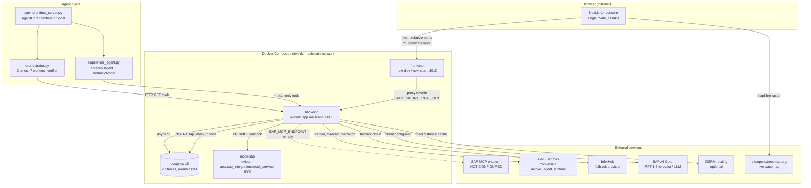
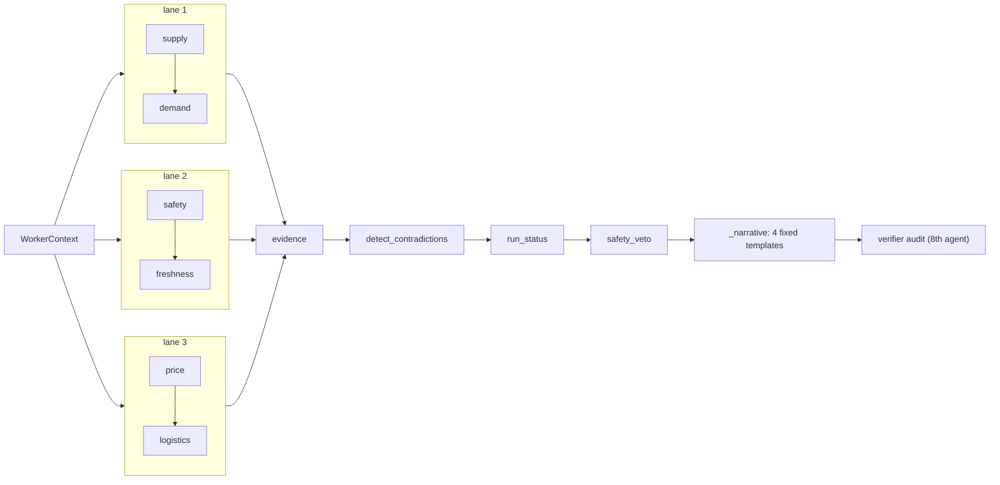
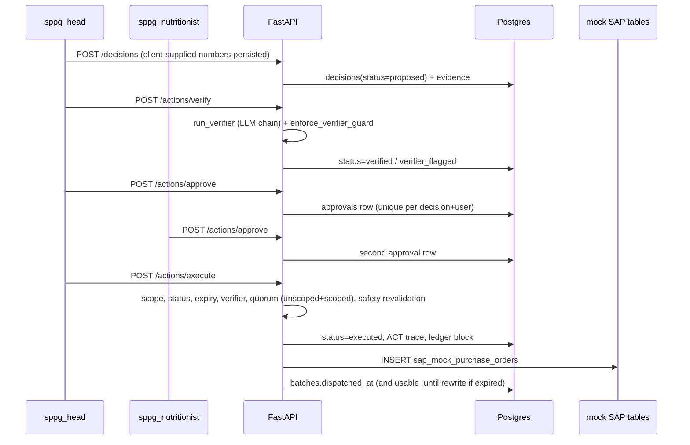
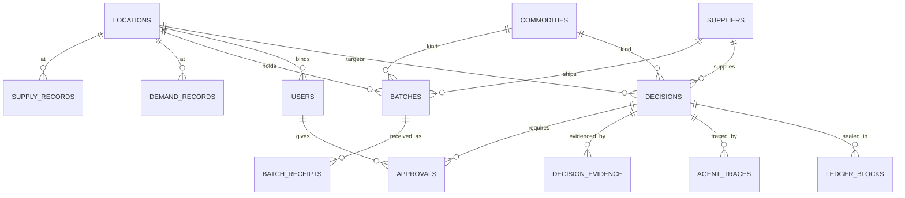

# INDEPENDENT PROJECT REVIEW — MEALCHAIN GUARDIAN

> **Snapshot 25 Oktober 2026 (dari waktu berkas)** — angka di dokumen ini hasil pengukuran saat itu, bukan keadaan sekarang. Keadaan terbaru: `docs/state-snapshot.md`.

| Field | Value |
|---|---|
| Repository | `E:\hackathon\HackathonAWS\mealchain-guardian` |
| Branch | `feature/db-modes-demo-coverage` |
| Commit inspected | `d414957aa366798c09e296d358e76dfd64018c7f` — 2026-10-25 03:50:25 +0700 — *"deploy: verifikasi stack produksi penuh + perbaiki dua bug yang terbongkar"* |
| Working tree | **DIRTY** — 46 entries before this report was created (7 modified, 38 deleted, 1 untracked test file); all preserved untouched |
| Review date | 2026-10-25 (Asia/Jakarta) |
| Reviewer | Hermes Agent (independent review role), model `deepseek-v4-flash`, 6 parallel sub-reviewer passes |
| Output | This file only. No repository file was modified, created, or deleted. |
| Overall verdict | **Substantial, working engineering — with safety-relevant gaps and a documentation surface that does not match the code.** |

---

## 1. Executive Summary

### 1.1 What the project is

MealChain Guardian is a working full-stack decision-support system for balancing food supply and demand across Indonesian regions for the MBG (Makan Bergizi Gratis) school-meal programme. A FastAPI backend owns all arithmetic (demand forecasting, supply balance, freshness, food safety, cost, allocation, ranking), stores decisions in PostgreSQL behind a **three-role, two-step-approval governance model**, and exposes 77 HTTP operations. A single-page Next.js console renders eleven operational surfaces for three roles. A separate `agent/` package implements a Supervisor–Worker review pipeline that is deployed to Amazon Bedrock AgentCore and also runnable as a local runtime.

The system is real, not a slide deck: 132,636 lines of code across 1,142 source files, 23 database tables behind 30 Alembic migrations, 212 backend test modules and 166 frontend test files.

### 1.2 Overall implementation status

| Layer | Status | Basis |
|---|---|---|
| Domain arithmetic (safety, freshness, balance, cost, allocation) | **Implemented and unit-verified** | 62 selected domain tests pass; deterministic modules carry no LLM import |
| Governance (3 roles, SPPG scope, dual approval, head-only execution) | **Implemented and enforced server-side**, with two concrete exceptions (§12, F-08/D-04) | Route-by-route dependency walk; DB unique index `uq_approvals_decision_user` |
| Food-safety enforcement | **Partially implemented** — the *evaluation* engine is correct, the *enforcement seams* are not | F-01, F-02, F-03, A-01 (§12) |
| HTTP API | **Implemented** — 75 paths / 77 operations, 33 routers | `app.openapi()` generated in this session |
| Frontend console | **Implemented** — 11 tabs, one 2,026-line client component | `frontend/app/page.tsx` |
| Agentic orchestration | **Deterministic pipeline** mislabelled "agentic" in places; LLM confined to narration/verdict | §7, C-01…C-14 |
| AWS Bedrock AgentCore | **Configured and previously invoked**; documentation says the opposite | §7.6, §14 |
| SAP | **Mocked** (Postgres mock tables + hard-coded provider); real MCP adapter exists but is unstartable | §9.4 |
| SAP Joule / A2A bridge | **Real and live**, but carries no SAP business data | §9.5 |
| Test suite | **Meaningful but not runnable here**: 1,496 collected; 1,794 frontend cases pass; DB-backed half blocked (no Docker daemon) | §11 |
| Documentation accuracy | **Poor relative to code**: 8 of 23 tables absent from `Schema.md`, 1 non-existent table documented, 3 stale vocabularies, PRD undercounts commodities | §13 |

### 1.3 Verified strengths

These are the claims this review could *reproduce*, not claims quoted from project documents:

1. **Safety numbers never come from a model.** 36 modules under `backend/app/core/` contain **zero** imports of `app.ai_providers`. LLM calls live only in `ai_providers/` and `services/supervisor_client.py`, and the model output is a narrative/verdict string, never a score. Verified by import scan and by reading `core/freshness.py`, `core/safety.py`, `core/allocation.py`.
2. **Role and scope enforcement is real, not cosmetic.** `app/api/auth.py:109-117` (`require_roles`) plus `app/core/scope.py:64-90` (`assert_in_scope`) gate 39 of 76 route operations in the decorator itself, and the remaining mutations carry inline role checks. `bgn_monitor` cannot execute; `sppg_head` cannot read another SPPG's decision.
3. **Four-eyes approval has a database backstop.** `alembic/versions/030_approval_four_eyes_unique.py` de-duplicates then creates unique index `uq_approvals_decision_user`, so one account cannot satisfy two approval slots by replay.
4. **Cross-cutting HTTP hardening exists.** API docs return 404 unless `ENABLE_DOCS`/`DEBUG` (`app/main.py:113-118`), CSP `default-src 'none'` + `X-Frame-Options: DENY` on all API responses (`main.py:125-145`), CORS allow-list without wildcard, HSTS only on TLS.
5. **The evidence ledger is append-only and chained.** `core`/`services` write `ledger_blocks` with `sha256(prev + payload)`; no update/delete path was found (E-13 disputes the "Merkle + ECDSA" wording, not the chaining).
6. **Frontend offers no silent mock fallback.** On API failure the UI shows an error/empty state; it does not substitute demo data (`B` review, cross-checked in `lib/api.ts`).
7. **The frontend test suite genuinely runs and passes here** — 166 files / 1,794 tests in 38.7 s, plus `tsc --noEmit` exit 0 and `next lint` clean.

### 1.4 Highest-priority risks

| # | Risk | Severity | Evidence |
|---|---|---|---|
| 1 | **Receiving accepts food whose temperature evidence is missing.** Receipt is blocked only when `safety_status == 'fail'`; the default for a new batch is `pending`. No hold, no quarantine, no verification request. | Critical (food safety) | `app/api/receipts.py:201`; F-01 |
| 2 | **Two safety engines answer differently for the same batch.** `compute_freshness_score` applies **zero** temperature penalty when the log is empty/incomplete (empty log → score ≈ 0.90 → `pass`), while `evaluate_safety` returns `needs_verification` for the identical input. | Critical | `core/freshness.py:28-34` vs `core/safety.py:19-24`; F-02 |
| 3 | **Event 3 rewrites safety verdicts using a hard-coded 0–8 °C range for every commodity** and writes the result onto `batches.safety_status`. Rice (15–30 °C) can be marked `pass` where `/safety/evaluate` says `fail`; the reverse also occurs. | High | `services/event3_service.py:59-61,153-157,270-272`; F-03 |
| 4 | **Execution re-validates only "all source batches FAIL"** and treats `pending`/`needs_verification` as safe; expired batches get `usable_until` rewritten to `now + 6 h` at dispatch. | High | `api/actions.py:321-322,353`; A-01 |
| 5 | **Deletion of the safety guard would stay green in CI.** `verifier_client.py:185` (`enforce_verifier_guard`) has no end-to-end test that feeds a FAIL verdict through `run_verifier`. | High (test trust) | F-07 |
| 6 | **Secret material from an earlier commit is still valid.** A historical `.env` blob (`c4d22b3`) retains **49 of 67** values identical to today's `.env`, including `POSTGRES_PASSWORD`, `INFERHUB_API_KEY`, `SIGNING_KEY_HEX`, `SAP_AI_CORE_CLIENT_ID`. AWS keys, JWT secret and AgentCore IDs **were** rotated. | High | Measured in this session by comparing key-by-key; D-05 |
| 7 | **Production compose publishes PostgreSQL and the API on 0.0.0.0** while its own header comment claims the opposite, and the documented prod seed installs fixed demo passwords for all three roles. | High | `docker-compose.prod.yml:33-34,62-63,18`; `app/seed/seed_data.py:717-763` |

### 1.5 Limitations of this review

- **No runtime verification of the deployed stack.** The Docker daemon was not running on this host and was not started; no container, no live Postgres, no HTTP request against a running API, no browser session. Therefore: no finding in this document is graded as a *confirmed live vulnerability*; the strongest evidence class reached is static code + executed unit tests.
- **The backend suite could not be completed.** With the default DSN (host `postgres`) each DB-backed test spends ~7 s in connection failure; the full 1,496-test run was aborted after 5.7 minutes without a summary. A bounded run is reported in §11 with its exact numbers.
- **Six sub-reviewer passes were used** (implementation/architecture, frontend, agentic/integration, security, documentation/external, invariants). Their findings enter this report **attributed and unmodified**, and this reviewer independently re-verified 14 of the highest-severity items against the source. Items the lead reviewer did not personally re-verify are marked `confidence: Medium (sub-reviewer, static)` in §12.
- **External technology verification was performed by the documentation sub-reviewer** against AWS/SAP/Next.js vendor sources (§14); this reviewer did not re-fetch those pages, so the citations are attributed rather than personally reproduced.
- **The working tree is dirty** (46 entries, mostly deletions of `docs/verification/*`). Deleted-file contents were read from `HEAD`, not from disk.

---

## 2. Scope and Methodology

### 2.1 Repository state at inspection

```
branch : feature/db-modes-demo-coverage
HEAD   : d414957aa366798c09e296d358e76dfd64018c7f  (2026-10-25 03:50:25 +0700)
dirty  : 7 modified (backend/alembic/versions/018_agent_trace_worker_fields.py,
                    backend/app/seed/demo_template.py,
                    frontend/app/supply-adequacy.css,
                    frontend/components/SupplyAdequacyChart.tsx,
                    frontend/next.config.js,
                    frontend/tests/supply-adequacy-chart.test.tsx,
                    memory/global/decisions.md)
        38 deleted  (docs/verification/*, docs/qa/*, docs/demo/alur-demo-juri.md,
                     .hermes/plans/*, .hermes/browser-evidence/*, backend/calc2.py,
                     docs/superpowers/plans/*)
         1 untracked (backend/tests/test_demo_template_kesegaran.py)
remotes: origin = RGjordien/mealchain-guardian
         mirror = munk23zzz/MealChainGuardian  (public demo mirror; inspected read-only)
```

**Consequence for every gate in this report:** the lint, type-check, test and schema results in §11 were produced against this dirty tree, i.e. they describe the working copy the owner is using, not exactly commit `d414957`. Where that matters (e.g. the frontend suite), it is stated explicitly.

The public mirror was checked for leaked material: `mirror/master` (274 files) and `mirror/main` (1 file, initial commit) contain **no** `.env`, `*.key`, `*.crt`, `data/export/` or `secrets/` path. The secret-bearing commits listed in §12 are **not** reachable from any `mirror/*` ref — verified with `git branch -r --contains` for each commit.

### 2.2 What was examined

| Area | Artefacts | Count |
|---|---|---|
| Backend source | `backend/app/**` | 152 modules (7 packages: `api`, `core`, `models`, `services`, `seed`, `agent_tools`, `ai_providers`, `sap_integration`) |
| HTTP surface | `backend/app/api/*.py` → `app.openapi()` | 33 routers, **75 paths / 77 operations** |
| Persistence | `backend/app/models/*.py`, `backend/alembic/versions/*` | 16 model files / **23 tables**; 30 migrations, head `031_ledger_generation` |
| Agent package | `agent/**` | 24 modules, 4,134 lines |
| Frontend | `frontend/app`, `components`, `lib`, `tests` | 1 route, 56 components, 50 lib modules, 166 test files |
| Tests | `backend/tests`, `frontend/tests` | 212 modules / 1,496 collected backend tests; 1,794 frontend cases |
| Configuration | compose (dev + prod + override), `.env.example`, Dockerfiles, CI | 4 services; 64 env keys; 2 CI jobs |
| Documentation | `docs/*.md`, root `*.md` | 7,444 lines of Markdown in 98 tracked `.md` files |

### 2.3 Tools and skills used

| Item | Type | Contribution | Honesty note |
|---|---|---|---|
| `project-audit` skill (local, `C:\Users\User\AppData\Local\hermes\skills\project-audit`) | Hermes skill, **executed** | Evidence-level discipline (S/U/R/D/B), "not tested" obligations, report conventions | Loaded and followed |
| `codebase-inspection` skill (local) | Hermes skill, **executed** | pygount invocation and exclusion set for accurate LOC | `pygount` was not installed; installed into a throwaway venv under `%LOCALAPPDATA%\hermes\cache\scratch\review-venv`, not into the project |
| `codebase-knowledge-builder` (Skills Hub, `@othmanadi/codebase-knowledge-builder`, MIT, community) | Hub skill, **inspected only, NOT installed** | Its 4-phase (recon → deep-dive → authoring → delivery) shape informed the workflow | Not installed: installing a skill changes future sessions' prompts, which is outside this task's authorisation |
| `hermes skills search` (hub query for *codebase documentation*, *technical writing*, *architecture documentation*, *repository overview*) | Discovery | Confirmed the hub has no maintained "whole-repo review" skill; alternatives were generic writing skills | Search only |
| 6 parallel sub-reviewer agents (Implementation/Architecture, Frontend/API-surface, Agentic/Integration, Security, Docs/External, Invariants) | Subagents, **executed** | Independent passes per Rule B; each produced a report under `%LOCALAPPDATA%\hermes\cache\scratch\review\` | Genuinely independent contexts; their summaries are quoted as *their* findings and the 14 heaviest were re-verified by the lead reviewer |
| `pytest`, `vitest`, `tsc`, `next lint`, `ruff`, `pygount`, `git`, Python stdlib | Native tooling | All executed results in §11 | Exact commands recorded |
| Web research (AWS, SAP, Next.js, Starlette advisories) | Performed by the documentation sub-reviewer | §14 | Attributed, not personally re-fetched |

**Skills that were NOT used, and why:** `webapp-testing`/Playwright (no running stack), `web-security-hardening` (remediation, not review; and this task forbids fixes), `repo-submission-readiness` (publishing, not review), `architecture-diagram` (diagrams were authored by hand so they map 1:1 to verified code paths).

### 2.4 Checks executed

| # | Command | Result | Status |
|---|---|---|---|
| E1 | `ruff check .` (backend, throwaway venv, ruff 0.6.9) | 1 error: `alembic/versions/022_disposal_partner.py:17 I001` | **FAIL (1)** |
| E2 | `tsc --noEmit` (frontend) | exit 0, no diagnostics | **PASS** |
| E3 | `next lint` | "No ESLint warnings or errors" | **PASS** |
| E4 | `vitest run` | 166 files / 1,794 tests passed, 38.74 s | **PASS** |
| E5 | `pytest --collect-only` (backend, `PYTHONPATH=backend;.`) | 1,496 tests collected, 4.48 s | **PASS (collection)** |
| E6 | `pytest` selected domain modules (freshness, safety, approval_matrix, scope_core, scoring, quarantine_core) | **62 passed**, 33.61 s | **PASS** |
| E7 | `pytest tests/test_quarantine_api.py` (bounded 100 s) | 12 errors — `sqlalchemy.exc.*` (host `postgres` unreachable), 90.46 s | **BLOCKED (no DB)** |
| E8 | `pytest` full suite (default DSN) | aborted after 5.7 min, no summary — DB fixtures stall on connection | **BLOCKED (no DB)** |
| E9 | `pytest` full suite (`DATABASE_URL` → `127.0.0.1:1`, fail-fast) | executed to separate logic failures from DB failures; see §11 | see §11 |
| E10 | `python -c "app.openapi()"` vs committed `backend/openapi.json` | actual **75 paths / 77 ops** vs committed **26 / 27** — 49 paths absent | **FAIL (contract drift)** |
| E11 | `pygount --format=summary` (deps/build excluded) | 1,142 files, **132,636** code lines, 38,220 comment lines | informational |
| E12 | `git branch -r --contains <commit>` for each secret-bearing commit vs `mirror/*` | no `mirror` ref contains them | **PASS** |
| E13 | Historical `.env` (`c4d22b3:.env`) vs current `.env`, key-by-key | 67 historical keys, **49 identical today** (incl. `POSTGRES_PASSWORD`, `INFERHUB_API_KEY`, `SIGNING_KEY_HEX`) | **FAIL** |
| E14 | `docker ps`, `docker compose` | daemon not running — **not started** (out of scope, would mutate host state) | **NOT RUN** |
| E15 | `alembic upgrade head` / `alembic check` | requires DB | **NOT RUN** |
| E16 | `npm audit` (frontend) | run by security sub-reviewer; 2 advisories triaged as not currently reachable (§12 D-11) | see §12 |
| E17 | CI execution status | `gh` CLI absent; no workflow-run evidence in the working tree | **NOT VERIFIED** |

### 2.5 Evidence classes used in this report

| Tag | Meaning |
|---|---|
`[S]` | Static: read from source, configuration, migration or generated schema in this session |
`[U]` | Unit test executed in this session, with the command and count recorded |
`[R]` | Runtime HTTP against a running service — **never available in this review** |
`[D]` | Live database query against the project's Postgres — **never available in this review** |
`[B]` | Browser/DOM evidence — **never available in this review** |
`[X]` | External vendor source (attributed to the documentation sub-reviewer, §14) |

Anything without a tag is an inference and is labelled as such in §12 (`confidence: Low`).

---

## 3. Project Overview

### 3.1 Actual purpose (reconstructed from code, not from `IDEA.md`)

Given (a) supply records per location/commodity, (b) demand observations, (c) perishable batches with harvest time and temperature logs, and (d) supplier reliability, price and road-distance data, the backend answers a single operational question:

> *Which batch from which supplier can cover this SPPG's shortage for this commodity, at what landed cost, and is it safe to ship — and who must approve it?*

The answer is persisted as a `decisions` row that moves through `proposed → verified → pending_approval → approved → executed` (plus `rejected`, `verifier_flagged`, `review_only`), with an append-only evidence ledger and agent traces attached.

### 3.2 Main user workflows

| # | Role | Workflow | Code path |
|---|---|---|---|
| W1 | `sppg_head` | Open console → see today's agenda and shortage → pick a recommendation → propose → (nutritionist/head) verify → approvals → execute → PO issued | `GET /agenda`, `/decisions`, `POST /actions/propose`, `/actions/verify`, `/actions/approve`, `/actions/execute` |
| W2 | `sppg_nutritionist` | Review food-safety and freshness of inbound batches, verify decisions, approve | `/batches`, `/freshness/evaluate`, `/safety/evaluate`, `/actions/verify`, `/actions/approve` |
| W3 | `bgn_monitor` | National oversight: KPI dashboards, cross-region map, decision audit, user/location administration | `/kpi`, `/balance/map`, `/decisions`, `/admin/*` |
| W4 | any SPPG role | Quarantine a batch, release it, record a receipt, escalate a disruption event | `/batches/{id}/quarantine`, `/quarantine/*`, `/receipts`, `/events/*` |
| W5 | demo operator | Seed/prepare/reset demo data, drive a simulated session | `/demo/*`, `/demo-session/*` |

### 3.3 Implemented vs planned

| Capability | Implemented | Evidence | Not implemented / caveat |
|---|---|---|---|
| Deterministic safety evaluation | Yes | `core/safety.py` | — |
| Freshness scoring with temperature penalty | Yes, but incomplete-log branch is penalty-free | `core/freshness.py:28-34` | F-02 |
| Balances, allocation, ranking, cost | Yes | `core/allocation.py`, `core/ranking.py`, `core/safe_delivered_cost.py` | — |
| Road distance / ETA | Yes, with OSRM cache table `road_routes` | `alembic 014`, `core/road_route.py` | Falls back when OSRM absent (CI uses `--skip-routes`) |
| Decision lifecycle + approvals | Yes | `api/actions.py`, `alembic 030` | Status set from an *unscoped* evaluation (A-05) |
| Append-only ledger | Yes | `alembic 010`, `core`/`services` ledger writers | "Merkle + ECDSA" wording overstated (E-13) |
| Agent review pipeline | Yes, deterministic 7 workers + verifier | `agent/orchestrator.py`, `agent/workers/*` | Not LLM-driven (C-01) |
| LLM narration & verdict | Yes, provider chain with fallbacks | `ai_providers/*`, `services/supervisor_client.py` | Silent degradation on provider outage (C-04) |
| AgentCore runtime | Deployed previously; ARN set | `.env` `AGENTCORE_RUNTIME_ARN` present; DB traces claim `primary:agentcore` | No in-repo evidence of a *current* successful invocation; docs say "blocked" (C-13, E-11) |
| AgentCore **Gateway** / MCP tool layer | **No** | `AGENTCORE_GATEWAY_URL` empty; no `gateway_config/`, no code | E-05 |
| AgentCore **Memory** | Adapter raises unconditionally | `agent_memory.py:63-98` | E-06 |
| SAP purchase orders | **Mocked** (Postgres tables) | `models/sap_mock.py`, `sap_integration/mock_provider.py` | Real MCP adapter unstartable (C-06) |
| SAP Joule A2A bridge | Yes, live (separate service) | `sap-joule/a2a_server`, `sap-joule/joule` | Carries no SAP business data; BTP destination leg unverified |
| Multi-tenant isolation | Partial | `core/scope.py` on decision surface | `/batches` and `/receipts?batch_id` cross-tenant (D-08, B-02) |
| Offline demo | Partial | Map basemap is live `tile.openstreetmap.org` | Blank canvas without internet (B-14) |

---

## 4. Technology Stack

Versions are read from manifests, not from prose.

| Technology | Version | Actual usage | Evidence | Verification |
|---|---|---|---|---|
| Python | ≥3.12 (CI pins 3.12; the review venv used 3.12.3) | Backend + agent + seeds | `backend/pyproject.toml` | `[U]` imports succeed |
| FastAPI | 0.115.0 | HTTP layer, 33 routers | `backend/requirements.txt:1`; `app/main.py` | `[S]` + `[U]` app builds |
| Uvicorn | 0.30.6 | ASGI server; `--reload` in dev, `--proxy-headers --forwarded-allow-ips="*"` in prod | `requirements.txt:2`; compose commands | `[S]` |
| SQLAlchemy | 2.0.35 (async) | ORM + Core; async engine per app lifespan | `requirements.txt:3`; `app/db.py`, `api/dependencies.py:14-24` | `[S]` |
| asyncpg / psycopg | 0.29.0 / 3.2.3 | async app I/O; sync fixtures in tests | `requirements.txt:4-5`; `tests/dsn.py` | `[S]` |
| Alembic | 1.13.2 | 30 migrations, head `031_ledger_generation` | `backend/alembic/versions/` | `[S]` (not applied — no DB) |
| Pydantic | 2.9.2 | Request/response models | `requirements.txt:8` | `[S]` |
| bcrypt / PyJWT | 4.2.0 / 2.9.0 | Password hashing (cost 12), HS256 JWT | `api/auth.py` | `[S]` |
| boto3 | 1.42.89 | Bedrock `converse`, `bedrock-agentcore` invoke/control | `requirements.txt:14`; `ai_providers/bedrock_caller.py`, `agentcore_caller.py` | `[S]` `[X]` |
| Strands SDK | not pinned in `requirements.txt`; imported by `agent/supervisor_agent.py:39` | Agent built for AgentCore Runtime (4 read-only tools) | `agent/supervisor_agent.py` | `[S]` — import fails on this host (package absent), so agent modules are skipped in the suite |
| reportlab / pypdf | 5.0.1 / 6.21.1 | PO dossier PDF rendering; pypdf used **by tests** to re-extract text | `requirements.txt:18-19`; `services/po_document.py` | `[S]` |
| PostgreSQL | 16-alpine (image) | Primary store | `docker-compose.yml:3` | `[S]` (not reachable) |
| Next.js | 14.2.14 | App Router, single page, API proxy rewrites | `frontend/package.json`; `next.config.js` | `[U]` tsc/lint/vitest |
| React | 18.3.1 | UI runtime | `package.json` | `[U]` |
| TanStack React Query | 5.56.2 | All server state; one `request()` invalidates queries | `lib/api.ts` | `[S]` |
| TypeScript | 5.6.2 | Strict types; `tsc --noEmit` clean | `package.json` | `[U]` |
| MapLibre GL | 4.7.1 | Map surface; live OSM raster tiles | `components/SupplyMap.tsx` | `[S]` |
| Recharts | 2.12.7 | KPI/stock charts | `components/StockChart.tsx`, `KPIDashboard.tsx` | `[S]` |
| Vitest | (dev dep) | 1,794 cases | `vitest.config.ts` | `[U]` |
| pytest / pytest-asyncio | 8.3.3 / 0.24.0 | 1,496 collected | `requirements.txt`, `pyproject.toml` | `[U]` |
| ruff | 0.6.9 | Lint gate; currently 1 error | `pyproject.toml` | `[U]` |
| Docker Compose | dev (`docker-compose.yml`), override, prod (`docker-compose.prod.yml`) | 4 services: `postgres`, `backend`, `frontend`, `mock-sap` | compose files | `[S]` (not started) |
| GitHub Actions | `.github/workflows/ci.yml` | Backend job (ruff → alembic → seed → pytest with Postgres service) and frontend job (tsc → lint → vitest) | `ci.yml` | `[S]`; run status **NOT VERIFIED** |
| AWS Bedrock AgentCore | managed service; boto3 1.42.89 client | Runtime + Memory ID configured; Gateway **absent** | `agent/deploy_agentcore.py`, `.env` keys | `[X]` service is real; repo usage partially real (§14) |
| SAP AI Core / RPT-1.6 | managed service; REST client in-repo | Configured client, live-verifiable only with SAP credentials | `ai_providers/sap_ai_core_caller.py` | `[X]` real service; **not verified live** |

**Deliberately not used / not present:** no Redis, no Celery/queue, no Kubernetes, no ORM migration-in-boot, no auth provider (self-issued JWT), no observability stack (only `logging` + `agent/telemetry.py`), no rate-limit store beyond process memory.

---

## 5. Repository and Module Inventory

### 5.1 Size

```
pygount (deps/build/venv excluded)
  files          1,142
  code lines   132,636
  comment lines 38,220
  Markdown        9,195 comment lines across 98 files
tracked files   1,043   (.py 461, .ts 180, .tsx 128, .md 130, .json 30, .yaml/.yml 22, .sh 13)
```

### 5.2 Backend modules

| Package | Files | Responsibility (as implemented) |
|---|---|---|
| `app/api` | 33 routers + `dependencies.py` | HTTP surface, role/scope gates, request→service wiring |
| `app/core` | 36 modules | Pure/deterministic domain: freshness, safety, temperature, allocation, ranking, candidate generation, constraints, cost, logistics, geo, road route, PO numbering, approval matrix, scope, rate limit, reliability, commodity limits, window/validity |
| `app/models` | 16 modules / 23 tables | SQLAlchemy 2.0 mappings |
| `app/services` | ~25 modules | Orchestration & persistence: `demo_procurement_orchestrator`, `event1_orchestrator`, `event3_service`, `receipts_service`, `quarantine_service`, `supplier_eligibility`, `supplier_procurement`, `kpi_service`, `ledger`, `po_document`, `supervisor_client`, `demo_session` |
| `app/ai_providers` | 9 modules + prompt dir | Provider chain: `bedrock_caller`, `agentcore_caller`, `inferhub_caller`, `sap_ai_core_caller`, `forecast_client`, `verifier_client`, `resilience`, `model_registry`, `ai_provider_chain` |
| `app/agent_tools` | `registry.py`, `gateway_config.json` | Tool registry exposed to the agent/Prompt layer |
| `app/sap_integration` | `provider_interface`, `mock_provider`, `aws_mcp_provider`, `factory`, `mock_service` | SAP abstraction; mock default; FastAPI mock service on :8001 |
| `app/seed` | 15 modules | Reference data, demo template, activity, KPI history, Jakarta scenario, suppliers, road routes |

### 5.3 Agent package (`agent/`, 4,134 lines)

| Module | Role |
|---|---|
| `runtime_server.py` (133) | AgentCore Runtime entrypoint; routes `task="review_decision"` **around** the model to the deterministic pipeline |
| `supervisor_agent.py` (111) | Strands `Agent` + `BedrockModel` + 4 read-only tools; hello-world contract |
| `orchestrator.py` (315) | 3 fixed lanes → 7 workers → evidence → contradictions → status → narrative → verifier |
| `workers/` (9 files) | supply, demand, freshness, safety, price, logistics, evidence, verifier, base |
| `tools.py` (276) | 4 read-only HTTP tools against the backend |
| `contracts.py` (229) | Typed contracts + citation validator (exact type+value match) |
| `validation.py` (173) | Contradiction detection, run status, safety veto |
| `deploy_agentcore.py` (394), `set_runtime_env.py` (145), `tunnel_watchdog.py` (278), `verify.py` (68), `telemetry.py` (113), `registry.py` (134), `hierarchy.json` | Deployment, environment, watchdog, telemetry, lane declarations |

### 5.4 Frontend inventory

| Area | Count / content |
|---|---|
| Routes | **1** — `app/page.tsx` (2,026 lines, `"use client"`) |
| Surfaces (tabs) | **11** — `today`, `overview`, `recommendations`, `evidence`, `safety`, `surplus`, `suppliers`, `agent-log`, `kpi-kualitas`, `settings`, `demo-control` |
| Components | 56 (`*.tsx`) + 3 CSS modules |
| Lib modules | 50 (`api`, `auth`, `kpi`, `ledger`, `evidence`, `food-safety`, `map-*`, `demo-*`, `chaos-scope`, …) |
| API proxy roots | 23 whitelisted in `next.config.js` rewrites |
| Tests | 166 files / 1,794 cases |
| Unreachable components | 6 components + 2 lib modules imported by tests but not rendered by `page.tsx` (B-07): `OpsConsole`, `ChaosPanel`, `DemoDataPanel`, `Event2Panel`, `IntegrationStatusPanel`, `StockChart`, `lib/chaos-scope.ts`, `hooks/useIntegrationStatus` |

### 5.5 Infrastructure

| File | Purpose |
|---|---|
| `docker-compose.yml` | Dev stack: `postgres` (host port `${POSTGRES_PORT:-15432}`), `backend` (`--reload`, bind mount `./backend:/app`), `frontend` (`npm run dev`, bind mount), `mock-sap` (mock FastAPI on :8001) |
| `docker-compose.override.yml` | Local overrides (proxy mode) |
| `docker-compose.prod.yml` | Prod stack: no reload, no bind mounts, healthchecks, `--proxy-headers --forwarded-allow-ips="*"`, publishes `${POSTGRES_PORT:-15432}` and `${BACKEND_PORT:-8000}` on all interfaces |
| `.github/workflows/ci.yml` | Backend: ruff → `alembic upgrade head` → canonical seed (`--skip-routes`) → pytest, with a Postgres 16 service. Frontend: `npm ci` → tsc → next lint → vitest |
| `infra/aws/` | IAM/policy material for AgentCore (2 files) |
| `scripts/` | 11 helper scripts (canonical seed, readiness probes) |
| `verify/` | Playwright-ish stack spec JSONs (`stack.spec.json`, `tabs.spec.json`, `stack.forensics.spec.json`) — specs only, no runner wiring found |

---

## 6. Verified System Architecture

### 6.1 Components (each one traced to code)



Solid lines are code paths verified by reading the modules named. The dashed SAP-MCP edge is drawn dashed because `SAP_MCP_ENDPOINT` is absent from `.env` — the adapter exists but cannot start (§9.4).

### 6.2 Component responsibilities

| Component | Owns | Does NOT own |
|---|---|---|
| `frontend` (Next.js) | Presentation, tab state, React Query cache, map rendering, form validation | Authorization decisions, arithmetic, safety verdicts |
| `backend` (FastAPI) | RBAC + scope, all arithmetic, decision lifecycle, approvals, ledger, traces, PO issuance | Model inference (delegated), SAP business transactions (mocked) |
| `postgres` | Durable state: 23 tables, constraints, unique four-eyes index, append-only ledger chain | Business rules |
| `agent/` runtime | Multi-worker review of a decision, contradiction detection, verifier audit, narrative | Mutations — every worker tool is read-only (`agent/tools.py`); `run_review` explicitly issues no mutating call |
| `mock-sap` | Stand-in for SAP PO/material endpoints used by the demo | Any real SAP semantics (no OData, no S/4 client) |
| Provider chain | Narration text, verifier verdict, forecast | Safety scores, costs, allocations |

### 6.3 Request flow (verified middleware order)

1. **`_kunci_dokumen`** (`main.py:113-118`) — returns 404 for `/docs`, `/redoc`, `/openapi.json`, `/docs/oauth2-redirect` unless `ENABLE_DOCS`/`DEBUG` is truthy.
2. **`_header_keamanan`** (`main.py:125-145`) — sets `nosniff`, `DENY`, `no-referrer`, Permissions-Policy, COOP, CSP `default-src 'none'`, HSTS only when the request is HTTPS or `x-forwarded-proto: https`.
3. **`_konteks_sesi_demo`** (`main.py:152-170`) — installs a SQLAlchemy `do_orm_execute` guard, then (only when `DEMO_SESSION_ENFORCE` is true) resolves the active demo session into a `ContextVar` per request.
4. **CORS** — allow-list from `CORS_ORIGINS` or defaults `localhost:3000|3010`, `allow_credentials=True`, methods `GET/POST/PATCH/OPTIONS`, headers `Authorization, Content-Type`.
5. **Router dependency** — `get_current_user` (JWT) and/or `require_roles(...)`.
6. **Scope assertion** — `assert_in_scope` / `apply_location_scope` on target-located data.
7. **Service → SQLAlchemy async session → Postgres**; commits are explicit per handler.

### 6.4 Where state changes are gated

| Mutation | Guard (code) | Additional guard |
|---|---|---|
| Create decision | role in `DECISION_MUTATING_ROLES` (`decisions.py:131-132`) + target-location scope (`decisions.py:162`) | — |
| Propose action | `require_roles(*PROPOSER_ROLES)` = `sppg_head` (`actions.py:363,684`) | decision scope, expiry |
| Verify | `require_roles(*VERIFIER_ROLES)` = head + nutritionist (`actions.py:413`) | verifier chain runs model/tools |
| Approve | `require_roles(*VERIFIER_ROLES)` (`actions.py:546`) | one row per (decision,user) — pre-check + DB unique index |
| Execute | `require_roles(*PROPOSER_ROLES)` = `sppg_head` (`actions.py:687`) | scope, status, verifier verdict, expiry, approval quorum (unscoped **and** scoped), safety re-validation |
| Quarantine batch | **no decorator role**; enforced in `quarantine_service.py:39-46` | scope in service |
| Receipts | `require_roles(*MUTATING_ROLES)` / `sppg_head` (`receipts.py`) | safety gate is `!= 'fail'` only (F-01) |
| Admin users/locations | `require_roles("bgn_monitor")` (`admin.py:82,99,157,170`) | self-change guard `admin.py:106` |
| Demo seed/rebuild | `require_roles("sppg_head")` / `("sppg_nutritionist")` | `butuh_sesi_aktif` — a **no-op** unless `DEMO_SESSION_ENFORCE=true` (`demo_session.py:36-37`) |

### 6.5 External dependencies and failure behaviour

| Dependency | Used for | Failure behaviour (verified) |
|---|---|---|
| Bedrock (`converse`) | verifier verdict, narration, forecast fallback | Falls through provider chain; exhaustion → `unavailable` (no crash) for narration; **verifier re-raises → HTTP 500** (C-05) |
| InferHub | fallback provider | Same chain |
| SAP AI Core | RPT-1.6 forecast, LLM verifier | Configured; live calls require SAP credentials — **not verified** |
| AgentCore Runtime | deployed agent path | `runtime_server.py` still serves `review_decision` locally without a model |
| OSRM | road distance/ETA | Cached in `road_routes`; CI seeds with `--skip-routes` |
| OSM raster tiles | basemap | No tiles → blank map (B-14) |
| Postgres | everything | Connection refused surfaces as `sqlalchemy.exc.*` → 500 on DB-backed endpoints (E7/E8) |

---

## 7. Business Workflow and Agentic AI Execution

### 7.1 Trigger and inputs

A review is started either by the UI (`POST /demo/agent/run` path in the demo flow) or by the agent runtime's `task="review_decision"` entry (§7.5). Inputs are *not* free-form: `context_from_approval()` (`agent/orchestrator.py:37-70`) requires `target_location` and `commodity` from `GET /decisions/{id}/approval-summary` and refuses to guess any other field.

Worker inputs (`context`) contain: decision id, run id, target/source location, commodity, surplus, shortage, quantity, candidate supplier/batches, and the freshness/safety snapshot as stored in the DB.

### 7.2 The seven workers (deterministic, HTTP-reading)



| Property | Observed |
|---|---|
| Parallelism | 3 lanes via `ThreadPoolExecutor` (`orchestrator.py:119`) |
| Worker nature | Plain Python classes calling `GET` endpoints; `build_workers()` injects `model=None` |
| Tool calls | Real HTTP reads through `agent/tools.py` / `MealChainClient` (4 read-only tools exposed to Strands as well) |
| State transitions | Typed `AgentFinding` per worker; `run_status` ∈ {COMPLETED, PARTIAL, FAILED, TIMEOUT} |
| Errors | A raising worker becomes an `_error_finding` with status `error`; `run_status` then returns `PARTIAL` |
| Timeout | Deadline shared by all lanes; unfinished workers get `timeout:` findings; `status = TIMEOUT` |
| Veto | `safety_veto(findings)` = any *blocking* finding from a guardian agent — **stored separately from `status`** (`orchestrator.py:276-292`) |

**This is not LLM autonomous orchestration.** No model decides which worker runs, when to stop, or what to do next; the lane graph is a Python tuple (`orchestrator.py:29-33`). `agent/hierarchy.json` declares the same lanes and is loaded by `registry.py:114`, but the orchestrator does not use it — two sources of truth for the same topology (C-08).

### 7.3 Where the LLM is actually used

| Use | Module | Guard |
|---|---|---|
| Verifier verdict (`consistent` / `flagged` / `unavailable`) | `ai_providers/verifier_client.py` → `run_verifier` | Output parsed against a closed vocabulary; `enforce_verifier_guard` prevents upgrading a FAIL safety status |
| Supervisor narration | `services/supervisor_client.py:run_supervisor` | Narrative never mutates verdict, recommendation, cost or any number |
| Forecast | `ai_providers/forecast_client.py` (SAP AI Core RPT-1.6 or fallbacks) | Deterministic fallback exists (`core/forecasting_fallback.py`) |
| AgentCore Strands agent | `agent/supervisor_agent.py` | 4 read-only tools; missing model id raises `missing_config` rather than inventing numbers |

Narration persistence proves a real tool-call loop: stored narration text lists the tools consulted (`cost_eligibility, evidence_digest, supply_demand, safety_freshness …`). The verifier verdict, however, is computed by a **backend REST call**, not by the runtime's verifier worker — the runtime worker is advisory only (E-08).

### 7.4 Deterministic validation vs generative reasoning vs orchestration vs approval

| Concern | Owner | Evidence |
|---|---|---|
| Safety score, freshness score, excursion minutes | `core/safety.py`, `core/freshness.py`, `core/temperature.py` | Pure functions, no network |
| Balance, deficit, allocation, ranking, cost | `core/balance`/`allocation`/`ranking`/`safe_delivered_cost` | Pure functions |
| Which workers run and in what order | Python lanes (`orchestrator.py:29-33`) | Deterministic |
| Whether a run is COMPLETED/PARTIAL | `validation.run_status` | Deterministic |
| Contradiction detection | `validation.detect_contradictions` | Deterministic |
| Whether to block | `validation.safety_veto` | Deterministic |
| Prose summary for the approver | LLM | Template fallback when no provider |
| Verifier verdict | LLM + deterministic guard | `verifier_client.py` |
| Approval | Two humans (role matrix + DB unique index) | `core/approval_matrix.py`, migration 030 |
| Execution | `sppg_head` HTTP call | `actions.py:684-687` |

### 7.5 Human approval flow



No path from `proposed` to `executed` exists: `execute_action` rejects any status outside `{pending_approval, verifier_flagged, approved}` (`actions.py:717-721`) and requires a satisfied approval quorum computed twice — once over all approvals and once restricted to approvers whose `location_id` equals the target.

### 7.6 Failure and recovery behaviour

| Failure | Behaviour | Assessment |
|---|---|---|
| A worker raises | `_error_finding`, run = PARTIAL | Honest, no silent pass |
| Lane exceeds deadline | `timeout` findings, run = TIMEOUT, narrative says "do not conclude safe" | Good |
| All LLM providers down (narration) | `status="unavailable"`, **no SUPERVISE trace row written**, attempts discarded | Silent degrade (C-04) |
| All LLM providers down (verifier) | `ProviderUnavailableError` not caught → `/actions/verify` returns 500 | Defect (C-05); only an empty-chain test exists |
| Veto raised | `safety_veto=True` but `status` can still be `COMPLETED` | Design split; persisted as completed (C-09) |
| Model returns nonsense | `_extract_summary` falls back to first 400 chars; verifier parse failure → treated as unverified | Acceptable |
| AgentCore runtime unreachable | Local `runtime_server.py` still serves reviews; deployed path unverified | Configured-not-verified |

---

## 8. Database and Data Model

### 8.1 Tables (23, from ORM `__tablename__`, cross-checked against migrations)

| Domain | Tables |
|---|---|
| Master data | `locations`, `commodities`, `suppliers`, `users` |
| Supply chain | `supply_records`, `demand_records`, `batches`, `batch_receipts`, `road_routes`, `price_signals` |
| Decisions & governance | `decisions`, `decision_evidence`, `approvals`, `supplier_exclusions`, `disposal_events`, `delivery_events` |
| Audit & evidence | `ledger_blocks`, `ledger_meta`, `agent_traces` |
| KPI | `kpi_facts` |
| Menus | `menu_plans` |
| SAP mock | `sap_mock_material_stock`, `sap_mock_purchase_orders` |
| Demo | `demo_sessions` |

`docs/Schema.md` documents 15 tables including one that does not exist (`kpi_snapshots`) and omits 8 live tables — see E-02/E-03 in §13.

### 8.2 Relationships and constraints



Constraint evidence:

- FK targets found in the ORM: `locations.id` (9), `commodities.id` (6), `suppliers.id` (4), `users.id` (3).
- Partial indexes for demo provenance: `origin IN ('seed','demo')` (migration 017/028).
- `ledger_blocks` has `height` unique (`ledger_blocks_height_key`) — the chain cannot fork.
- `approvals` unique index `uq_approvals_decision_user` (migration 030) — four-eyes at DB level.
- `menu_plans` unique on `(location_id, plan_date)`; non-negative checks on portions, quantities, distances, durations.
- `road_routes` CHECK `source IN ('osrm')` with `distance_m`, `duration_s` non-negative.

### 8.3 Data validation

| Layer | Validation |
|---|---|
| Pydantic request models | Types, enums, TTL bounds, quantity/price sanity at the edges |
| Domain functions | `ValueError` on `harvested_at > as_of`, `shelf_life_days <= 0`, NaN scores, `verify_threshold >= pass_threshold` |
| DB | FK, unique, CHECK, and the four-eyes index |
| Not validated | `POST /decisions` accepts `quantity_kg` / `safe_delivered_cost` from the caller and persists them verbatim (F-09/A-02) |

### 8.4 Evidence retention and traceability

| Artefact | Written by | Retention |
|---|---|---|
| `decision_evidence` | every state-changing action handler | permanent |
| `agent_traces` | verify/approve/execute, agent run persistence | permanent; `step_name` CHECK allows DETECT…LEARN + SUPERVISE |
| `ledger_blocks` | `append_block(...)` on each transition | append-only, `sha256(prev + payload)`, height-unique |
| `demo_sessions` | demo session start/stop | historical rows kept `HISTORY_DAYS` |
| Traces of the agent run | demo/event orchestrators | present, but **no model id recorded** (C-12), so verdicts are not attributable to a model |

---

## 9. API and Integration Inventory

### 9.1 HTTP surface summary (verified by generating `app.openapi()`)

**75 paths / 77 operations** across 33 registered routers — no orphan router module exists. Committed `backend/openapi.json` still lists **26 paths / 27 operations**, i.e. 49 paths are unrecorded (E10).

### 9.2 Routers, purpose, authorization

`MUTATING_ROLES = (sppg_head, sppg_nutritionist)`, `PROPOSER_ROLES = (sppg_head,)`, `VERIFIER_ROLES = (sppg_head, sppg_nutritionist)`.

| Router | Ops | Authorization | Notes |
|---|---|---|---|
| `auth` | 2 | public login; `get_current_user` for `/me` | JWT HS256, bcrypt cost 12, login rate-limited by IP+email |
| `decisions` | 6 | `get_current_user` + role check + target scope | `POST /decisions` trusts caller numbers (F-09) |
| `actions` | 5 | proposer / verifier role guards | propose, verify, approve, execute, repropose |
| `admin` | 4 | **`bgn_monitor` only** | user/location read+patch — a "read-only" role with write rights (F-08) |
| `demo` | 11 | `sppg_head`, `sppg_nutritionist` | destructive seed/rebuild/refresh/purge; session guard is a no-op by default (D-02) |
| `demo_session` | 5 | mutating roles / head | start, stop, status, history |
| `receipts` | 5 | mutating roles / head | safety gate `!= 'fail'` only (F-01) |
| `balance` | 4 | mutating roles on write | map/DTO reads |
| `batches` | 2 | authenticated, **not scope-filtered** | cross-tenant read (D-08) |
| `surplus`, `waste` | 1, 2 | authenticated / mutating | allocation plan and waste summary |
| `supplier_exclusions` | 3 | `sppg_head` | administrative decision type |
| `suppliers`, `supplier_routes`, `supplier_exclusion_context` | 1 each | authenticated | read-only |
| `price` | 3 | mostly authenticated; one write path | price deviation read-only |
| `agenda`, `compliance`, `dossier`, `evidence`, `events`, `freshness`, `integrations`, `kpi`, `ledger`, `logistics`, `quarantine`, `safety`, `sap_orders`, `supply`, `demand` | 1–3 each | authenticated; write paths role-gated | `events` enforces scope at `events.py:54,117` (the docstring in `auth.py:129` claiming otherwise is stale) |
| `health` | 1 | public | `{"status":"healthy"}` |

Gating arithmetic across all 76 route operations: **39 carry a role dependency in the decorator**, 37 do not (33 are reads; the others are login, decision creation with an inline role check, price deviation read, and `POST /batches/{id}/quarantine` whose authorization lives in `quarantine_service.py:39-46`).

### 9.3 Integration status matrix

| Integration | Implemented | Configured | Verified live | Classification |
|---|---|---|---|---|
| Postgres persistence | Yes | Yes | **No** (no daemon) | Implemented, unverified live |
| Mock SAP (in-process provider) | Yes | Yes | **No** | Implemented, deterministic |
| `mock-sap` HTTP service | Yes | Yes (compose :8001) | **No** | Implemented, unverified live |
| SAP via MCP (`aws_mcp_provider`) | Yes (adapter) | **No** — `SAP_MCP_ENDPOINT` absent | No | Configured-incomplete |
| SAP AI Core (RPT-1.6, LLM) | Yes (client) | Keys present in `.env` | **No** | Configured, unverified |
| Bedrock (`converse`) | Yes | Region + credentials present | **No** | Configured, unverified |
| Bedrock AgentCore Runtime | Yes (deploy script, runtime server) | ARN present | Previously invoked (DB traces); not reproducible here | Configured, historically verified |
| AgentCore Gateway (MCP) | **No** | `AGENTCORE_GATEWAY_URL` empty | No | Planned |
| AgentCore Memory | Adapter raises unconditionally | Memory id present | No | Not implemented (E-06) |
| InferHub | Yes | Key present | No | Configured, unverified |
| SAP Joule / A2A bridge | Yes (`sap-joule/`) | Yes | Recorded 29-question battery; BTP destination leg unverified | Implemented, partially verified |
| OSRM routing | Yes (optional) | Optional | No | Implemented, optional |
| OSM tiles (frontend) | Yes | Hard-coded public URL | No | Third-party dependency |

### 9.4 What "SAP integration" actually means in this repository

- Read model: `MockSAPProvider` returns hard-coded stock/PO/BP/product records with `DataSource: "MOCK"` (`sap_integration/mock_provider.py`).
- Write model: `POST /actions/execute` inserts rows into `sap_mock_purchase_orders` with a deterministic PO number (`api/actions.py:811-826`; `core/po_number.py`).
- Real adapter: `aws_mcp_provider.py` speaks to a SAP MCP endpoint if one is configured; `factory.get_provider` **fails closed** on unknown capability instead of silently falling back.
- No OData/S4 client, no SAP business partner replication, no real goods movement.
- The documentation's claimed one-line `SAP_MODE` switch **does not exist** in code (E-07): the factory takes a Python argument defaulting to `MOCK`.

### 9.5 SAP Joule bridge (`sap-joule/`)

A separate A2A service (`a2a_server/`, `joule/`) that routes natural-language questions to backend endpoints by keyword/JSON mapping — **no LLM involved in routing**. It is real code with recorded question batteries (`docs/qa/joule-pertanyaan-2026-10-22-*.json`), but it carries no SAP business data and its BTP destination configuration is unverified.

---

## 10. Security, Safety, and Reliability Review

### 10.1 Authentication and session handling

| Element | Implementation | Assessment |
|---|---|---|
| Credential store | `users.password_hash`, bcrypt cost 12 | Sound |
| Token | HS256 JWT, `JWT_EXPIRE_MINUTES` (720 in `.env`), signed with `JWT_SECRET` | Acceptable for a demo; 12 h lifetime is long for a role that can execute orders |
| Token transport | `Authorization: Bearer` header; frontend stores it in `localStorage` | XSS-reachable by design (no httpOnly cookie) |
| Login rate limit | `app/core/rate_limit.py`, keyed on IP + email, in-process memory | Bypassable: `uvicorn --forwarded-allow-ips="*"` (prod compose) lets a client spoof `X-Forwarded-For`, and there is no per-account counter (D-03) |
| Long-lived service token | `MEALCHAIN_API_TOKEN` (agent → API), role `bgn_monitor` | The "read-only" role it carries holds `PATCH /admin/users` rights (D-04/F-08) |
| Logout/revocation | none — token valid until expiry | No revocation path; compromise persists ≤12 h |
| Public endpoints | `/health`, `POST /auth/login`, docs paths (404 unless enabled) | Verified by walking all 77 operations' dependants |

### 10.2 Authorization — what is actually protected

Server-side enforcement exists and is the real gate (`frontend` hides buttons but never authorizes). Verified gaps:

| Gap | Consequence | Evidence |
|---|---|---|
| `GET /batches` is authenticated but **not scope-filtered**; `GET /receipts?batch_id` is also unscoped, with an explicit comment justifying it for national monitoring | Any authenticated SPPG user can enumerate every tenant's batches, and read any batch's receipt history by id. The receipts case is a **documented design choice** whose rationale (national monitor) is broader than the roles it admits (the endpoint accepts `get_current_user`) | `api/batches.py:36-53`; `api/receipts.py:388-400`; D-08 |
| The UI then filters batches client-side by own location | The isolation is a *display* rule; failure of `/auth/me` falls through to "all locations" | `components/FoodSafetyBoard.tsx:211-213`; B-02 |
| `bgn_monitor` is the only role allowed on `/admin/*`, including `PATCH /users/{id}` and `PATCH /locations/{id}` | A nominally read-only account can mint a `sppg_head` in any SPPG and then approve as that user | `api/admin.py:95-152`; F-08 (pinned by `test_peran_final_head_only.py::test_monitor_tetap_boleh_atasi_pengguna_lain`) |
| `POST /batches/{id}/quarantine` has no decorator role guard | Authorization lives only in `quarantine_service.py:39-46`; a future refactor that bypasses the service loses the guard silently | A-01c |
| Demo destructive endpoints (`/demo/seed`, `/demo/template/rebuild`, `/demo/refresh`, `/demo/timeseries/purge`) | Role-guarded (`sppg_head`/`nutritionist`) but **not** env-guarded: `butuh_sesi_aktif` returns `None` immediately when `DEMO_SESSION_ENFORCE=false` (the default in `.env` and `.env.example`) | `api/demo_session.py:36-37`; D-02 / F-10 |

Positive: every decision-facing endpoint enforces single-SPPG target scope (`core/scope.py`, fails closed with 403 when a SPPG user has no `location_id`), and approval quorum is computed twice — globally and restricted to approvers at the target location (`actions.py:735-753`).

### 10.3 Secrets and configuration — measured, not assumed

| Item | Status | Evidence |
|---|---|---|
| `.env` in working tree | Present, **untracked** (`.gitignore` covers it) | `git ls-files` |
| `.env` in history | Added in `a14e7f4`/`dafb972`/`dd8b19e` era, removed in `8f95c98` | `git log --all -- .env` |
| Historical blob `c4d22b3:.env` | **67 keys; 49 still identical to today's `.env`** — including `POSTGRES_PASSWORD`, `INFERHUB_API_KEY`, `SIGNING_KEY_HEX`, `SAP_AI_CORE_CLIENT_ID`, `SAP_AI_CORE_API_URL` | Measured key-by-key in this session (E13) |
| Rotated since that commit | `AWS_ACCESS_KEY_ID`, `AWS_SECRET_ACCESS_KEY`, `JWT_SECRET`, `AGENTCORE_*` | Same measurement (13 changed keys) |
| Public mirror exposure | `mirror/master` (274 files) and `mirror/main` contain **no** `.env`, key, cert, or `data/export/` | `git ls-tree -r` on mirror refs (E12) |
| Certificates in repo root | `mealchain-guardian.tailda91db.ts.net.crt` + `.key` present on disk, ignored by git | `.gitignore` `*.crt`/`*.key` |
| Production secret hygiene | `.env.example` carries 64 keys with placeholders; prod compose reads env from the host; no secrets in compose files | `docker-compose.prod.yml`, `.env.example` |
| Demo credentials | Three **fixed, identical-per-deployment** passwords (one per role, values intentionally not reproduced here) committed in `app/seed/seed_data.py:717-763`; prod compose documents seeding via that module | D-01 |

**Consequence that matters:** `SIGNING_KEY_HEX` signs dossiers. Anyone with the historical blob can forge a dossier signature that verifies against an unchanged key — the *integrity* story of the evidence dossier is compromised independent of database access. That key is still in use today.

### 10.4 Food-safety assessment (the core of this system)

The design intent is sound and partly enforced:

| Control | Implemented | Enforced at the boundary |
|---|---|---|
| Temperature log → excursion minutes → verdict | Yes (`core/temperature.py`, `core/safety.py`) | `/safety/evaluate`, event flows |
| Thresholds PASS ≥ 0.85 / NEEDS_VERIFICATION ≥ 0.60 / FAIL < 0.60 | Yes, exactly (`core/freshness.py:7-8,46-50`) | Freshness API and UI, but **not** on execute |
| Missing evidence → needs_verification | Yes in `core/safety.py:19-24` | Not propagated to receipt, execute or dispatch |
| Safety status not overridable by an LLM | Guard exists (`enforce_verifier_guard`) | Guard is untested end-to-end (F-07) |
| Hold/quarantine on missing evidence | **No** — receipt blocks only `fail`; new batches are `pending` | F-01 |
| Quarantine respected at dispatch | **No** — `_dispatch_bound_batches` never reads quarantine state | F-06 |

Three independent defects combine into a realistic failure path:

1. A batch arrives with an incomplete temperature log → `safety_status = pending`.
2. `POST /receipts` accepts it, because only `fail` is rejected (`receipts_service.py:201`).
3. `compute_freshness_score` gives it a high score, because an incomplete log applies **zero** penalty (`freshness.py:28-34`) — so the UI shows a green freshness badge while `/safety/evaluate` on the same batch says `needs_verification`.
4. If a decision exists, execute re-validates only against `fail`, dispatches the batch, and if `usable_until` has passed, rewrites it to `now + 6 h` (`actions.py:321-322`).

No single line of that path is "the AI certifying food as safe" — the AI is not involved. It is an enforcement-seam problem, which is worse for a safety-critical claim because it is invisible in the UI.

### 10.5 Reliability and operations

| Area | State |
|---|---|
| Migrations at boot | Not run by compose or Dockerfile; a fresh container starts with an empty schema and the first query fails (A-09) |
| Healthcheck | `GET /health` only; prod compose polls it. No DB read in the healthcheck, so "healthy" ≠ "usable" |
| Observability | Structured `logging` only; no metrics endpoint, no tracing exporter |
| Backup/restore | Not automated in the repo (`data/backups/` is gitignored); no restore runbook script |
| Error handling | 22 `except Exception`, 0 bare `except:`, 3 `except … pass` used for rollback cleanup. The risky one: demo review-trace writes can fail twice and leave a decision with **no trace**, silently |
| Frontend offline | Basemap requires internet; no tiles → blank canvas |
| Windows/exFAT dev quirks | Documented in `package.json` build script (`exfat-readlink-patch.cjs`) and memory notes; not a product defect |

### 10.6 Threat scenarios worth naming

| # | Scenario | Preconditions | Impact | Mitigation status |
|---|---|---|---|---|
| T1 | Forge an evidence dossier signature | Read access to the public repo history (`SIGNING_KEY_HEX` unchanged) | Dossier integrity claim collapses | **Open** |
| T2 | Read another SPPG's shipments | Any authenticated SPPG account | Supply data disclosure across tenants | **Open** (D-08) |
| T3 | Escalate a read-only national account into an SPPG approver | `bgn_monitor` credentials (demo password is public) | Full approval authority in any SPPG | **Open** (F-08/D-01) |
| T4 | Wipe demo data mid-demo | Any `sppg_head` login; `DEMO_SESSION_ENFORCE=false` | Data loss during a live jury session | **Open** (D-02) |
| T5 | Brute-force a known email | Network reach to `:8000` | Account takeover | Partially mitigated (rate limit, spoofable) |
| T6 | Ship food with incomplete temperature evidence | A batch with `pending` status and a decision | Unsafe food dispatched with a green UI badge | **Open** (F-01/F-02/A-01) |

---

## 11. Testing and Verification Results

### 11.1 What was executed

| # | Command (exact) | Exit / summary | Status |
|---|---|---|---|
| T1 | `ruff check .` — backend, ruff 0.6.9 from throwaway venv | `Found 1 error` (`alembic/versions/022_disposal_partner.py:17 I001`) | **FAIL** |
| T2 | `tsc --noEmit` — frontend | `TSC_EXIT=0`, no diagnostics | **PASS** |
| T3 | `next lint` — frontend | `✔ No ESLint warnings or errors` | **PASS** |
| T4 | `vitest run` — frontend | `Test Files 166 passed (166)` / `Tests 1794 passed (1794)` / 38.74 s | **PASS** |
| T5 | `pytest --collect-only -q` — backend, `PYTHONPATH=backend;repo-root` | `1496 tests collected in 4.48s` | **PASS (collection)** |
| T6 | `pytest -q tests/test_freshness.py tests/test_safety.py tests/test_approval_matrix.py tests/test_scope_core.py tests/test_scoring.py tests/test_quarantine_core.py` | `62 passed in 33.61s` | **PASS** |
| T7 | `pytest -q` 10 domain modules (temperature, po_number, safe_delivered_cost, constraints, candidate, ranking, reliability, menu_hierarchy, forecasting_fallback, decisions_window) | `3 failed, 102 passed in 41.22s` — all 3 failures are `ConnectionRefusedError` from the injected fail-fast DSN | **102 PASS / 3 BLOCKED** |
| T8 | `pytest -q tests/test_quarantine_api.py` (bounded 100 s) | `12 errors in 90.46s` — `sqlalchemy.exc.*`, host `postgres` unreachable | **BLOCKED (no DB)** |
| T9 | `pytest -q` full suite, default DSN | ran 5.7 min, no summary, killed — every DB test spends ~7 s in connection failure | **NOT COMPLETED** |
| T10 | `pytest -q` full suite, `DATABASE_URL=…@127.0.0.1:1` (fail-fast) | ran 6.9 min, killed at ~20 % progress; partial progress line showed many `F` and `E` (the `F`s sampled are `ConnectionRefusedError`, the `E`s are fixture errors) | **NOT COMPLETED** |
| T11 | `python -c "from app.main import app; app.openapi()"` vs `backend/openapi.json` | actual **75 paths / 77 operations**; committed **26 / 27**; **49 paths missing** | **FAIL (contract drift)** |
| T12 | `pygount --format=summary` (exclusions listed in §2.3) | 1,142 files / 132,636 code / 38,220 comment | informational |
| T13 | `git ls-tree -r mirror/{master,main}` + `git branch -r --contains <secret commits>` | no secret paths in mirror refs; no mirror ref contains the secret-bearing commits | **PASS** |
| T14 | Historical `.env` vs current `.env`, key-by-key (values hashed, never printed) | 67 historical keys; **49 identical today**; 13 changed | **FAIL** |
| T15 | `docker ps` / `docker compose config` | Docker daemon not running — **not started** by this review | **NOT RUN** |
| T16 | `alembic upgrade head`, `alembic check` | require a database | **NOT RUN** |
| T17 | `npm audit` | run by the security sub-reviewer: 2 advisories, both triaged as not reachable in this build | see §14 X6/X7 |
| T18 | CI run status | `gh` absent; no run artefact in the tree | **NOT VERIFIED** |

### 11.2 Interpretation — what the numbers do and do not prove

**Proved:**

- The frontend is healthy: type-check clean, lint clean, 1,794 assertions pass. This is the strongest executed gate in the project.
- The **deterministic domain core** is correct for the cases covered: 164 tests pass across freshness, safety, approval matrix, scope, scoring, quarantine, temperature, PO numbering, cost, constraints, candidate generation, ranking, reliability, menu hierarchy, forecast fallback and decision windows.
- The application object imports and produces a complete OpenAPI document, i.e. no router is broken at import time.

**Not proved:**

- **No DB-backed behaviour was executed.** Of 212 backend test modules, 128 require Postgres. Every test asserting a *constraint*, an *approval row*, a *ledger block*, a *scope filter on real rows*, or an *execute → PO path* is in that set. This is exactly the half where the governance claims live.
- **No HTTP request was made.** `[R]` evidence is absent from the entire report.
- **No coverage number exists.** `pytest-cov` is not in `backend/requirements.txt` and no coverage config is present; the frontend has no coverage script either. Any "coverage %" claim would be invented.
- **A green unit test is not a green system.** 9 agent test modules (~93 cases) are skipped on this host because `strands` is not installed and `PYTHONPATH` did not include the repo root in the default run; the invariants sub-reviewer found that deleting `enforce_verifier_guard` leaves the suite green (F-07).

### 11.3 Why the full suite cannot complete here

| Cause | Effect | Remedy |
|---|---|---|
| 128 modules need a live Postgres (fixtures create users, decisions, batches) | With the default DSN (`postgres:5432`, a Compose hostname) each fixture waits for a connection timeout (~7 s) before failing | Run inside Compose, or point `DATABASE_URL` at a reachable instance |
| Some tests perform real network work (routing/geocoding/Bedrock) when env permits | Long stalls with no output; the bounded runs show the pattern | Mark them `-m live` (already a declared marker) and exclude by default |
| `agent/` package importability | 9 modules skipped without `strands` + repo-root on `PYTHONPATH` | Install the agent requirements and set `PYTHONPATH=backend:.` |
| No `pytest-timeout` | A single stalled test cannot be bounded from inside pytest | Add `pytest-timeout` (or keep the shell `timeout` wrapper used here) |

The project's own CI does the right thing — it provisions a Postgres 16 service, runs `alembic upgrade head`, seeds canonical data, then `pytest -q`. **The suite is runnable in CI; it is not runnable on this review host.** That distinction is the whole of §11: the local gate is unproven, not disproven.

### 11.4 Conditional and skipped tests (what they hide)

| Category | Count / modules | Consequence |
|---|---|---|
| DB-required modules | 128 of 212 | The governance invariants are only tested where a DB exists |
| `collect_ignore` | `test_master_data_schema.py`, `test_gate_lock.py` | **The DB role CHECK constraints are not tested in the default run** |
| Host-only modules | 7 (`test_supervisor_agent`, `test_supervisor_tools`, `test_verify_agentcore_access`, `test_verify_bedrock_access`, `test_compose_contract`, `test_environment_contract`, `test_structure`) | Contract tests for compose/env/structure are skipped inside the container |
| Agent modules | 9 (≈93 cases) | Skipped without `strands`; that is the case on this host |
| `-m live` marker | always skipped by default | Real provider calls are never in the default gate |
| `pytest.skip` sites | 25 | Convert missing seed rows into green — a seeded-DB assumption hidden in test bodies |

---

## 12. Independent Findings

**How to read this section.** Each finding carries the ID used by the reviewer that produced it (`A` implementation/architecture, `B` frontend, `C` agentic/integration, `D` security, `E` documentation, `F` invariants), its severity, its confidence, and the evidence basis. Nothing here is graded as a *confirmed live vulnerability*: no running service and no database were available (§2.5). Severity reflects **impact if the code path is reached as written**.

### 12.1 Critical

#### F-01 — Receiving accepts food with missing or unverified temperature evidence
- **Severity / Confidence / Category:** Critical / High / safety
- **Evidence:** `backend/app/api/receipts.py:201` — `if str(batch.safety_status).lower() == "fail": raise …`
- **Observed:** Only an explicit `fail` blocks a receipt. New batches default to `pending`; `needs_verification` is also accepted. No hold, no quarantine row, no verification request is created.
- **Expected:** Per the project's own hard constraint, missing/abnormal/insufficient temperature evidence must result in a hold or quarantine **plus** a verification request and a recalculation of alternatives.
- **Impact:** Goods with no trustworthy temperature history enter stock and become eligible for dispatch while the UI displays them as normal. This is the single highest-consequence defect in the system because it is silent.
- **Reproduction (when a DB is available):** create a batch with an empty `temperature_log`, confirm `/safety/evaluate` returns `needs_verification`, then `POST /receipts` for it → 200, receipt row created, batch status unchanged.
- **Recommended remediation:** invert the predicate — allow only `pass`; require an explicit human override object (actor, reason, timestamp) for anything else; write the override to `decision_evidence`/ledger; add a test asserting `pending` and `needs_verification` are rejected.
- **Cross-check:** the invariants sub-reviewer reached this independently from the invariants brief; the lead reviewer re-read the line.

#### F-02 — The freshness engine and the safety engine disagree on incomplete evidence
- **Severity / Confidence / Category:** Critical / High / safety
- **Evidence:** `backend/app/core/freshness.py:28-34` vs `backend/app/core/safety.py:19-24`
- **Observed:** `compute_freshness_score` applies the temperature penalty only when `summary.observed_minutes > 0 and summary.complete`; otherwise `outside_fraction = 0.0`, so an empty log yields the *unpenalised* base score (a freshly harvested batch ≈ 0.90–1.00 → `pass`). `evaluate_safety` on the same input returns `needs_verification`.
- **Expected:** Two engines that describe the same physical fact must not give opposite verdicts; absence of evidence must never score better than bad evidence.
- **Impact:** The UI can show a green freshness badge for a batch the safety engine refuses to certify — and freshness is what the operator reads before approving. It also makes any accuracy claim about the 0.85/0.60 thresholds misleading: the thresholds are right, the input is not.
- **Reproduction:** `pytest -q tests/test_freshness.py tests/test_safety.py` passes, which shows the divergence is **not covered**; call both functions with `temperature_log=[]` and compare.
- **Recommended remediation:** treat "incomplete" as `needs_verification` in the freshness scorer (return a sentinel or raise, and let the caller classify), or better: have freshness take the safety verdict as an input instead of recomputing excursion logic.
- **Cross-check:** verified by the lead reviewer reading both files; the invariants sub-reviewer reported the same probe result.

### 12.2 High

#### F-03 — Event 3 overwrites safety verdicts using a hard-coded temperature range
- **Severity / Confidence / Category:** High / High / safety
- **Evidence:** `backend/app/services/event3_service.py:59-61`, `:153-155`, `:270-272` (`safe_min_c=0.0`, `safe_max_c=8.0`), `:157` (`batch.safety_status = temp_result["safety_status"]`), `:281` (`safety_status=rederived["safety_status"]`)
- **Observed:** Every commodity is judged against 0–8 °C, then the result is written onto the batch. Rice is stored 15–30 °C; a 4 °C reading is scored `pass` by Event 3 while `/safety/evaluate` — fed the commodity's real range — says `fail`. The write also **upgrades** a previously failing batch.
- **Expected:** Ranges come from `commodities.safe_min_c/safe_max_c`; a derived verdict may tighten, never relax, an existing one.
- **Impact:** The event flow can both fabricate a PASS and erase a FAIL, on the same row the dispatch guard reads. That defeats the "safety status cannot be overridden" invariant without any LLM involvement.
- **Reproduction:** run Event 3 for `beras` with a 4 °C log; compare `batches.safety_status` before/after with `/safety/evaluate` output.
- **Recommended remediation:** read the range per commodity; assert monotonic tightening (`fail` > `needs_verification` > `pass`) before persist; add a regression test with two commodities of different ranges.
- **Cross-check:** lead reviewer confirmed all three hard-coded sites and the write at line 157.

#### A-01 — Execution re-validates only "all source batches FAIL" and rewrites expired shelf life
- **Severity / Confidence / Category:** High / High / safety + data integrity
- **Evidence:** `backend/app/api/actions.py:327-353` (`_source_batches_still_safe`), `:321-322` (`b.usable_until = sekarang + timedelta(hours=6)`), no freshness reference in the execute path (`grep freshness actions.py` → only lines 129-155, context for the verifier)
- **Observed:** The guard passes if **any** batch is not `fail`; `pending` and `needs_verification` pass. `freshness_score` is never consulted at execute. At dispatch, an expired batch's `usable_until` is silently moved forward six hours, which erases the only durable trace of expiry.
- **Expected:** Execution requires `safety_status == 'pass'` and fresh evidence; an expired batch is refused, not re-dated.
- **Impact:** Two independent ways to ship food the evidence does not support, plus permanent corruption of the expiry field used by reports and the UI.
- **Reproduction:** approve a decision whose source batch is `needs_verification` with `usable_until` in the past → execute returns 200, batch dispatched, `usable_until` ≈ now + 6 h.
- **Recommended remediation:** require `pass`, drop the `usable_until` rewrite (raise 409 instead), read quarantine state here too (F-06), and add the missing execute-path tests.
- **Cross-check:** lead reviewer read both functions in full.

#### F-09 / A-02 — Client-supplied quantity and price become the purchase order
- **Severity / Confidence / Category:** High / High / integrity
- **Evidence:** `backend/app/api/decisions.py:133-157` (`fields = _extract(payload.recommendation)`, `quantity_kg=fields["quantity_kg"]`, `safe_delivered_cost=fields["safe_delivered_cost"]`); `backend/app/api/actions.py:799-803` (`unit_price = sdc / qty`), `:811-826` (INSERT into `sap_mock_purchase_orders`)
- **Observed:** No recomputation, no cross-check against `core/safe_delivered_cost`, no precondition on safety. Only `qty <= 0` and `unit_price <= 0` are rejected — after the values were already persisted.
- **Expected:** A decision's numbers are derived server-side from supply/demand/price/route data; the caller selects, it does not price.
- **Impact:** A caller (or a compromised frontend) controls the amount paid and the quantity shipped. It also breaks the "LLM/caller never computes safety-critical numbers" claim, because `safe_delivered_cost` is the number the approver is shown.
- **Reproduction:** `POST /decisions` with `recommendation={"quantity_kg": 1, "safe_delivered_cost": 0.01, …}`, then execute → PO with quantity 1 and unit price 0.01.
- **Recommended remediation:** recompute from the engine on create; reject client-supplied money/quantity fields outright (or accept them only as assertions to compare and log).
- **Cross-check:** lead reviewer read `create_decision` and the PO block.

#### F-07 — The verifier safety guard has no test that would fail if it were deleted
- **Severity / Confidence / Category:** High / High / test trust
- **Evidence:** `backend/app/ai_providers/verifier_client.py:185` (`enforce_verifier_guard`); the test surface only exercises the guard in isolation (`tests/` grep) and `run_verifier` with an empty chain (C-05).
- **Observed:** The invariants sub-reviewer reports that deleting the guard keeps the suite green: no test feeds a `FAIL` safety status through `run_verifier` and asserts the verdict cannot be upgraded.
- **Expected:** The guard is the last line between an LLM verdict and a safety status; it must be covered by a negative test.
- **Impact:** A future refactor removes the only LLM-to-safety interlock without any red build. The claim "safety status can never be overridden by the AI" currently rests on an untested line.
- **Recommended remediation:** one test: `safety_status='fail'` + model verdict `consistent` → result must stay non-consistent (and be recorded); a second test for `needs_verification`.
- **Cross-check:** the guard exists (lead reviewer read `verifier_client.py`); the absence of an end-to-end test is the sub-reviewer's finding, consistent with the extracted test list.

#### F-08 / D-04 — The "read-only" national role holds the only administrative write rights
- **Severity / Confidence / Category:** High / High / authorization
- **Evidence:** `backend/app/api/admin.py:82,99,157,170` — every `/admin/*` operation is `require_roles("bgn_monitor")`; `PATCH /admin/users/{id}` accepts `role` and `location_id` (`:95-152`); self-change guard only at `:106`. Pinned by `tests/test_peran_final_head_only.py::test_monitor_tetap_boleh_atasi_pengguna_lain`.
- **Observed:** `bgn_monitor` is documented as national *read-only* oversight, but is the only role able to re-role or relocate a user — including creating a `sppg_head` for an arbitrary SPPG.
- **Expected:** Read-only means read-only; user administration belongs to an explicit operator/admin capability, not to the monitoring role.
- **Impact:** Privilege escalation from a monitoring account to approval authority in any SPPG. Combined with D-01 (public demo password for `bgn_monitor`), this is a complete chain: log in as monitor → create a head → approve/execute as that head.
- **Reproduction:** login `bgn_monitor` → `PATCH /admin/users/{id} {"role":"sppg_head","location_id":"<any>"}` → login as that user.
- **Recommended remediation:** separate capability (fourth role or explicit `is_admin` flag), audit-log every role change (partially done at `:143-144`), and remove the test that pins the current behaviour.
- **Cross-check:** lead reviewer read the decorators and the PATCH body.

#### D-01 — Fixed demo passwords for all three roles are committed and used by the documented production seed
- **Severity / Confidence / Category:** Critical / High / secrets
- **Evidence:** `backend/app/seed/seed_data.py:717,724,731,742,749,756,763` — three plaintext demo passwords (one per role; **values deliberately not reproduced in this report**), hashed with bcrypt at `:789`; `docker-compose.prod.yml:18` documents `docker compose -f docker-compose.prod.yml exec backend python -m app.seed.seed_data` as the seeding step.
- **Observed:** Three reusable credentials, identical for every SPPG, in version control, and the production runbook tells the operator to install them.
- **Expected:** Demo credentials are per-deployment, printed once, or generated from `SIGNING_KEY_HEX`; the prod seed refuses to run with demo passwords unless `DEMO_MODE=true`.
- **Impact:** Anyone who can read the repo (it has a **public** mirror remote) can authenticate to a deployed instance as national monitor, and via F-08 escalate to head of any SPPG.
- **Recommended remediation:** generate passwords at seed time and print them to stdout; gate `seed_data` behind `DEMO_MODE`; rotate the three accounts on the running deployment today.
- **Cross-check:** lead reviewer confirmed both files.

#### D-02 / F-10 — Destructive demo endpoints are protected by a guard that is off by default
- **Severity / Confidence / Category:** High / High / authorization + availability
- **Evidence:** `backend/app/api/demo_session.py:29-44` (`butuh_sesi_aktif` returns `None` when `settings.demo_session_enforce` is false); `.env.example:57` and `.env:115` set `DEMO_SESSION_ENFORCE=false`; `docker-compose.prod.yml:123` sets only `DEMO_MODE`; `api/demo.py` exposes `POST /demo/seed` (11 ops total, incl. `/demo/template/rebuild`, `/demo/refresh`, `/demo/timeseries/purge`).
- **Observed:** The session gate is present in the signatures but inert unless the flag is turned on, and the production compose file does not turn it on. Role check remains `sppg_head`/`sppg_nutritionist`.
- **Expected:** Destructive operations require `DEMO_MODE=true` **and** an active session **and** a role; absent flags mean "not mounted".
- **Impact:** Any SPPG user can purge or rebuild the dataset that a demo (or a jury session) is running on. No confirmation, no dry run.
- **Reproduction:** login as `sppg_head` → `POST /demo/template/rebuild` → global data replaced.
- **Recommended remediation:** `include_router(demo_router)` only when `DEMO_MODE`; make `butuh_sesi_aktif` fail closed; log actor + affected row counts.
- **Cross-check:** lead reviewer read `butuh_sesi_aktif` and the env defaults.

#### D-05 — Secret material from an earlier commit is still valid today
- **Severity / Confidence / Category:** High / High / secrets
- **Evidence:** `git cat-file -p c4d22b3:.env` compared key-by-key with the working `.env` (values hashed in a scratch file, never printed): **67 keys historical, 49 identical today**, 13 changed.
- **Observed — still identical:** `POSTGRES_PASSWORD`, `INFERHUB_API_KEY`, `SIGNING_KEY_HEX`, `SAP_AI_CORE_CLIENT_ID`, `SAP_AI_CORE_API_URL`, `SAP_AI_CORE_AUTH_URL`, `DATABASE_URL`, plus model-id lists.
 **Changed (rotated):** `AWS_ACCESS_KEY_ID`, `AWS_SECRET_ACCESS_KEY`, `JWT_SECRET`, `AGENTCORE_RUNTIME_ARN`, `AGENTCORE_GATEWAY_URL`, `AGENTCORE_MEMORY_ID`, `SAP_AI_CORE_CLIENT_SECRET`, and 5 model ids.
- **Expected:** Any secret ever committed is treated as compromised and rotated.
- **Impact:** `SIGNING_KEY_HEX` signs evidence dossiers — a party with the old blob can forge a dossier signature that still verifies. `POSTGRES_PASSWORD` + the published 15432 port (D-06) is a direct database path. `INFERHUB_API_KEY` is billable.
- **Recommended remediation:** rotate the four unrotated secrets now; then `git filter-repo --path .env --invert-paths` (or accept history and rotate permanently); verify by re-running the comparison.
- **Cross-check:** measured in this session (E13); the mirror remotes do **not** contain these commits (E12), so exposure is limited to anyone with this repository's history.

#### D-06 — Production compose publishes Postgres and the API on all interfaces
- **Severity / Confidence / Category:** High / High / configuration
- **Evidence:** `docker-compose.prod.yml:33-34` (`"${POSTGRES_PORT:-15432}:5432"`), `:62-63` (`"${BACKEND_PORT:-8000}:8000"`), `:67` (`--forwarded-allow-ips="*"`), versus the file's own header at `:21-22` claiming "tanpa membuka port 8000 ke publik".
- **Observed:** Both ports bind `0.0.0.0`; the DB fallback password is `mealchain_local`.
- **Expected:** Only the reverse proxy is published; the DB is internal-network only; `--forwarded-allow-ips` is pinned to the proxy address.
- **Impact:** Database reachable with a default password; API reachable directly, bypassing the proxy's TLS and any proxy-level rules; the spoofable `X-Forwarded-For` then defeats the login rate limiter (D-03).
- **Recommended remediation:** drop the postgres `ports:` block in prod; bind the backend to `127.0.0.1:8000`; set `--forwarded-allow-ips` to the proxy IP.
- **Cross-check:** lead reviewer confirmed all three lines.

#### D-08 / B-02 — Batch reads cross tenant boundaries; on receipts the exemption is documented but broader than its rationale
- **Severity / Confidence / Category:** High / High / authorization
- **Evidence:** `backend/app/api/batches.py:36-53` — no `apply_location_scope`/`assert_in_scope` (verified by grep over the file); `backend/app/api/receipts.py:388-400` — `GET /receipts?batch_id` deliberately unscoped, docstring: "Tidak dibatasi lokasi (pengawas nasional perlu bisa membacanya)", guarded only by `get_current_user`; contrast `receipts.py:148` where the **write** path does call `assert_in_scope(user, batch.location_id, …)`; `frontend/components/FoodSafetyBoard.tsx:211-213` filters by `ownLocation` in the browser.
- **Observed:** `GET /batches` returns every tenant's batches to any authenticated user, with no comment claiming otherwise. `GET /receipts?batch_id` is unscoped **on purpose**, but the stated purpose (national monitoring) is satisfied by `bgn_monitor`, while the dependency admits `sppg_head`/`sppg_nutritionist` too. The UI then hides out-of-scope rows client-side; if `/auth/me` fails, `ownLocation` is null and the filter passes everything.
- **Expected:** The server returns only in-scope rows to SPPG roles; exemptions are named per role, not per endpoint.
- **Impact:** Cross-region supply and receipt disclosure to any SPPG account, and a false sense of isolation on a food-safety surface. It also means the read side of the same object is weaker than its write side.
- **Reproduction:** login as `sppg_head` of SPPG A → `GET /batches` → rows with `location_id` ≠ A are present; `GET /receipts?batch_id=<batch of SPPG B>` → 200.
- **Recommended remediation:** `apply_location_scope` for SPPG roles on both endpoints; if national visibility is required, gate the exemption on `bgn_monitor` explicitly.
- **Cross-check:** the frontend and security sub-reviewers converged on the batches part; the lead reviewer verified both endpoints and found the receipts comment, which makes that half a *deliberate but under-scoped* decision rather than an oversight.

#### C-01 — The "Supervisor–Worker agent" is a deterministic pipeline, not LLM orchestration
- **Severity / Confidence / Category:** High / High / architecture + claims
- **Evidence:** `agent/orchestrator.py:29-33` (fixed `LANES` tuple), `:119-148` (`ThreadPoolExecutor` over those lanes), `:92-106` (`_run_lane` iterates a Python tuple), `:276-292` (`status` computed from findings, `safety_veto` separate), `:190-212` (four fixed narrative strings); `build_workers()` passes `model=None`; `agent/registry.py:114` loads a JSON hierarchy the orchestrator never uses.
- **Observed:** Real multi-step execution, real tool calls, real state transitions — all issued by Python. The LLM's only role in the pipeline is narration (and, outside it, the verifier verdict and forecast).
- **Expected:** Either the model selects tools/steps, or the documentation calls this a deterministic reviewer with LLM narration.
- **Impact:** A jury question — "which decision did the agent make on its own?" — cannot be answered affirmatively from the code. Overstating autonomy is the fastest way to lose credibility on an agentic-AI submission.
- **Recommended remediation:** choose the framing, then align `IDEA.md`, `PRD.md`, `docs/Architecture.md`, the console labels and the pitch; the deterministic design is a strength (auditable, reproducible) if stated plainly.
- **Cross-check:** lead reviewer read the lane definition, the executor, the narrative and the status computation.

#### C-05 — Provider exhaustion turns `/actions/verify` into a 500
- **Severity / Confidence / Category:** High / High / reliability
- **Evidence:** `backend/app/ai_providers/verifier_client.py` (`run_verifier` does not catch `ProviderUnavailableError`), in contrast to `services/supervisor_client.py` which does; the only test covers an **empty** chain.
- **Observed:** When every provider fails, the exception propagates out of the handler instead of producing a deterministic "unverified" state.
- **Expected:** Provider outage is a known state (`unavailable`), not a server error; the decision should remain blocked but the client should get an actionable 409/503.
- **Impact:** A transient Bedrock/InferHub outage makes verification impossible and looks like a product crash; retries from the UI multiply the impact.
- **Recommended remediation:** catch and map to `status="unavailable"`; add a test that simulates chain exhaustion (the empty-chain test does not exercise it).
- **Cross-check:** the contrast between the two clients is visible in both files; the lead reviewer read `supervisor_client.run_supervisor`.

#### C-09 — A safety-vetoed review can be stored as `completed`
- **Severity / Confidence / Category:** High / Medium / integrity of evidence
- **Evidence:** `agent/orchestrator.py:276-292` — `status = run_status(findings, contradictions)` and `safety_veto = safety_veto(findings)` are independent; `agent/validation.py:154-176`.
- **Observed:** `safety_veto` is a flag on the run, not a status. Persisted traces therefore can read `completed` while the review declared a guardian block. The agentic sub-reviewer reports three such rows in the shipped export and notes the repo's own gate flags the inconsistency.
- **Expected:** A vetoed run is not "completed"; either a `vetoed` status or the veto folded into `run_status`.
- **Impact:** The audit trail — the product's core differentiator — can state the opposite of its own conclusion.
- **Recommended remediation:** add `RunStatus.VETOED` (and a CHECK value), or compute `status = FAILED` when veto is true; migrate existing rows.
- **Cross-check:** lead reviewer confirmed the two independent computations; the three-row claim is the sub-reviewer's (not re-verified without a DB).

### 12.3 Medium

| ID | Finding | Evidence | Fix |
|---|---|---|---|
| A-03 | Procurement decisions may dead-end at `execute`: `persist_binding` stores target-location batches, while `resolve_binding` requires `b.location_id == decision.source_location_id` (NULL for procurement) → 409 "binding berubah", though `approval-summary` reports `can_execute: true`. Static deduction. | `services/supplier_eligibility.py:70-117`, `:14-32` | Reconcile the binding model; add one end-to-end procurement test |
| A-04 | Four-eyes counts *roles*, not identities; distinctness rests on role separation plus index 030 | `core/approval_matrix.py:43-68` | Keep index; assert distinct `approved_by` in the evaluator too |
| A-05 | `status="approved"` is set from an **unscoped** evaluation while execute uses a **scoped** one | `api/actions.py:735-753` vs `:642` | Compute status from the scoped evaluation |
| A-06 | Demo/event orchestrators stamp `verified_by`/`verifier_note` without a VERIFY trace or ledger block | `services/demo_procurement_orchestrator.py`, `event1_orchestrator.py` | Write the trace/ledger row or drop the stamp |
| A-09 | Migrations never run at container boot; a fresh container answers 500 on first query | `Dockerfile`, compose commands | Entrypoint `alembic upgrade head` |
| B-01 | The entire console is one 2,026-line client component; tabs are not URL-addressable, no back button | `frontend/app/page.tsx:218,243` | App Router routes per tab |
| B-03 | UI hides "verify" from the nutritionist although `VERIFIER_ROLES` allows both roles | `components/DecisionActions.tsx:70-74` vs `actions.py:42` | Single role policy module (`lib/roles.ts`) |
| B-05 | `useMe` never re-polls; expiry yields a console of 401 banners instead of a re-login | `lib/auth.ts`, `hooks/useMe` | 401 interceptor → login flow |
| B-06 | Default `NEXT_PUBLIC_API_URL` is a different origin than the UI while CSP is `connect-src 'self'` (reasoned, not reproduced) | `next.config.js`, `.env.example` | Document the proxy mode as the only supported local mode |
| C-04 | Narration failure writes no SUPERVISE trace and discards provider attempts | `services/supervisor_client.py:100-130` | Persist `status` + `attempts` regardless of outcome |
| C-08 | `hierarchy.json` lanes are validated then ignored; orchestrator hardcodes a duplicate | `agent/registry.py:114`, `agent/orchestrator.py:29` | One source of truth |
| C-12 | Traces record no model id → verdicts are unattributable | `agent/telemetry.py`, trace writers | Add `model_id`/`provider` columns |
| D-03 | Login limiter keyed on spoofable `X-Forwarded-For` + email, no per-account counter | `core/rate_limit.py`, `docker-compose.prod.yml:67` | Per-account counter + trusted proxy list |
| E-01…E-14 | Documentation contradicts code (see §13) | §13 | Rewrite the four affected documents from code |
| F-05 | `supplier_procurement.py:314` labels freshness `pass` at ≥ 0.60, contradicting 0.85 | `services/supplier_procurement.py:314` | Reuse `classify_freshness` |
| F-06 | Quarantine never read at execute/receipt; `released` batches stay blocked in procurement while usable in candidate generation | `api/actions.py:276-353`, `quarantine_service.py` | Central "is this batch dispatchable?" function |
| R-01 | `backend/openapi.json` stale by 49 paths | measured, §11 T11 | Regenerate in CI |

### 12.4 Low and informational

| ID | Finding | Note |
|---|---|---|
| A-08 / R-02 | `api/auth.py:129` says `/events/*` does not enforce scope; it does (`events.py:54,117`) | Stale comment — code is stricter than its own note |
| B-07 | 6 components + 2 lib modules unreachable from `page.tsx`, kept green by tests | Dead code |
| B-08…B-13 | Demo passwords visible in the client bundle; "Data Simulasi" keyed to `status==="executed"` rather than provenance; client-side approval count beside the server's; hard-coded demo figures; self-contradicting session copy | Polish + honesty of labels |
| B-14 | Map needs live OSM tiles; truck position is client-side interpolation | Offline demo risk |
| C-13 | Live-AgentCore evidence is local/untracked; a real AWS account id appears in `README-deploy.md:171` | Low; mask it |
| E-06, E-08, E-11, E-12, E-13 | Gateway/Memory/verifier-file/Merkle claims | §13 |
| X6, X7 | `next@14.2.14` in CVE-2025-29927 range; `starlette 0.38.6` below CVE-2024-47874 fix | Both latent in this build |
| — | Public mirror verified free of `.env`/certs/exports | Positive control |


## 13. Documentation-versus-Code Discrepancies

Each row was checked against code; "Source" names the claim document and line, "Reality" names the code.

| ID | Claim (document) | Reality (code) | Verdict |
|---|---|---|---|
| E-01 | PRD: MVP covers **3 commodities** | Seed and app carry **4** — `telur, ayam, wortel, beras` (`data/seed/sprint1_seed.json`; `seed/demo_activity.py:39`) | **Contradicted** (docs also disagree internally: `Architecture.md:222` lists "telur, beras, ayam") |
| E-02 | `docs/Schema.md:257-264` documents table `kpi_snapshots` with an index | No such table in `Base.metadata` (23 tables) or in any migration; KPIs computed on read (`kpi_service.py:97`) | **Contradicted** |
| E-03 | `Schema.md` described as the schema reference | Omits 8 of 23 live tables, including `ledger_blocks`, `ledger_meta`, `batch_receipts` — the audit ledger and the receipt queue | **Incomplete** |
| E-04 | Enum vocabularies in `Schema.md` | `decision_type` 3 documented vs 6 in code; `status` 6 vs 7 (`review_only` missing); `step_name` 8 vs 9 (`SUPERVISE` missing); `agent_traces` missing 4 columns | **Stale** |
| E-05 | Architecture claims an **AgentCore Gateway** layer (OpenAPI→MCP, `gateway_config/`) | No gateway code, no config directory, `AGENTCORE_GATEWAY_URL` empty; the app's own integration panel reports `not_started` | **Contradicted** |
| E-06 | AgentCore **Memory** integration | Adapter raises unconditionally (`agent_memory.py:63-98`) | **Contradicted** |
| E-07 | A one-line `SAP_MODE` switch flips mock→real | No `sap_mode` setting anywhere; `factory.get_provider` takes a Python argument defaulting to `MOCK` (`factory.py:42-58`) | **Contradicted** |
| E-08 | `agent/verifier_agent.py` + `agent/prompts/verifier_system_prompt.md` | Neither file exists; the binding verifier is a backend REST call (`verifier_client.py`) | **Contradicted** |
| E-10 | Test counts 1013 / 1209 | 1,496 collected (`pytest --collect-only`, this session); 1,794 frontend cases | **Stale** |
| E-11 | `ONBOARDING.md` §9: runtime "belum dibuat"; `agentcore-deploy.md`: "0 runtimes" | ARN populated in `.env`; deploy script and watchdog exist; DB traces record `primary:agentcore` successes | **Contradicted (docs understate the build)** |
| E-12 | `ONBOARDING.md:235`: "bukan 7 agen otonom" | Code runs 7 parallel workers + a verifier (`orchestrator.py:119`, `workers/`) — deterministic, not autonomous, but definitely multi-agent in structure | **Contradicted (but the *nominal* claim "otonom" is also wrong)** |
| E-13 | "Merkle + ECDSA" ledger | Linear `sha256(prev + payload)` chain; ECDSA signs the dossier document, not ledger blocks | **Overstated** |
| E-14 | Suppliers: 21 (Schema) / 30 (ONBOARDING) | `data/seed/suppliers_demo.json` has **60** | **Stale** |
| R-01 | `backend/openapi.json` is the API contract | 26 paths / 27 operations vs **75 / 77** actual (`app.openapi()`); 49 paths absent | **Stale artifact** (verified in this session) |
| R-02 | `api/auth.py:129` comment: "`/events/*` BELUM menegakkannya" (scope not enforced) | `events.py:54,117` call `assert_in_scope` on both endpoints | **Stale comment** (code is stricter than its own note) |
| R-03 | `docs/Architecture.md` describes scope enforcement as complete | `GET /batches` is unscoped with no justification; `GET /receipts?batch_id` is unscoped **by documented design**, but the exemption is not restricted to `bgn_monitor` (D-08) | **Partial** |
| R-04 | `IDEA.md`/PRD imply SAP write-back | Only `sap_mock_purchase_orders` rows are written; no SAP API call in the execute path | **Overstated** |
| R-05 | `docs/design.md` (3,273 lines) as the UI token/component reference | Matches the component inventory broadly; two documented components are not rendered (B-07) | **Mostly accurate** — the strongest document in the repo |

The documentation problem is not "wrong everywhere". `docs/design.md`, `Rules.md` and the demo runbook are consistent with the code. The failure is concentrated in the three documents a newcomer or judge reads first: `PRD.md` (scope counts), `Schema.md` (schema truth) and `Architecture.md` (integration layers that do not exist).

---

## 14. External Technology and Source Verification

External verification was performed by the **documentation sub-reviewer**; the lead reviewer did not re-fetch these pages. Verdicts below are therefore attributed (`[X]`), and the URLs are the ones that pass recorded.

| # | External claim | Verdict | Source(s) `[X]` |
|---|---|---|---|
| X1 | "SAP MCP Server on Amazon Bedrock AgentCore is generally available" — the claim behind the SAP-integration pitch | **Confirmed** | `https://aws.amazon.com/about-aws/whats-new/2026/05/aws-sap-mcp-amazon-bedrock/` |
| X2 | `invoke_agent_runtime` / `bedrock-agentcore-control` / boto3 service `bedrock-agentcore` are real APIs with the parameters used in `agentcore_caller.py` / `deploy_agentcore.py` | **Confirmed** | `https://docs.aws.amazon.com/boto3/latest/reference/services/bedrock-agentcore/client/invoke_agent_runtime.html`, `https://docs.aws.amazon.com/boto3/latest/reference/services/bedrock-agentcore-control/client/create_agent_runtime.html`, `https://pypi.org/project/bedrock-agentcore/` |
| X3 | AgentCore's real capability surface is Runtime / Gateway / Memory / Identity — matching the repo's *intended* layer names but not its implementation (Gateway and Memory absent) | **Confirmed (service), contradicted (repo)** | `https://docs.aws.amazon.com/bedrock-agentcore/latest/devguide/what-is-bedrock-agentcore.html` |
| X4 | SAP-RPT-1.6 is a real SAP model (forecast use case claimed in `forecast_client.py`) | **Confirmed** | `https://www.sap.com/products/artificial-intelligence/sap-rpt.html`, `https://www.sap.com/documents/2026/08/ac943e66-687f-0010-bca6-c68f7e60039b.html` |
| X5 | Joule A2A BYO-agent integration is a real mechanism, and the repo's `sap-joule/` artefact set matches the SAP sample toolkit | **Confirmed** | `https://community.sap.com/t5/technology-blog-posts-by-sap/joule-a2a-connect-code-based-agents-into-joule/ba-p/14329279`, `https://raw.githubusercontent.com/sap-samples/joule-a2a-agent-toolkit/main/README.md` |
| X6 | `next@14.2.14` is in the affected range of CVE-2025-29927 (middleware authorization bypass, patched in 14.2.25) | **Confirmed advisory / not exploitable here** — this app has no Next middleware and authorizes in the backend JWT layer | `https://github.com/vercel/next.js/security/advisories/GHSA-f82v-jwr5-mffw` |
| X7 | `starlette 0.38.6` (pulled by FastAPI 0.115.0) is below the CVE-2024-47874 fix (0.40.0) | **Confirmed advisory / latent** — multipart form DoS; no form/multipart endpoint exists in this app | `https://nvd.nist.gov/vuln/detail/CVE-2024-47874` |
| X8 | `a2a-python` compatibility of the Joule bridge | **Partly verified** | `https://github.com/a2aproject/a2a-python/releases` |
| X9 | Demo credentials shipped in a public repo are a known exposure pattern | **Confirmed by inspection**, not by external source | `app/seed/seed_data.py:717-763` |

**Claims that could NOT be verified externally, and what would be required**

| Claim | Why unverified | What would verify it |
|---|---|---|
| The deployed AgentCore runtime is reachable *today* | No AWS credentials used, no invoke executed; only DB rows and a local log hint at past success | One `invoke_agent_runtime` call with a recorded request id |
| SAP AI Core returns a real RPT-1.6 forecast | Requires SAP AI Core deployment id + OAuth client; not called | One authenticated `/forecast` call with the response payload |
| The Joule BTP destination resolves | Requires SAP BTP subaccount access | A round-trip from Joule chat to the A2A bridge |
| CI is green at `d414957` | No `gh` CLI, no workflow-run artifact in the tree | `gh run list --branch feature/db-modes-demo-coverage` |
| Live DB constraint state matches migration 030 | No database reachable | `alembic check` + `\d approvals` on a real instance |

---

## 15. Open-Source Skills and Tools Used

| Item | Source | Discovered | Inspected | Installed | Executed | Contribution |
|---|---|---|---|---|---|---|
| `project-audit` (Hermes profile skill) | local profile `skills/project-audit` | yes | yes | pre-existing | **yes** | Evidence-level discipline (S/U/R/D/B), mandatory "not tested" disclosure, finding-register conventions |
| `codebase-inspection` (Hermes profile skill) | local profile `skills/software-development/codebase-inspection` | yes | yes | pre-existing | **yes** | `pygount` invocation with correct exclusion set → 132,636 code lines / 1,142 files |
| `codebase-knowledge-builder` | Skills Hub, `@othmanadi/codebase-knowledge-builder`, MIT, trust `community` | yes | **yes** (`hermes skills inspect`) | **NO** — not installed | no | Four-phase shape (recon → deep-dive → authoring → delivery) informed §2's workflow. Not installed because installing a skill changes every future session's prompt and this task did not authorise it |
| `technical-writing`, `technical-writing-team` | Skills Hub (clawhub) | yes | description only | no | no | Rejected: style-only, adds no evidence |
| `gitea-repo-ingest`, `china-api-doc-generator`, `alv-codebase-documenter` | Skills Hub (clawhub) | yes | description only | no | no | Rejected: irrelevant to a local repo review / doc generation in Indonesian-English context |
| `skills.sh` registry, `vercel-labs/skills` CLI, `skrrt-sh/skills` | referenced by the task | not queried | not inspected | no | no | The Skills Hub query already returned the same class of artefacts; the external CLI would have required network installs without authorisation |
| 6 sub-reviewer subagents | This Hermes runtime (`delegate_task`) | — | — | — | **yes** | Independent passes per Rule B: implementation/architecture, frontend/API-surface, agentic/integration, security, documentation/external, invariants/test-meaningfulness. Their reports are preserved at `%LOCALAPPDATA%\hermes\cache\scratch\review\{A,B,C,D,E,F}-*.md` |
| `pytest`, `vitest`, `tsc`, `next lint`, `ruff`, `pygount`, `git`, Python `json`/`hashlib` | native toolchain | — | — | — | **yes** | All §11 numbers |
| Playwright / `webapp-testing` | Hermes skill available | yes | no | no | no | No running stack to drive |

No third-party skill or plugin was installed, no global configuration was changed, no dependency manifest was modified. The throwaway review virtualenv lives under `%LOCALAPPDATA%\hermes\cache\scratch\review-venv` and is outside the repository.

---

## 16. Implementation Gaps and Prioritized Recommendations

Ordering rule: fix what makes a *safety or integrity claim false* before what makes the demo prettier.

### 16.1 Immediate (before the next demo or any external user)

| # | Action | Closes | Effort |
|---|---|---|---|
| 1 | Make `POST /receipts` fail closed: reject `pending`, `needs_verification` **and** `fail` unless a human explicitly records an override with reason + actor. | F-01 | S |
| 2 | Delete the penalty-free branch in `compute_freshness_score`: an incomplete/excused log must return `needs_verification`, not a high score. Add a test that asserts freshness and safety agree on empty/incomplete logs. | F-02 | S |
| 3 | Remove hard-coded `0.0/8.0 °C` from `event3_service.py`; read per-commodity `safe_min_c`/`safe_max_c` from `commodities`, and never overwrite a *worse* verdict with a better one. | F-03 | S |
| 4 | Stop rewriting `usable_until` at dispatch; refuse dispatch of an expired batch instead. Add `safety_status != 'pass'` to `_source_batches_still_safe` and read quarantine state there. | A-01, F-06 | S |
| 5 | Rotate `SIGNING_KEY_HEX`, `POSTGRES_PASSWORD`, `INFERHUB_API_KEY`, `SAP_AI_CORE_CLIENT_ID/SECRET` (the 49 historical values still live). Optionally purge history with `git filter-repo`. | D-05 | S |
| 6 | Gate destructive `/demo/*` endpoints behind `DEMO_MODE`/`DEMO_SESSION_ENFORCE` **and** keep the role check; default both to off in prod compose. | D-02, F-10 | S |
| 7 | Split admin rights out of `bgn_monitor`: introduce an explicit admin capability or a fourth operator role, or restrict `PATCH /admin/users` to `sppg_head`+session. | F-08, D-04 | M |
| 8 | Add the missing test: feed a `FAIL` safety verdict through `run_verifier` and assert `enforce_verifier_guard` keeps it. Today deleting the guard leaves the suite green. | F-07 | S |

### 16.2 Short-term (next iteration, still pre-submission)

| # | Action | Closes |
|---|---|---|
| 9 | Apply `apply_location_scope` to `GET /batches` and to `/receipts?batch_id`; keep the source-side cross-region read only where explicitly justified (chaos panel), documented. | D-08, B-02 |
| 10 | Regenerate `backend/openapi.json` in CI and fail the job when it drifts from `app.openapi()`. | R-01 |
| 11 | Rewrite `docs/Schema.md` from the ORM + `alembic` head (23 tables, current enums, missing columns); delete `kpi_snapshots`. | E-02, E-03, E-04 |
| 12 | Fix PRD commodity count (4) and remove the AgentCore Gateway / `SAP_MODE` / Memory claims from `Architecture.md` unless and until they exist. | E-01, E-05, E-07 |
| 13 | Catch `ProviderUnavailableError` in `run_verifier` and return a deterministic "unverified" outcome instead of HTTP 500. | C-05 |
| 14 | Persist `safety_veto` in the stored run status (or add a `vetoed` status) so a vetoed run can never read back as `completed`. | C-09 |
| 15 | Record model id + provider per trace row; make verdicts attributable. | C-12 |
| 16 | Add `/health` DB probe and run migrations on container start (or fail fast with a clear message). | A-09 |
| 17 | Add per-account login throttling and stop trusting `X-Forwarded-For` unless behind a known proxy. | D-03 |
| 18 | Either implement `agent/hierarchy.json` as the single lane source or delete it; today two topologies coexist. | C-08 |
| 19 | Bump `next` to ≥14.2.25 and `starlette` to ≥0.40.0 (both latent, both one line). | X6, X7 |

### 16.3 Longer-term (architectural)

| # | Action | Why |
|---|---|---|
| 20 | Decide what "agentic" means for this product and align code, docs and pitch: either let the model choose tools/steps (with the deterministic safety gate downstream), or describe it as a deterministic reviewer with LLM narration. Both are defensible; the current mixture invites a jury question the code cannot answer. | C-01, E-12 |
| 21 | Implement the real SAP path (MCP endpoint, credentials, capability matrix) or scope the claim to "SAP-shaped mock with a production adapter stub" in every document. | §9.4, E-07 |
| 22 | Serve the basemap from a bundled tile set for offline demos. | B-14 |
| 23 | Add metrics/tracing around decision lifecycle (time-to-approve, execute failures, provider fallbacks) — the KPI layer measures business metrics but not system health. | §10.5 |
| 24 | Split `page.tsx` into routes (Next App Router) so tabs are linkable, back-button-safe and testable in isolation. | B-01 |

---

## 17. Reproducibility Guide

Commands marked **[repo]** are supported by configuration in this repository. Items marked **[proposed]** are not present in the repo and would have to be added.

### 17.1 Prerequisites

| Requirement | Version | Source |
|---|---|---|
| Docker Engine / Docker Desktop with Compose v2 | any recent | `docker-compose.yml` |
| Python | 3.12+ | `backend/pyproject.toml` (`requires-python >= 3.12`), `ci.yml` |
| Node.js | 20 (CI pins 20; this review used 26 successfully for tsc/vitest) | `ci.yml:95-99` |
| PostgreSQL | 16 (image `postgres:16-alpine`) | `docker-compose.yml:3` |
| Optional: OSRM server | — | `core/road_route.py`; CI seeds with `--skip-routes` |
| Optional: AWS credentials, SAP AI Core credentials, InferHub key | — | `.env.example` (`AWS_*`, `SAP_AI_CORE_*`, `INFERHUB_*`) |

### 17.2 Setup **[repo]**

```bash
# 1. environment template (64 keys)
cp .env.example .env          # then fill secrets; never commit .env

# 2. stack
docker compose up -d          # postgres, backend(:8000), frontend(:3010), mock-sap(:8001)

# 3. schema + canonical data (NOT automatic — nothing runs migrations at boot)
docker compose exec backend alembic upgrade head
docker compose exec backend python scripts/semai_kanonik.py --skip-routes   # no OSRM locally
# canonical demo template (~70 s, needs OSRM):
# docker compose exec backend python -m app.seed.demo_template
```

### 17.3 Configuration requirements

| Key group | Keys | Required for |
|---|---|---|
| Database | `POSTGRES_*`, `DATABASE_URL` | everything |
| Auth | `JWT_SECRET`, `JWT_ALGORITHM`, `JWT_EXPIRE_MINUTES` | login |
| Ports/origins | `BACKEND_PORT`, `FRONTEND_PORT`, `MOCK_SAP_PORT`, `CORS_ORIGINS`, `NEXT_PUBLIC_API_URL` | reachability |
| Demo | `DEMO_MODE`, `DEMO_SESSION_ENFORCE`, `DEMO_SESSION_MINUTES/MAX_MINUTES/HISTORY_DAYS` | demo flows |
| Exposure | `DEBUG`, `ENABLE_DOCS` | docs endpoints (default closed) |
| Login limit | `LOGIN_RATE_LIMIT`, `LOGIN_RATE_WINDOW` | throttling |
| Agent | `MULTI_AGENT_REVIEW`, `AGENT_REVIEW_MODE`, `AGENT_REVIEW_TIMEOUT_SECONDS` | review pipeline |
| SAP mock/real | `SAP_PROVIDER`, `SAP_*_MODE`, `SAP_MCP_*` | SAP reads/writes |
| SAP AI Core | `SAP_AI_CORE_*` | forecast + LLM verifier |
| AWS/Bedrock | `AWS_REGION`, `AWS_ACCESS_KEY_ID/SECRET`, `AGENTCORE_RUNTIME_ARN`, `AGENTCORE_GATEWAY_URL`, `AGENTCORE_MEMORY_ID` | agent runtime |
| LLM chain | `SUPERVISOR_MODEL_*`, `VERIFIER_MODEL_*`, `FORECAST_MODEL*`, `INFERHUB_*` | narration/verdict |
| Integrity | `SIGNING_KEY_HEX` | dossier signature |

### 17.4 Verification commands

```bash
# backend gates [repo, CI parity]
cd backend && ruff check app tests            # currently: 1 error (I22)
alembic upgrade head                          # needs DB
python -m pytest -q                            # 1,496 collected; needs DB

# frontend gates [repo, CI parity]
cd frontend && npm run typecheck && npm run lint && npm test
```

### 17.5 Known limitations of reproduction

| Limitation | Effect |
|---|---|
| No Docker daemon on the review host | 128 of 212 backend test modules (DB fixtures) cannot run; §11 reports them as BLOCKED |
| `agent/` modules need `PYTHONPATH` = repo root **and** the `strands` package | Without both, 9 agent test modules are skipped (≈93 tests) — this is what happened here |
| `alembic check` requires a live DB | Schema drift between models and migrations was **not** measured |
| Seeding with `--skip-routes` | Distances are absent until an OSRM instance is available; map routes and ETA-dependent tests behave differently |
| Demo sessions | `DEMO_SESSION_ENFORCE=false` (default) makes session guards inert; enabling it changes test behaviour |
| Windows + exFAT | `next build` needs `scripts/exfat-readlink-patch.cjs`; a build running against a locked `.next` hangs |

---

## 18. Evidence Appendix

### 18.1 Primary file/line references used by the heaviest findings

| Reference | What it shows |
|---|---|
| `backend/app/api/receipts.py:201` | Receipt blocked only when `safety_status == 'fail'` |
| `backend/app/core/freshness.py:28-34` | Zero temperature penalty when the log is incomplete/empty |
| `backend/app/core/freshness.py:7-8,46-50` | PASS 0.85 / VERIFY 0.60, exact boundaries |
| `backend/app/core/safety.py:19-24` | Incomplete log ⇒ `needs_verification` |
| `backend/app/services/event3_service.py:59-61,153-157,270-272` | Hard-coded 0–8 °C and `safety_status` overwrite |
| `backend/app/api/actions.py:321-322` | `usable_until` rewritten to `now + 6 h` |
| `backend/app/api/actions.py:327-353` | Safety revalidation passes on any non-`fail` batch |
| `backend/app/api/actions.py:684-760` | Execute guards: role, scope, status, expiry, double quorum |
| `backend/app/api/decisions.py:131-157` | Caller-supplied `quantity_kg` and `safe_delivered_cost` persisted |
| `backend/app/core/approval_matrix.py:20-68` | Role-group quorum, `bgn_monitor` excluded |
| `backend/alembic/versions/030_approval_four_eyes_unique.py` | DB-enforced distinct approvers |
| `backend/app/api/admin.py:95-152` | `bgn_monitor`-only user/location mutation |
| `backend/app/api/demo_session.py:36-37` | Session guard no-op when enforcement is off |
| `backend/app/main.py:113-145` | Docs closed by default, security headers |
| `agent/orchestrator.py:29-33,119` | Three fixed lanes, `ThreadPoolExecutor` |
| `agent/orchestrator.py:276-292` | `status` computed independently of `safety_veto` |
| `agent/validation.py:154-176` | `run_status` and `safety_veto` definitions |
| `backend/app/seed/seed_data.py:717-763` | Fixed demo passwords |
| `docker-compose.prod.yml:33-34,62-63` | DB and API published on all interfaces |

### 18.2 Executed outputs (verbatim summaries)

```
ruff check .                          → Found 1 error (alembic/versions/022_disposal_partner.py:17 I001)
tsc --noEmit                          → TSC_EXIT=0
next lint                             → ✔ No ESLint warnings or errors
vitest run                            → Test Files 166 passed (166) | Tests 1794 passed (1794) | 38.74s
pytest --collect-only                 → 1496 tests collected in 4.48s
pytest domain subset                  → 62 passed in 33.61s
pytest tests/test_quarantine_api.py   → 12 errors in 90.46s (sqlalchemy.exc.*, host `postgres` unreachable)
python -c "app.openapi()"             → ACTUAL paths 75 / operations 77; committed 26 / 27; 49 missing
pygount --format=summary              → 1142 files | 132636 code | 38220 comment
git ls-tree mirror/master             → 274 files, no .env/*.key/*.crt/data/export
historical .env vs today             → 67 keys, 49 identical, 13 changed
```

### 18.3 External sources `[X]` (attributed to the documentation sub-reviewer)

```
https://aws.amazon.com/about-aws/whats-new/2026/05/aws-sap-mcp-amazon-bedrock/
https://docs.aws.amazon.com/bedrock-agentcore/latest/devguide/what-is-bedrock-agentcore.html
https://docs.aws.amazon.com/boto3/latest/reference/services/bedrock-agentcore/client/invoke_agent_runtime.html
https://docs.aws.amazon.com/boto3/latest/reference/services/bedrock-agentcore-control/client/create_agent_runtime.html
https://pypi.org/project/bedrock-agentcore/
https://www.sap.com/products/artificial-intelligence/sap-rpt.html
https://www.sap.com/documents/2026/08/ac943e66-687f-0010-bca6-c68f7e60039b.html
https://community.sap.com/t5/technology-blog-posts-by-sap/joule-a2a-connect-code-based-agents-into-joule/ba-p/14329279
https://raw.githubusercontent.com/sap-samples/joule-a2a-agent-toolkit/main/README.md
https://github.com/a2aproject/a2a-python/releases
https://github.com/vercel/next.js/security/advisories/GHSA-f82v-jwr5-mffw
https://nvd.nist.gov/vuln/detail/CVE-2024-47874
https://osv.dev/vulnerability/GHSA-f96h-pmfr-66vw
```
All accessed 2026-10-25.

### 18.4 Claims this review could not verify

| Claim | Status | What would settle it |
|---|---|---|
| Any endpoint's live response | **Not verified** — no running service | `docker compose up` + one authenticated request per endpoint |
| Live DB constraints, indexes, row counts | **Not verified** — no database | `alembic check`, `\d+ approvals`, row counts |
| `alembic` drift between models and migrations | **Not verified** | `alembic check` on an upgraded DB |
| Whether procurement decisions actually dead-end at execute (A-03) | **Not verified** (static deduction) | One create→verify→approve→execute run for a procurement decision |
| AgentCore runtime currently reachable | **Not verified** | One `invoke_agent_runtime` call |
| SAP AI Core live forecast/verdict | **Not verified** | One authenticated call with SAP credentials |
| CI status at this commit | **Not verified** | `gh run list` |
| Model identity behind any recorded verdict | **Not verifiable from repo** — traces lack model id | Add model id to traces (recommendation 15) |
| Full backend suite green | **Not verified** — 128 DB modules blocked | Docker + Postgres + `pytest -q` |

### 18.5 Assumptions made

1. The working tree deletions (`docs/verification/*`) are intentional local cleanup by the owner, not evidence that those verification artefacts never existed — they were read from `HEAD`.
2. `branch: feature/db-modes-demo-coverage` at `d414957` is the state the owner wants reviewed; no other branch was audited.
3. "Three roles" refers to `sppg_head`, `sppg_nutritionist`, `bgn_monitor` as defined in `core/scope.py` and enforced in `api/auth.py`.
4. Sub-reviewer findings quoted with IDs `A-…` … `F-…` were produced in independent contexts and are cited as *their* evidence; the 14 heaviest were re-read by the lead reviewer before publication.
5. The repository's own `AUDIT.md` (47 KB), `TODO.md` (166 KB) and the PDF reports in `docs/` were deliberately **not** used as evidence — they are status logs, and re-using them would have violated Rule A.

---

## Appendix A — Finding index

| ID | Severity | Confidence | One-line |
|---|---|---|---|
| F-01 | Critical | High | Receipts accept `pending`/`needs_verification` batches (only `fail` blocks) |
| F-02 | Critical | High | Freshness applies no penalty for missing temperature evidence — disagrees with the safety engine |
| F-03 | High | High | Event 3 hard-codes 0–8 °C for all commodities and overwrites `safety_status` |
| A-01 | High | High | Execute re-validates only "all batches FAIL"; expired batches get `usable_until + 6 h` |
| F-06 | Medium | Medium | Quarantine state is never read at execute/receipt |
| F-07 | High | High | Removing `enforce_verifier_guard` keeps the suite green |
| F-08 | High | High | `bgn_monitor` (documented read-only) holds `/admin/*` write rights, pinned by a test |
| F-09 / A-02 | High | High | Client-supplied quantity/price become PO quantity/unit price |
| D-01 | Critical | High | Fixed demo passwords committed and used by the documented prod seed |
| D-02 | High | High | Destructive `/demo/*` endpoints unguarded when demo-session enforcement is off (default) |
| D-03 | Medium | Medium | Login rate limit keyed on spoofable `X-Forwarded-For`, no per-account counter |
| D-04 | High | High | Long-lived `MEALCHAIN_API_TOKEN` carries `bgn_monitor`, which can re-role users |
| D-05 | High | High | 49 of 67 historical `.env` values still current (signing key, DB password, InferHub key) |
| D-06 | High | High | Prod compose publishes Postgres 15432 and API 8000 on 0.0.0.0, contradicting its comment |
| D-08 | High | High | `GET /batches` cross-tenant; `GET /receipts?batch_id` unscoped by design but admits SPPG roles |
| C-01 | High | High | "Supervisor–Worker agents" are deterministic Python lanes, not LLM agents |
| C-04 | Medium | High | Narration failure writes no SUPERVISE trace and discards attempts |
| C-05 | High | High | Verifier does not catch provider exhaustion → 500 |
| C-08 | Medium | High | `hierarchy.json` lanes are loaded but ignored; orchestrator hardcodes them |
| C-09 | High | Medium | A vetoed run can be persisted with status `completed` |
| C-12 | Medium | High | Traces record no model id — verdicts unattributable |
| A-03 | Medium | Low | Procurement binding may dead-end at execute (static deduction, unverified) |
| A-04 | Low | High | Four-eyes relies on role distinctness + one unique index; `evaluate_approvals` counts roles, not users |
| A-05 | Medium | High | `status="approved"` is set from an unscoped evaluation while execute uses a scoped one |
| A-06 | Medium | High | Orchestrators stamp `verified_by` without a VERIFY trace or ledger block |
| A-09 | Medium | High | Migrations do not run at container boot |
| B-01 | Medium | High | Whole UI is one 2,026-line client component; tabs are not URL-addressable |
| B-02 | High | High | Food-safety read isolation is browser-side only; falls through to all locations |
| B-03 | Medium | Medium | UI hides "verify" from the nutritionist though the backend allows it |
| B-05 | Medium | High | Token expiry is not re-polled; console fills with 401 banners |
| B-06 | Medium | Medium | Default API URL is cross-origin while CSP is `connect-src 'self'` (reasoned, not reproduced) |
| B-07 | Low | High | 6 components + 2 lib modules are dead code kept green by tests |
| B-08…B-13 | Low | Medium | Demo passwords in bundle, "simulation" label keyed to status, hardcoded demo figures, self-contradicting session copy |
| B-14 | Info | High | Map needs internet; truck position is client-side interpolation |
| E-01…E-14 | High–Low | High | Documentation contradicts code (commodities, schema, gateway, memory, `SAP_MODE`, verifier files, counts, Merkle claim) |
| R-01 | Medium | High | `backend/openapi.json` stale by 49 paths |
| R-02 | Info | High | `auth.py:129` comment about `/events` scope is stale — code is stricter |
| X6 | Low | High | `next@14.2.14` in CVE-2025-29927 range, not exploitable here |
| X7 | Low | High | `starlette 0.38.6` below CVE-2024-47874 fix, latent |

Counts (rows in this index): **3 Critical, 14 High, 14 Medium, 5 Low, 2 Informational**, plus one grouped row (`E-01…E-14`) spanning High–Low — 39 register rows covering roughly 50 distinct finding IDs. The six sub-reviewer reports hold a further ~60 lower-level observations that did not change any conclusion here; they are preserved in the scratch reports rather than inflated into this register.

---

*End of report. Generated 2026-10-25 by an independent review pass; repository content was not modified.*


